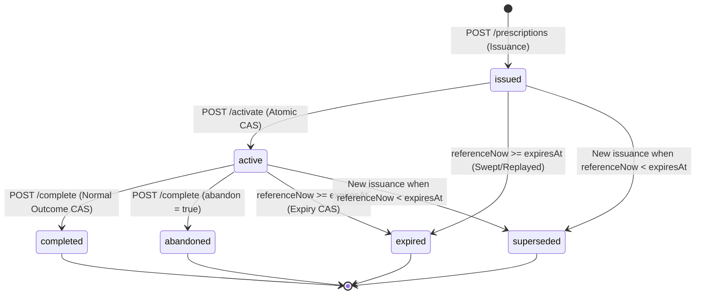

# PHASE 10 SPECIFICATION: PRESCRIPTION ADHERENCE & LEARNING OUTCOME ATTRIBUTION ENGINE (PAOA)

```text
Document Type:       Authoritative Implementation Specification (Frozen Contract)
Status:              VERIFIED ARCHITECTURE IMPLEMENTATION CONTRACT — RECONCILED
Target Phase:        Phase 10
Repository:          adaptive-aptitude-api
Frozen Baseline:     Phases 1–9 Verified (66 Suites, 876 Tests, Exactly 13 Models)
Persistence Boundary: Exactly 1 New Mongoose Model (PrescriptionExecutionRecord), Exactly 1 New Collection
Projected Totals:    14 Mongoose Models, 14 MongoDB Collections
```

---

## 1. Phase 10 Identity & Purpose

### 1.1 Canonical Naming
- **Canonical Name**: Phase 10 — Prescription Adherence & Learning Outcome Attribution Engine
- **Canonical Abbreviation**: `PAOA`
- **Primary Model**: `PrescriptionExecutionRecord`
- **Primary Collection**: `prescriptionexecutionrecords`
- **Primary Config**: `attributionConfig` (`src/config/attributionConfig.js`)

### 1.2 Primary System Purpose
Phase 10 provides a server-authoritative persistence and observation layer that:
1. Re-executes the verified, read-only Phase 9 Prescriptive Orchestration Engine with full request context parity and persists the resulting prescription as an immutable `issuanceSnapshot`.
2. Issues a verifiable, time-bounded execution lease (`prescriptionId`) with a deterministic expiry (`expiresAt`).
3. Enforces an atomic activation lifecycle barrier where an immediate pre-execution `activationBaselineSnapshot` is captured.
4. Deterministically attributes post-activation student learning events (`Attempt` records with `sessionId = prescriptionId`, or finalized `MockSession` records with `startedAt >= activatedAt`).
5. Evaluates execution adherence (`executionRequirementMet`) and verifies type-specific learning-state progression (`targetMilestoneMet`) relative to the activation baseline.
6. Exposes bounded, read-only longitudinal attribution analytics without modifying upstream engine state.

### 1.3 Explicit Analytical Limitation (Non-Causal Mandate)
> [!CAUTION]
> Phase 10 records **observational pre/post associations** only.
> It **MUST NOT** claim, calculate, or report:
> - Causal lift or treatment effect
> - Counterfactual outcomes
> - Proved skill acquisition
> - Prescription-caused performance improvement
> - True intervention effectiveness
>
> All analytics, API documentation, client responses, and diagnostic metrics must frame findings as observational associations over attributed execution windows, explicitly acknowledging unobserved confounding variables (e.g., self-directed practice, external instruction, natural cognitive maturation).

---

## 2. Source-of-Truth Precedence & Frozen Cross-Phase Boundaries

### 2.1 Precedence Hierarchy
In any scenario involving conflicting documentation or historical reports, the following strict hierarchy of truth governs:
1. **Live repository source code** (`src/**`, `package.json`)
2. **Verified Phase 1–9 authoritative specifications** (`docs/PHASE*_SPECIFICATION.md`)
3. **Verified Phase 10 architecture proposal** (`docs/PHASE10_ARCHITECTURE_PROPOSAL.md`)
4. **Current Phase 10 implementation specification**
5. **Historical walkthroughs, audit logs, and discussion notes**

### 2.2 Frozen Upstream Dependencies (Read-Only Consumption)
Phase 10 consumes state and services from upstream phases without modifying their runtime behaviors:
- **Phase 2 (Question Intelligence)**: Canonical topics (24), canonical patterns (278), prerequisite DAG (410 directed edges, 60 foundational patterns), `patternRegistryService`, `hierarchyService`.
- **Phase 3 (Student Learning Data Layer)**: `User`, `Goal`, `StudyPlan`, `DailyObjective`, `Attempt`, `StudentProgress`. Read-only consumption except for student `Attempt` records created independently by standard client practice endpoints.
- **Phase 4 (Adaptive Decision Engine)**: `masteryService` formulas (0.70 prerequisite mastery threshold, 0.85 curriculum completion threshold, 10-attempt recent window).
- **Phase 5 (Automated Planning & Spaced Revision)**: `RevisionItem`, `RevisionProcessingRecord`, Leitner intervals `[1, 3, 7, 14, 30]`, `revisionTransitionHelper` terminal states.
- **Phase 6 (Mock Test & Exam Simulation)**: `MockSession`, `MockBlueprint`, section timing, finalization leases, 30-second finalization barrier.
- **Phase 8 (Cognitive Diagnostics & Analytics)**: `speedAccuracyMatrixService` (rushing-risk threshold 0.60, 30-day window), `readinessService.getGoalReadiness`.
- **Phase 9 (Prescriptive Orchestration Engine)**: `nextActionArbiter`, `dailyAgendaAssembler`, `orchestrationGuard`, public Action DTO formats.

### 2.3 Strict Implementation Prohibitions
To preserve cross-phase isolation and architectural integrity:
- **0 Phase 1–9 schema changes**: No modifications to the 13 existing Mongoose schemas or their MongoDB indexes.
- **0 Phase 1–9 behavioral mutations**: Phase 10 services must never mutate `Attempt`, `StudentProgress`, `StudyPlan`, `DailyObjective`, `RevisionItem`, `RevisionProcessingRecord`, `MockSession`, or `Question`.
- **0 Phase 7 / LLM dependencies**: Zero imports or invocations of LLMs, prompts, or Phase 7 services.
- **0 Internal Phase 9 candidate leaks**: Phase 10 consumes only public Phase 9 DTO properties and execution intents.
- **0 Unbounded historical scans**: All database queries must be indexed, bounded by timestamps, and capped by configuration constants.

---

## 3. Configuration Contract

### 3.1 File Location
```text
src/config/attributionConfig.js
```

### 3.2 Authoritative Configuration Object
Phase 10 owns strictly its own operational configuration. Domain constants owned by earlier phases (prerequisite thresholds, planning targets, rushing risk thresholds) are referenced directly from their authoritative source modules (`adaptiveConfig`, `planningConfig`, `analyticsConfig`) and not duplicated as secondary mutable truth.

```javascript
'use strict';

/**
 * Attribution Configuration — Phase 10: Prescription Adherence & Learning Outcome Attribution Engine (PAOA)
 */
const attributionConfig = Object.freeze({
  // Phase 10 algorithm and engine version
  ALGORITHM_VERSION: 'v1',

  // Prescription time-to-live in wall-clock hours
  PRESCRIPTION_TTL_HOURS: 24,

  // Summary analytics time windows (in calendar days)
  SUMMARY_DEFAULT_WINDOW_DAYS: 30,
  SUMMARY_MAX_WINDOW_DAYS: 90,

  // Evaluation and probe caps for summary analytics
  SUMMARY_EVALUATED_LIMIT: 500,
  SUMMARY_PROBE_LIMIT: 501,
});

module.exports = attributionConfig;
```

---

## 4. Domain Model & Collection Contract

Phase 10 introduces exactly **one** Mongoose model and **one** MongoDB collection.

### 4.1 Specification
- **Model Name**: `PrescriptionExecutionRecord`
- **Model Path**: `src/models/prescriptionExecutionRecordModel.js`
- **Mongoose Registration**: `mongoose.model('PrescriptionExecutionRecord', prescriptionExecutionRecordSchema)`
- **Collection Name**: `prescriptionexecutionrecords`
- **Total Models After Implementation**: Exactly **14**
- **Total Collections After Implementation**: Exactly **14**

### 4.2 Complete Mongoose Schema Specification

```javascript
'use strict';

const mongoose = require('mongoose');

const { Schema } = mongoose;

const prescriptionExecutionRecordSchema = new Schema(
  {
    // ── Unique Identity ────────────────────────────────────────────────────────
    prescriptionId: {
      type: String,
      required: true,
      trim: true,
      match: /^rx_[a-f0-9]{24}$/,
    },

    // ── Student Identity (Consistent Phase 3 String Strategy) ──────────────────
    userId: {
      type: String,
      required: true,
      trim: true,
    },

    // ── Idempotency & Slot Concurrency Invariants ─────────────────────────────
    issuanceIdempotencyKey: {
      type: String,
      required: true,
      trim: true,
      maxlength: 128,
    },
    issuanceRequestFingerprint: {
      type: String,
      required: true,
      match: /^[a-f0-9]{64}$/, // SHA-256 hex digest
    },
    nonTerminalSlotKey: {
      type: String,
      default: null, // String(userId) while issued/active; null when terminal
    },

    // ── Algorithm Version Fingerprints ────────────────────────────────────────
    phase10AlgorithmVersion: {
      type: String,
      required: true,
      trim: true,
    },
    orchestrationAlgorithmVersion: {
      type: String,
      required: true,
      trim: true,
    },

    // ── Issuance Origin & Action Metadata ─────────────────────────────────────
    originSurface: {
      type: String,
      required: true,
      enum: ['next_action', 'daily_agenda'],
    },
    actionId: {
      type: String,
      required: true,
      trim: true,
    },
    actionType: {
      type: String,
      required: true,
      enum: [
        'PREREQUISITE_REMEDIATION',
        'RETENTION_RESCUE',
        'CURRICULUM_ADVANCEMENT',
        'PACING_CALIBRATION',
        'EXAM_BENCHMARK',
        'DIAGNOSTIC_ASSESSMENT',
      ],
    },
    actionSubtype: {
      type: String,
      required: true,
      trim: true,
    },
    policyPriorityClass: {
      type: Number,
      default: null,
      enum: [0, 1, 2, null],
    },
    urgencyScore: {
      type: Number,
      default: null,
    },
    priorityTier: {
      type: String,
      required: true,
      enum: ['critical', 'urgent', 'high', 'normal', 'low'],
    },

    // ── Pedagogical Targets ───────────────────────────────────────────────────
    topic: {
      type: String,
      default: null,
      trim: true,
    },
    pattern: {
      type: String,
      default: null,
      trim: true,
    },
    prescribedQuestions: {
      type: Number,
      required: true,
      min: 0,
    },
    estimatedMinutes: {
      type: Number,
      default: null,
      min: 0,
    },

    // ── Targeted Bottlenecks & Entity Links ───────────────────────────────────
    blockedTargetTopic: {
      type: String,
      default: null,
      trim: true,
    },
    blockedTargetPattern: {
      type: String,
      default: null,
      trim: true,
    },
    revisionItemId: {
      type: Schema.Types.ObjectId,
      ref: 'RevisionItem',
      default: null,
    },
    goalId: {
      type: Schema.Types.ObjectId,
      ref: 'Goal',
      default: null,
    },
    planId: {
      type: Schema.Types.ObjectId,
      ref: 'StudyPlan',
      default: null,
    },
    mockSessionId: {
      type: Schema.Types.ObjectId,
      ref: 'MockSession',
      default: null, // Populated upon verified benchmark completion
    },

    // ── Dual Pre-Execution Snapshots ──────────────────────────────────────────
    issuanceSnapshot: {
      type: Schema.Types.Mixed,
      required: true,
    },
    activationBaselineSnapshot: {
      type: Schema.Types.Mixed,
      default: null,
    },

    // ── Lifecycle & State Management ──────────────────────────────────────────
    status: {
      type: String,
      required: true,
      enum: ['issued', 'active', 'completed', 'abandoned', 'superseded', 'expired'],
      default: 'issued',
    },

    // ── Timestamps ───────────────────────────────────────────────────────────
    issuedAt: {
      type: Date,
      required: true,
    },
    activatedAt: {
      type: Date,
      default: null,
    },
    completedAt: {
      type: Date,
      default: null,
    },
    abandonedAt: {
      type: Date,
      default: null,
    },
    supersededAt: {
      type: Date,
      default: null,
    },
    supersededByPrescriptionId: {
      type: String,
      default: null,
      match: /^rx_[a-f0-9]{24}$/,
    },
    expiresAt: {
      type: Date,
      required: true,
    },
    lastActivityAt: {
      type: Date,
      default: null,
    },

    // ── Outcome Evidence ─────────────────────────────────────────────────────
    executionRequirementMet: {
      type: Boolean,
      default: null,
    },
    targetMilestoneMet: {
      type: Boolean,
      default: null,
    },
    outcomeSnapshot: {
      type: Schema.Types.Mixed,
      default: null,
    },
  },
  {
    timestamps: true,
    collection: 'prescriptionexecutionrecords',
  }
);
```

### 4.3 Database Index Specifications
To avoid accidental duplicate index creation in MongoDB, the schema contains zero field-level `unique: true` or `index: true` annotations. Exactly five Phase 10 indexes are registered explicitly on the schema:

1. **Unique Prescription Identifier Index**:
   ```javascript
   prescriptionExecutionRecordSchema.index(
     { prescriptionId: 1 },
     { unique: true }
   );
   ```
2. **Compound Unique Idempotency Key Index**:
   ```javascript
   prescriptionExecutionRecordSchema.index(
     { userId: 1, issuanceIdempotencyKey: 1 },
     { unique: true }
   );
   ```
3. **Partial Unique Non-Terminal User Slot Index**:
   ```javascript
   prescriptionExecutionRecordSchema.index(
     { nonTerminalSlotKey: 1 },
     {
       unique: true,
       partialFilterExpression: { nonTerminalSlotKey: { $type: 'string' } },
     }
   );
   ```
4. **Summary & History Chronological Query Index**:
   ```javascript
   prescriptionExecutionRecordSchema.index(
     { userId: 1, issuedAt: -1 }
   );
   ```
5. **Lease Expiry Sweeper & State Management Index**:
   ```javascript
   prescriptionExecutionRecordSchema.index(
     { status: 1, expiresAt: 1 }
   );
   ```

*(Note: MongoDB's default `_id` index is built-in and is not counted as one of the five Phase 10 custom indexes.)*

---

## 5. Lifecycle State Machine & Expiry Contract

### 5.1 Status Enum Taxonomy
Exactly six mutually exclusive statuses are recognized:
- **Non-Terminal Statuses** (`nonTerminalSlotKey = String(userId)`):
  1. `issued`: Server has generated and persisted the prescription lease. Awaiting student activation.
  2. `active`: Student has explicitly activated the lease. Baseline state is frozen. Execution in progress.
- **Terminal Statuses** (`nonTerminalSlotKey = null`):
  3. `completed`: Prescribed execution completed and outcome evaluated.
  4. `abandoned`: Student explicitly terminated the prescription without completing execution.
  5. `superseded`: A newer prescription was issued before the current unexpired prescription was completed.
  6. `expired`: The 24-hour lease duration elapsed without completion or explicit supersession.

> [!IMPORTANT]
> No seventh status exists. Once a record enters any of the four terminal states, it is permanently immutable. Terminal status always outranks later wall-clock time advancement.

### 5.2 Authoritative Lifecycle State Machine



### 5.3 Valid and Forbidden State Transitions

| Origin Status | Target Status | Permitted? | Triggering Operation | Required CAS Preconditions |
|---|---|---|---|---|
| `issued` | `active` | **YES** | `POST /activate` | `status == 'issued' && expiresAt > referenceNow` |
| `issued` | `superseded` | **YES** | `POST /prescriptions` | Predecessor active/issued, `expiresAt > referenceNow` |
| `issued` | `expired` | **YES** | `POST /prescriptions` or Mutation CAS | `status == 'issued' && expiresAt <= referenceNow` |
| `issued` | `completed` | **NO** | Direct completion without activation | **FORBIDDEN** (409 PRESCRIPTION_STATE_CONFLICT) |
| `issued` | `abandoned` | **NO** | Direct abandonment without activation | **FORBIDDEN** (409 PRESCRIPTION_STATE_CONFLICT) |
| `active` | `completed` | **YES** | `POST /complete` | `status == 'active' && expiresAt > referenceNow && verified execution` |
| `active` | `abandoned` | **YES** | `POST /complete` (`abandon=true`) | `status == 'active' && expiresAt > referenceNow` |
| `active` | `superseded` | **YES** | `POST /prescriptions` | Predecessor active, `expiresAt > referenceNow` |
| `active` | `expired` | **YES** | Expiry CAS during mutation | `status == 'active' && expiresAt <= referenceNow` |
| `completed` | *any* | **NO** | Any mutation | **IMMUTABLE** (Terminal replay HTTP 200) |
| `abandoned` | *any* | **NO** | Any mutation | **IMMUTABLE** (Terminal replay HTTP 200 if abandon=true) |
| `superseded` | *any* | **NO** | Any mutation | **IMMUTABLE** (409 PRESCRIPTION_STATE_CONFLICT) |
| `expired` | *any* | **NO** | Any mutation | **IMMUTABLE** (409 PRESCRIPTION_STATE_CONFLICT) |

### 5.4 Expiry Contract
- **Rule of Expiry**: A prescription lease is expired if and only if:
  $$\text{referenceNow} \ge \text{expiresAt}$$
- **Rule of Validity**: A prescription lease is valid (unexpired) if and only if:
  $$\text{referenceNow} < \text{expiresAt}$$
- **Database Query Form for Unexpired Leases**:
  ```javascript
  { expiresAt: { $gt: referenceNow } }
  ```
- **Database Query Form for Expired Leases**:
  ```javascript
  { expiresAt: { $lte: referenceNow } }
  ```
- **Default Expiry Duration**: Exactly 24 hours ($24 \times 3600 \times 1000\text{ ms}$) from `issuedAt`.
- **Field Contract**: In accordance with Option A, no separate `expiredAt` field exists in V1. `expiresAt` represents the authoritative expiry timestamp.
- **In-Memory Effective Status Resolution**:
  ```javascript
  function resolveEffectiveStatus(record, referenceNow) {
    if (['issued', 'active'].includes(record.status) && referenceNow >= record.expiresAt) {
      return { effectiveStatus: 'expired', isExpired: true };
    }
    return { effectiveStatus: record.status, isExpired: record.status === 'expired' };
  }
  ```

### 5.5 Last Activity Timestamp Contract
The `lastActivityAt` property tracks state transitions deterministically:
- Upon issuance: `lastActivityAt = issuedAt`
- Upon activation: `lastActivityAt = activatedAt`
- Upon completion: `lastActivityAt = completedAt`
- Upon abandonment: `lastActivityAt = abandonedAt`
- Upon supersession: `lastActivityAt = supersededAt`
- Upon on-demand expiry materialization: `lastActivityAt = referenceNow`

---

## 6. Request Clock & Identity Invariants

### 6.1 Unified Request Clock (`referenceNow`)
To prevent race conditions, time drift, and multi-query skew:
- Every Phase 10 route controller captures exactly one reference timestamp at the entry point of the request:
  ```javascript
  const referenceNow = req.referenceNow || new Date();
  ```
- Downstream services must accept `referenceNow` as an explicit argument and must **never** call `new Date()` internally for domain evaluation.
- `referenceNow` is used consistently for:
  - Database queries and expiry filters
  - Issuance, activation, completion, abandonment, and supersession timestamps
  - Upstream Phase 8 analytics parameters (`referenceNow`)
  - Upstream Phase 9 prescriptive guard context (`referenceNow`)
  - Daily objective logical-day resolution
  - Summary analytics window filtering

### 6.2 Zero Auth / Explicit Identity Paradigm
In strict alignment with Phases 1–9:
- Phase 10 introduces **no** JWT authentication, Bearer tokens, cookies, OAuth, or RBAC middleware.
- Request identity is passed explicitly via `userId` (in the request body for POST routes, or in the URL params for GET routes).
- `userId` validation rules:
  1. Must be provided as a non-empty scalar string.
  2. Trim whitespace.
  3. Must exist in the `User` collection by checking `User.exists({ userId: trimmedUserId })`. Failure returns `404 USER_NOT_FOUND`.
  4. Failure to provide a non-empty string returns `400 VALIDATION_ERROR`.
  5. **No ObjectId syntax or 24-hex validation** is applied to `userId`, preserving Phase 3 platform string identity conventions.
- Resource ownership validation:
  1. Accessing a `prescriptionId` belonging to another student returns `403 FORBIDDEN`.
  2. Accessing a non-existent `prescriptionId` returns `404 PRESCRIPTION_NOT_FOUND`.
  3. Submitting a `mockSessionId` belonging to another student returns `403 FORBIDDEN`.
  4. Submitting a non-existent `mockSessionId` returns `404 MOCK_SESSION_NOT_FOUND`.

---

## 7. Phase 9 Prescriptive Context Parity & Extraction

### 7.1 Context Parity Construction
When Phase 10 issues a prescription, it must construct the exact request context expected by the Phase 9 engine (`orchestrationGuard` parity):

```javascript
const orchestrationContext = {
  userId: trimmedUserId,
  goal: resolvedGoal || null,
  goalId: resolvedGoal ? String(resolvedGoal._id) : null,
  explicitGoalProvided: Boolean(resolvedGoal),
  referenceNow: referenceNow,
};
```

### 7.2 Explicit Goal Resolution
- If `goalId` is provided in the issuance request:
  1. Validate 24-character hexadecimal ObjectId syntax (`/^[0-9a-fA-F]{24}$/`). Failure returns `400 VALIDATION_ERROR`.
  2. Query `Goal.findById(goalId).lean()`. If not found $\to$ `404 GOAL_NOT_FOUND`.
  3. Verify goal ownership: `goal.userId === trimmedUserId`. If mismatched $\to$ `403 FORBIDDEN`.
  4. Set `resolvedGoal = goal`.
- If `goalId` is omitted:
  - Set `resolvedGoal = null`.
  - Set `orchestrationContext.goal = null`.
  - Set `orchestrationContext.goalId = null`.
  - Set `orchestrationContext.explicitGoalProvided = false`.
  - **Prohibited**: Phase 10 must NOT independently query an active goal when `goalId` is omitted. Phase 9 services handle their own fallback logic when `explicitGoalProvided` is false.

### 7.3 Surface Extraction Rules
Phase 10 supports issuance from two origin surfaces (`originSurface`):

#### 1. Next Action Surface (`originSurface = 'next_action'`)
- Invoke `nextActionArbiter.getNextAction(orchestrationContext)`.
- If the result contains no action (`result.nextAction === null`) $\to$ reject with `409 NO_ISSUABLE_PRESCRIPTION`.
- The candidate action is `result.nextAction`.

#### 2. Daily Agenda Surface (`originSurface = 'daily_agenda'`)
- Issuance request **must** provide `actionId`. If omitted $\to$ reject with `400 VALIDATION_ERROR`.
- Invoke `dailyAgendaAssembler.getDailyAgenda(orchestrationContext)`.
- Search for `actionId` **strictly** within agenda segment activities:
  ```javascript
  const candidateActivities = [];
  for (const segment of result.agenda?.segments || []) {
    for (const activity of segment.activities || []) {
      if (activity.actionId === requestActionId) {
        candidateActivities.push(activity);
      }
    }
  }
  ```
- **Prohibited**: Never search `result.agenda.checkpoints`. `COGNITIVE_REST` checkpoints are not actionable learning activities.
- Cardinality enforcement:
  - If `candidateActivities.length === 0` $\to$ reject with `409 NO_ISSUABLE_PRESCRIPTION`.
  - If `candidateActivities.length === 1` $\to$ proceed with `candidateActivities[0]`.
  - If `candidateActivities.length > 1` $\to$ reject with `500 ATTRIBUTION_ISSUANCE_FAILED` (ambiguous agenda match).

---

## 8. Finalization Barrier Contract

Before Phase 10 reads or evaluates unstable learning analytics from Phase 8 or Phase 9, it must verify that no in-progress mock finalizations exist for the student.

### 8.1 Barrier Predicate
```javascript
async function assertNoFinalizationInProgress(userId) {
  const inProgressMock = await MockSession.findOne({
    userId,
    finalizationState: 'in_progress',
  }).select('_id finalizationState').lean();

  if (inProgressMock) {
    throw new AppError(
      409,
      'FINALIZATION_IN_PROGRESS',
      'Cannot execute attribution operation: mock session finalization is currently in progress.'
    );
  }
}
```

### 8.2 Mandatory Application Points
The finalization barrier must be checked before:
1. **Prescription Issuance** (`POST /api/v1/attribution/prescriptions`): All action types.
2. **Pacing Calibration Activation** (`POST /activate`): Action type `PACING_CALIBRATION`.
3. **Pacing Calibration Completion** (`POST /complete`): Action type `PACING_CALIBRATION`.
4. **Exam Benchmark Activation** (`POST /activate`): Action type `EXAM_BENCHMARK`.

---

## 9. Idempotency, Request Fingerprinting & Concurrency Control

### 9.1 Idempotency Key Header
- Prescription issuance requires an HTTP header:
  ```http
  Idempotency-Key: <string>
  ```
- Header validation: Must be a non-empty string, trimmed, with a maximum length of 128 characters.
- Failure returns `400 VALIDATION_ERROR`.

### 9.2 Canonical Request Fingerprint Algorithm
To guarantee deterministic replay detection, the request fingerprint is computed using a strict SHA-256 hash over a normalized JSON payload with frozen property ordering:

```javascript
const crypto = require('crypto');

function computeIssuanceFingerprint(userId, originSurface, goalId, actionId) {
  const normalizedPayload = {
    userId: String(userId).trim(),
    originSurface,
    goalId: goalId ? String(goalId) : null,
    actionId: actionId ? String(actionId) : null,
  };

  return crypto
    .createHash('sha256')
    .update(JSON.stringify(normalizedPayload))
    .digest('hex');
}
```

> [!IMPORTANT]
> - **Frozen Field Order**: `userId`, `originSurface`, `goalId`, `actionId`.
> - **Prohibited**: Delimiters such as `.join(':')`, string concatenation, including `referenceNow`, headers, or non-deterministic properties.

### 9.3 Idempotent Replay Semantics
When an issuance request arrives with an existing `{ userId, issuanceIdempotencyKey }`:
1. Retrieve the existing `PrescriptionExecutionRecord`.
2. Compare stored `issuanceRequestFingerprint` with the newly computed fingerprint:
   - **Mismatched Fingerprint**: Reject immediately with `409 IDEMPOTENCY_KEY_REUSE_MISMATCH`. Zero database writes.
   - **Matching Fingerprint**:
     - Compute effective status based on `referenceNow`:
       ```javascript
       const { effectiveStatus, isExpired } = resolveEffectiveStatus(storedRecord, referenceNow);
       ```
     - Return `200 OK` with the existing prescription record.
     - **Zero writes**, zero re-computation of Phase 8/9, zero state mutation. Even if `referenceNow >= storedRecord.expiresAt`, do not mutate status to `expired` solely due to a replay request.

### 9.4 Single Active Prescription Slot & Predecessor Handling
A student may possess at most **one** non-terminal prescription at any time. This invariant is guaranteed at the database level by the unique partial index on `nonTerminalSlotKey`.

When issuing a new prescription within a MongoDB multi-document transaction:
1. Search for any existing non-terminal prescription:
   ```javascript
   const predecessor = await PrescriptionExecutionRecord.findOne({
     userId,
     status: { $in: ['issued', 'active'] },
   }).session(mongoSession);
   ```
2. If a predecessor exists, classify it using the request clock `referenceNow`:
   - **Case A: Predecessor is already expired** (`referenceNow >= predecessor.expiresAt`):
     ```javascript
     predecessor.status = 'expired';
     predecessor.nonTerminalSlotKey = null;
     predecessor.supersededAt = null;
     predecessor.supersededByPrescriptionId = null;
     predecessor.lastActivityAt = referenceNow;
     await predecessor.save({ session: mongoSession });
     ```
   - **Case B: Predecessor is still valid** (`referenceNow < predecessor.expiresAt`):
     ```javascript
     predecessor.status = 'superseded';
     predecessor.supersededAt = referenceNow;
     predecessor.supersededByPrescriptionId = newPrescriptionId;
     predecessor.nonTerminalSlotKey = null;
     predecessor.lastActivityAt = referenceNow;
     await predecessor.save({ session: mongoSession });
     ```
3. Generate new prescription identifier:
   ```javascript
   const newPrescriptionId = `rx_${new mongoose.Types.ObjectId().toString()}`;
   ```
4. Create and persist the new `PrescriptionExecutionRecord` with:
   - `prescriptionId = newPrescriptionId`
   - `nonTerminalSlotKey = String(userId)`
   - `status = 'issued'`
   - `issuedAt = referenceNow`
   - `expiresAt = new Date(referenceNow.getTime() + 24 * 60 * 60 * 1000)`
   - `lastActivityAt = referenceNow`
5. Commit the transaction atomically.

### 9.5 Concurrency Race & Duplicate-Key Classification
If concurrent requests race during issuance, MongoDB throws a `MongoServerError` with error code `11000` (E11000 duplicate key error). The service must classify the error:

1. **Collision on `{ userId, issuanceIdempotencyKey }`**:
   - Re-read the winning record from the database.
   - If `storedRecord.issuanceRequestFingerprint === currentFingerprint`, return `200 OK` idempotent replay.
   - Otherwise, throw `409 IDEMPOTENCY_KEY_REUSE_MISMATCH`.
2. **Collision on `{ nonTerminalSlotKey }`**:
   - If this occurred due to a transient concurrent issuance race, perform **at most one bounded retry** of the entire issuance transaction.
   - If the retry fails or the slot remains contested, throw `409 PRESCRIPTION_ISSUANCE_CONFLICT`.

### 9.6 Transaction Retry Bounding
- Qualifying transient transaction errors (`TransientTransactionError` or `UnknownTransactionCommitResult`): **Maximum 1 bounded retry**.
- **No infinite retry loops**.
- **No unsafe non-transactional fallback**.

---

## 10. Issuance & Activation Baseline Snapshot Contracts

Phase 10 splits pre-execution recording into two distinct, non-overlapping snapshots:
1. **`issuanceSnapshot`**: Captures why the prescription was issued and the exact algorithm evidence observed by Phase 9. Stored at issuance (`POST /api/v1/attribution/prescriptions`) and never mutated.
2. **`activationBaselineSnapshot`**: Captures the student's exact state immediately before attributed execution begins. Captured atomically during activation (`POST /api/v1/attribution/prescriptions/:prescriptionId/activate`).

### 10.1 Authoritative Issuance Snapshot Specifications

```javascript
// 1. PREREQUISITE_REMEDIATION
{
  actionType: 'PREREQUISITE_REMEDIATION',
  prerequisitePattern: string,
  prerequisiteTopic: string,
  prerequisiteMastery: number,     // StudentProgress.mastery at issuance (0 if absent)
  blockedTargetPattern: string,
  blockedTargetTopic: string,
  allPrerequisitesForTarget: [
    { pattern: string, mastery: number }
  ]
}

// 2. RETENTION_RESCUE
{
  actionType: 'RETENTION_RESCUE',
  revisionItemId: string,
  topic: string,
  pattern: string,
  stage: number,
  intervalDays: number,
  nextReviewDate: Date,
  status: string,
  lastOutcome: string | null,
  lastProcessedAttemptId: string | null
}

// 3. CURRICULUM_ADVANCEMENT
{
  actionType: 'CURRICULUM_ADVANCEMENT',
  topic: string,
  pattern: string,
  planId: string,
  dailyObjectiveId: string,
  patternTargetQuestions: number,
  patternCompletedQuestions: number,
  patternRemainingQuestions: number,
  storedMastery: number
}

// 4. PACING_CALIBRATION
{
  actionType: 'PACING_CALIBRATION',
  topic: string,
  overallRushingRiskScore: number | null, // From speedAccuracyMatrixService(30 days, null)
  rushingRiskWindowDays: 30
}

// 5. EXAM_BENCHMARK
{
  actionType: 'EXAM_BENCHMARK',
  goalId: string,
  planId: string | null,
  planTargetPatternsSnapshot: [
    { topic: string, pattern: string }
  ],
  readinessStatus: string,
  eligibleMocksCount: number | null
}

// 6. DIAGNOSTIC_ASSESSMENT
{
  actionType: 'DIAGNOSTIC_ASSESSMENT',
  actionSubtype: string,
  topic: string,
  pattern: string,
  storedMastery: number,
  existingAttemptCount: number
}
```

### 10.2 Authoritative Activation Baseline Snapshot Specifications

Captured atomically during `POST /activate`:

```javascript
// 1. PREREQUISITE_REMEDIATION
{
  actionType: 'PREREQUISITE_REMEDIATION',
  prerequisitePattern: string,
  prerequisiteTopic: string,
  prerequisiteMastery: number,     // StudentProgress.mastery at activation (0 if absent)
  blockedTargetPattern: string,
  blockedTargetTopic: string,
  allPrerequisitesForTarget: [
    { pattern: string, mastery: number }
  ]
}

// 2. RETENTION_RESCUE
{
  actionType: 'RETENTION_RESCUE',
  revisionItemId: string,
  topic: string,
  pattern: string,
  stage: number,                   // RevisionItem.stage at activation
  intervalDays: number,
  nextReviewDate: Date,
  status: string,
  lastOutcome: string | null,
  lastProcessedAttemptId: string | null
}

// 3. CURRICULUM_ADVANCEMENT
{
  actionType: 'CURRICULUM_ADVANCEMENT',
  topic: string,
  pattern: string,
  planId: string,
  dailyObjectiveId: string,
  patternTargetQuestions: number,
  patternCompletedQuestions: number,
  patternRemainingQuestions: number,
  storedMastery: number            // StudentProgress.mastery at activation
}

// 4. PACING_CALIBRATION
{
  actionType: 'PACING_CALIBRATION',
  topic: string,
  topicRushingRiskScore: number | null, // From speedAccuracyMatrixService(30 days, topic)
  rushingRiskWindowDays: 30
}

// 5. EXAM_BENCHMARK
{
  actionType: 'EXAM_BENCHMARK',
  goalId: string,
  planId: string | null,
  readinessStatus: string,         // Queried via readinessService.getGoalReadiness at activation
  eligibleMocksCount: number | null
}

// 6. DIAGNOSTIC_ASSESSMENT
{
  actionType: 'DIAGNOSTIC_ASSESSMENT',
  actionSubtype: string,
  topic: string,
  pattern: string,
  storedMastery: number,
  existingAttemptCount: number
}
```

---

## 11. Activation Protocol & Compare-And-Swap (CAS)

### 11.1 Atomic Activation CAS
Transitioning from `issued` to `active` must execute via an atomic query filter:

```javascript
const updatedRecord = await PrescriptionExecutionRecord.findOneAndUpdate(
  {
    prescriptionId,
    userId,
    status: 'issued',
    expiresAt: { $gt: referenceNow },
  },
  {
    $set: {
      status: 'active',
      activatedAt: referenceNow,
      lastActivityAt: referenceNow,
      activationBaselineSnapshot: baselineSnapshot,
    },
  },
  { new: true }
);
```

### 11.2 Activation Evaluation & Replay Precedence
1. If CAS succeeds $\to$ return `200 OK` with activated prescription DTO.
2. If CAS returns `null`, inspect the current record state:
   - **Case 1: Record already `active` and unexpired** (`referenceNow < record.expiresAt`):
     - Return `200 OK` idempotent activation replay. Zero writes.
   - **Case 2: Record is `active` but now expired** (`referenceNow >= record.expiresAt`):
     - Materialize expiry atomically via Expiry CAS.
     - Reject with `409 PRESCRIPTION_STATE_CONFLICT` ("Prescription lease has expired").
   - **Case 3: Record is `issued` but expired** (`referenceNow >= record.expiresAt`):
     - Materialize expiry atomically via Expiry CAS.
     - Reject with `409 PRESCRIPTION_STATE_CONFLICT` ("Prescription lease has expired").
   - **Case 4: Record in terminal status (`completed`, `abandoned`, `superseded`, `expired`)**:
     - Reject with `409 PRESCRIPTION_STATE_CONFLICT`.

---

## 12. Attempt & Mock Attribution Protocols

### 12.1 Non-Mock Practice Attribution Protocol
For all non-mock action types (`PREREQUISITE_REMEDIATION`, `RETENTION_RESCUE`, `CURRICULUM_ADVANCEMENT`, `PACING_CALIBRATION`, `DIAGNOSTIC_ASSESSMENT`):
- The client executes questions by submitting attempts to `POST /api/v1/attempts`.
- The client sets `Attempt.sessionId = prescriptionId`.
- **Authoritative Attributed Attempt Query**:
  ```javascript
  const attributedAttempts = await Attempt.find({
    userId,
    sessionId: prescriptionId,
    source: expectedSource, // 'practice' or 'revision'
    topic: prescription.topic,
    ...(prescription.pattern ? { pattern: prescription.pattern } : {}),
    attemptedAt: {
      $gte: prescription.activatedAt,
      $lte: referenceNow,
    },
  })
    .sort({ attemptedAt: 1, _id: 1 })
    .lean();
  ```
- **Strict Exclusion**: Any attempt where `sessionId !== prescriptionId`, or `attemptedAt < activatedAt`, or `source !== expectedSource` is **UNATTRIBUTED** and ignored.

### 12.2 Exam Benchmark Mock Attribution Protocol
- In Phase 6, `Attempt.sessionId` is strictly reserved for `MockSession._id` (`Attempt.source = 'mock'`). Setting `Attempt.sessionId = prescriptionId` is **prohibited**.
- Instead, Phase 10 attributes benchmarks via the root property `PrescriptionExecutionRecord.mockSessionId`.
- **Benchmark Execution Boundary**:
  - The student completes an eligible mock examination.
  - The client provides `mockSessionId` to `POST /complete`.
  - The engine validates:
    1. `mockSession.userId === prescription.userId` $\to$ 403 FORBIDDEN on mismatch.
    2. `mockSession.status` is `'submitted'` or `'expired'`.
    3. `mockSession.finalizationState === 'completed'`.
    4. `mockSession.mode === 'standard'`.
    5. **Temporal Execution Boundary**:
       $$\text{mockSession.startedAt} \ge \text{prescription.activatedAt}$$
       *(Note: A session created before activation but started after activation is valid. Execution begins at `startedAt`, not `createdAt`.)*
    6. **Blueprint Scope Alignment**:
       $$\text{MockScopePatterns} \subseteq \text{PlanTargetPatterns}$$
       Both sets must be non-empty. Alignment check:
       ```javascript
       mockScopePatterns.every(mp =>
         planTargetPatterns.some(tp => tp.topic === mp.topic && tp.pattern === mp.pattern)
       )
       ```
- Upon completion CAS, `PrescriptionExecutionRecord.mockSessionId` is populated and becomes immutable.

---

## 13. Outcome Evaluation Specifications

Outcome evaluation executes deterministically during `POST /complete`. It compares post-execution state strictly against `activationBaselineSnapshot`.

### 13.1 PREREQUISITE_REMEDIATION
- **Execution Requirement**:
  $$\text{attributedAttempts.length} \ge \text{prescription.prescribedQuestions}$$
- **Post-Execution Observation**:
  - Query current `StudentProgress` for prerequisite pattern:
    ```javascript
    const currentProgress = await StudentProgress.findOne({ userId, topic: prescription.topic, pattern: prescription.pattern });
    const finalMastery = currentProgress ? currentProgress.mastery : 0;
    const baselineMastery = prescription.activationBaselineSnapshot.prerequisiteMastery;
    const masteryDelta = finalMastery - baselineMastery;
    ```
  - Inspect prerequisite unlock status for `blockedTargetPattern` using DAG hierarchy and frozen `allPrerequisitesForTarget`.
- **Target Milestone Met**:
  $$\text{targetMilestoneMet} = (\text{finalMastery} \ge 0.70)$$

### 13.2 RETENTION_RESCUE
- **Execution Requirement**:
  $$\text{attributedAttempts.length} \ge \text{prescription.prescribedQuestions}$$
- **Phase 5 Verification & Final Attempt Resolution**:
  - Attributed attempts must be sorted deterministically: `{ attemptedAt: 1, _id: 1 }`.
  - Select the final attempt: `finalAttempt = attributedAttempts[attributedAttempts.length - 1]`.
  - Verify Phase 5 processing readiness:
    ```javascript
    const isProcessed = await RevisionProcessingRecord.exists({ attemptId: finalAttempt._id });
    if (!isProcessed && !isExplicitAbandon) {
      throw new AppError(
        409,
        'REVISION_PROCESSING_PENDING',
        'Phase 5 revision processing has not yet completed for attributed attempts.'
      );
    }

    const revisionItem = await RevisionItem.findById(prescription.revisionItemId);
    if (!revisionItem || String(revisionItem.lastProcessedAttemptId) !== String(finalAttempt._id)) {
      if (!isExplicitAbandon) {
        throw new AppError(
          409,
          'REVISION_PROCESSING_PENDING',
          'RevisionItem state does not reflect final attributed attempt.'
        );
      }
    }
    ```
- **Target Milestone Met**:
  ```javascript
  const baselineStage = prescription.activationBaselineSnapshot.stage;
  const retentionRescued = (
    revisionItem &&
    revisionItem.lastOutcome === 'correct' &&
    (
      revisionItem.stage > baselineStage ||
      revisionItem.status === 'completed' ||
      (
        revisionItem.stage === 4 &&
        baselineStage === 4 &&
        revisionItem.intervalDays === 30 &&
        revisionItem.status === 'scheduled'
      )
    )
  );

  const targetMilestoneMet = Boolean(retentionRescued);
  ```

### 13.3 CURRICULUM_ADVANCEMENT
- **Execution Requirement**:
  $$\text{attributedAttempts.length} \ge \text{prescription.prescribedQuestions}$$
- **Phase 4 Observable Mastery Progression**:
  - Query current `StudentProgress` for prescribed pattern:
    ```javascript
    const currentProgress = await StudentProgress.findOne({ userId, topic: prescription.topic, pattern: prescription.pattern });
    const finalMastery = currentProgress ? currentProgress.mastery : 0;
    const baselineMastery = prescription.activationBaselineSnapshot.storedMastery;
    const masteryDelta = finalMastery - baselineMastery;
    ```
- **Target Milestone Met**:
  $$\text{targetMilestoneMet} = (\text{masteryDelta} > 0 \lor \text{finalMastery} \ge 0.85)$$
  *(Note: DailyObjective completedQuestions counter is explicitly NOT used as the success milestone because practice attempts do not automatically increment it).*

### 13.4 PACING_CALIBRATION
- **Execution Requirement**:
  $$\text{attributedAttempts.length} \ge \text{prescription.prescribedQuestions}$$
- **Post-Execution Observation**:
  - Assert no finalization in progress.
  - Invoke `speedAccuracyMatrixService.getSpeedAccuracyMatrix(userId, 30, prescription.topic, referenceNow)`.
  - Extract post-execution rushing risk:
    ```javascript
    const postRisk = result?.speedAccuracyMatrix?.rushingRiskScore ?? null;
    const baselineRisk = prescription.activationBaselineSnapshot.topicRushingRiskScore;
    ```
- **Target Milestone Met**:
  - If `postRisk === null` (insufficient questions in window):
    ```javascript
    targetMilestoneMet = null;
    outcomeEvidenceStatus = 'INSUFFICIENT_POST_EVIDENCE';
    ```
  - If `postRisk !== null`:
    $$\text{targetMilestoneMet} = (\text{postRisk} < 0.60)$$
    Report `riskImproved = (baselineRisk !== null ? postRisk < baselineRisk : null)`.

### 13.5 EXAM_BENCHMARK
- **Execution Requirement & Milestone**:
  - In Phase 10 V1, exam benchmark success is verified standard mock completion aligned with plan targets:
    ```javascript
    const benchmarkCompletionVerified = Boolean(isTerminalAndCompleted && isScopeValid);
    const executionRequirementMet = benchmarkCompletionVerified;
    const targetMilestoneMet = benchmarkCompletionVerified;
    ```
  *(Note: No completion-time readiness recalculation is required for benchmark milestone evaluation in V1).*

### 13.6 DIAGNOSTIC_ASSESSMENT
- **Execution Requirement**:
  $$\text{attributedAttempts.length} \ge \text{prescription.prescribedQuestions}$$
- **Target Milestone Met**:
  - Subtype `FOUNDATIONAL_DIAGNOSTIC`: Baseline evidence creation milestone:
    ```javascript
    const baselineEvidenceCreated = (finalMastery > 0 || attributedAttempts.length > 0);
    const targetMilestoneMet = executionRequirementMet && baselineEvidenceCreated;
    ```
  - Subtype `FOUNDATIONAL_REINFORCEMENT`:
    ```javascript
    const targetMilestoneMet = executionRequirementMet;
    ```

---

## 14. Completion, Abandonment & CAS Protocols

### 14.1 Completion Route Precedence
When `POST /api/v1/attribution/prescriptions/:prescriptionId/complete` is called:

1. **User Validation**: Verify `userId`. (400 if invalid non-empty string; 404 if missing in `User` via `User.exists`).
2. **Prescription Retrieval**: Find prescription by `prescriptionId`. If missing $\to$ `404 PRESCRIPTION_NOT_FOUND`.
3. **Ownership Verification**: If `prescription.userId !== trimmedUserId` $\to$ `403 FORBIDDEN`.
4. **Terminal Replay Checks**:
   - If already `completed` $\to$ return `200 OK` idempotent completion replay with stored record.
   - If already `abandoned` and `req.body.abandon === true` $\to$ return `200 OK` idempotent abandonment replay.
   - If already `abandoned` but `req.body.abandon !== true` $\to$ reject with `409 PRESCRIPTION_STATE_CONFLICT`.
   - If `superseded` or `expired` $\to$ reject with `409 PRESCRIPTION_STATE_CONFLICT`.
5. **Issued Status Check**:
   - If status is `issued` $\to$ reject with `409 PRESCRIPTION_STATE_CONFLICT` ("Prescription must be activated before completion").
6. **Expiry Verification**:
   - If `referenceNow >= prescription.expiresAt`:
     - Atomically materialize expiry via Expiry CAS.
     - Reject with `409 PRESCRIPTION_STATE_CONFLICT` ("Prescription lease has expired").
7. **Action Path Bifurcation**:
   - If `req.body.abandon === true` $\to$ proceed to **Abandonment Flow**.
   - If `req.body.abandon !== true` $\to$ proceed to **Normal Completion Flow**.

### 14.2 Abandonment Flow
- Only an `active`, unexpired prescription may be abandoned.
- Benchmark abandonment **does not require** `mockSessionId`.
- **Atomic Abandonment CAS**:
  ```javascript
  const abandonedRecord = await PrescriptionExecutionRecord.findOneAndUpdate(
    {
      prescriptionId,
      userId,
      status: 'active',
      expiresAt: { $gt: referenceNow },
    },
    {
      $set: {
        status: 'abandoned',
        abandonedAt: referenceNow,
        lastActivityAt: referenceNow,
        nonTerminalSlotKey: null,
        executionRequirementMet: false,
        targetMilestoneMet: null,
        outcomeSnapshot: {
          abandoned: true,
          abandonedAt: referenceNow,
          reason: 'USER_ABANDONED',
        },
      },
    },
    { new: true }
  );
  ```

### 14.3 Normal Completion Flow & CAS
- Execute outcome evaluation for the specific action type.
- Verify `executionRequirementMet === true`. If false $\to$ reject with `409 PRESCRIPTION_EXECUTION_INCOMPLETE`.
- **Atomic Completion CAS**:
  ```javascript
  const completedRecord = await PrescriptionExecutionRecord.findOneAndUpdate(
    {
      prescriptionId,
      userId,
      status: 'active',
      expiresAt: { $gt: referenceNow },
    },
    {
      $set: {
        status: 'completed',
        completedAt: referenceNow,
        lastActivityAt: referenceNow,
        nonTerminalSlotKey: null,
        executionRequirementMet: true,
        targetMilestoneMet: evaluatedMilestone,
        outcomeSnapshot: evaluatedOutcomeSnapshot,
        ...(verifiedMockSessionId ? { mockSessionId: verifiedMockSessionId } : {}),
      },
    },
    { new: true }
  );
  ```
- If another request completed concurrently, CAS returns `null`. Re-read record: if status is `completed`, return `200 OK` replay.

---

## 15. Summary Analytics Contract

### 15.1 Route Definition
```http
GET /api/v1/attribution/users/:userId/summary
```

### 15.2 Query Parameters & Validation
- `windowDays`: Integer string.
  - Min: 1, Max: 90. Default: 30.
  - Invalid value or out of bounds $\to$ `400 VALIDATION_ERROR`.
- `actionType`: Optional string.
  - Must be one of the six canonical action types.
  - Invalid action type $\to$ `400 VALIDATION_ERROR`.

### 15.3 Bounded Query Execution
- The query calculates a window threshold:
  $$\text{windowStart} = \text{referenceNow} - (\text{windowDays} \times 86400000\text{ ms})$$
- Database query:
  ```javascript
  const filter = {
    userId,
    issuedAt: { $gte: windowStart, $lte: referenceNow },
    ...(actionType ? { actionType } : {}),
  };

  const probeRecords = await PrescriptionExecutionRecord.find(filter)
    .sort({ issuedAt: -1, _id: 1 })
    .limit(501)
    .lean();
  ```

### 15.4 Probe vs. Evaluated Bounding
- Probe limit: Exactly **501** records.
- Evaluated limit: Exactly **500** records.
  ```javascript
  const isTruncated = probeRecords.length > 500;
  const evaluatedRecords = isTruncated ? probeRecords.slice(0, 500) : probeRecords;
  ```
- All calculations, status tallies, adherence metrics, and returned history must operate **exclusively** on `evaluatedRecords`. The 501st record is a sentinel used only to compute `isTruncated = true`.

### 15.5 In-Memory Effective Status Tally
During summary aggregation, issued/active records past expiry are tallied under effective status:
```javascript
const statusCounts = {
  issued: 0,
  active: 0,
  completed: 0,
  abandoned: 0,
  superseded: 0,
  expired: 0,
};

for (const record of evaluatedRecords) {
  const { effectiveStatus } = resolveEffectiveStatus(record, referenceNow);
  statusCounts[effectiveStatus] += 1;
}
```

### 15.6 Metric Formulas
- **Resolved Prescriptions**:
  $$\text{resolvedCount} = \text{statusCounts.completed} + \text{statusCounts.abandoned} + \text{statusCounts.superseded} + \text{statusCounts.expired}$$
- **Execution Adherence Rate**:
  $$\text{executionAdherenceRate} = \begin{cases} \dfrac{\text{statusCounts.completed}}{\text{resolvedCount}}, & \text{if } \text{resolvedCount} > 0 \\ \text{null}, & \text{if } \text{resolvedCount} = 0 \end{cases}$$
- **Milestone Success Rate**:
  - Filter `completed` records where `targetMilestoneMet !== null`:
    $$\text{milestonesEvaluated} = \sum [\text{record.targetMilestoneMet} \in \{ \text{true}, \text{false} \}]$$
    $$\text{milestonesMet} = \sum [\text{record.targetMilestoneMet} === \text{true}]$$
    $$\text{milestoneSuccessRate} = \begin{cases} \dfrac{\text{milestonesMet}}{\text{milestonesEvaluated}}, & \text{if } \text{milestonesEvaluated} > 0 \\ \text{null}, & \text{if } \text{milestonesEvaluated} = 0 \end{cases}$$
  - Records with `targetMilestoneMet === null` (e.g., pacing with insufficient window evidence) are tallied under `milestonesInsufficientEvidence` and excluded from both numerator and denominator.

---

## 16. API Specification & Public DTO Contracts

### 16.1 Route Inventory (Exactly Four Routes)
1. `POST /api/v1/attribution/prescriptions`
2. `POST /api/v1/attribution/prescriptions/:prescriptionId/activate`
3. `POST /api/v1/attribution/prescriptions/:prescriptionId/complete`
4. `GET /api/v1/attribution/users/:userId/summary`

### 16.2 Snapshot Exposure Decision
- `issuanceSnapshot`: **Internal Audit Only**. Excluded from public responses to prevent analytical leakage. Key pedagogical fields (`topic`, `pattern`, `prescribedQuestions`, `estimatedMinutes`) are projected at root.
- `activationBaselineSnapshot`: **Internal Audit Only**. Summary progress fields are projected cleanly at root in the activation response.
- `outcomeSnapshot`: **Public Projected DTO**. Contains structured pre/post delta metrics and evidence flags.

### 16.3 Endpoint 1: POST /api/v1/attribution/prescriptions

#### Request Headers
```http
Content-Type: application/json
Idempotency-Key: <string>
```

#### Request Body
```json
{
  "userId": "user_12345",
  "originSurface": "next_action",
  "goalId": "64b8f0a1c9e77b0012a4b891",
  "actionId": null
}
```

#### Response Envelope (201 Created or 200 OK Replay)
```json
{
  "success": true,
  "data": {
    "prescriptionId": "rx_64b8f0a1c9e77b0012a4b890",
    "status": "issued",
    "effectiveStatus": "issued",
    "isExpired": false,
    "originSurface": "next_action",
    "action": {
      "actionId": "nba_prerequisite_remediation_algebra_linear-equations-systems-of-equations_blocks_inequalities-modulus-functions",
      "actionType": "PREREQUISITE_REMEDIATION",
      "actionSubtype": "BLOCKING_PREREQUISITE",
      "priorityTier": "urgent",
      "policyPriorityClass": 0,
      "urgencyScore": 71.25,
      "topic": "Algebra",
      "pattern": "Linear Equations & Systems of Equations",
      "prescribedQuestions": 7,
      "estimatedMinutes": 11,
      "rationale": {
        "reasonCode": "UNMET_PREREQUISITE_BLOCK",
        "description": "Prerequisite \"Linear Equations & Systems of Equations\" (55% mastery) blocks curriculum target \"Inequalities & Modulus Functions\"."
      },
      "executionIntent": {
        "capability": "ADAPTIVE_PRACTICE",
        "topic": "Algebra",
        "pattern": "Linear Equations & Systems of Equations",
        "planId": "64b8f0a1c9e77b0012a4b892",
        "questionDelivery": {
          "endpoint": "/api/v1/adaptive/next-question",
          "method": "GET",
          "params": {
            "userId": "user_12345",
            "topic": "Algebra",
            "pattern": "Linear Equations & Systems of Equations",
            "planId": "64b8f0a1c9e77b0012a4b892"
          }
        },
        "attemptSubmissionContext": {
          "endpoint": "/api/v1/attempts",
          "method": "POST",
          "source": "practice"
        }
      },
      "blockedTarget": {
        "topic": "Algebra",
        "pattern": "Inequalities & Modulus Functions"
      }
    },
    "issuedAt": "2026-10-08T12:00:00.000Z",
    "expiresAt": "2026-10-09T12:00:00.000Z",
    "versions": {
      "phase10AlgorithmVersion": "v1",
      "orchestrationAlgorithmVersion": "v1"
    }
  }
}
```

<!-- Mathematical derivation of urgencyScore and priorityTier above:
     W_type = 50.0 (PREREQUISITE_REMEDIATION)
     S_deficit = max(0, 1 - 0.55) * 25.0 = 0.45 * 25.0 = 11.25
     I_goal = 10.0 (isPlanAligned = true)
     T_temporal = 0.0
     urgencyScore = 50.0 + 11.25 + 10.0 + 0.0 = 71.25
     priorityTier = 'urgent' (threshold: >= 65.0 and < 80.0)
     prescribedQuestions = 5 + Math.floor((1 - 0.55) * 5) = 7
-->

### 16.4 Endpoint 2: POST /api/v1/attribution/prescriptions/:prescriptionId/activate

#### Request Body
```json
{
  "userId": "user_12345"
}
```

#### Response Envelope (200 OK)
```json
{
  "success": true,
  "data": {
    "prescriptionId": "rx_64b8f0a1c9e77b0012a4b890",
    "status": "active",
    "effectiveStatus": "active",
    "isExpired": false,
    "actionType": "PREREQUISITE_REMEDIATION",
    "topic": "Algebra",
    "pattern": "Linear Equations & Systems of Equations",
    "prescribedQuestions": 7,
    "activatedAt": "2026-10-08T12:05:00.000Z",
    "expiresAt": "2026-10-09T12:00:00.000Z",
    "executionGuidance": {
      "sessionId": "rx_64b8f0a1c9e77b0012a4b890",
      "targetSource": "practice",
      "instructions": "Submit all practice attempts with sessionId set to this prescriptionId."
    }
  }
}
```

### 16.5 Endpoint 3: POST /api/v1/attribution/prescriptions/:prescriptionId/complete

#### Request Body (Normal Completion)
```json
{
  "userId": "user_12345",
  "mockSessionId": null
}
```

#### Request Body (Explicit Abandonment)
```json
{
  "userId": "user_12345",
  "abandon": true
}
```

#### Response Envelope (200 OK — Normal Completion)
```json
{
  "success": true,
  "data": {
    "prescriptionId": "rx_64b8f0a1c9e77b0012a4b890",
    "status": "completed",
    "effectiveStatus": "completed",
    "completedAt": "2026-10-08T12:20:00.000Z",
    "executionRequirementMet": true,
    "targetMilestoneMet": true,
    "outcomeSnapshot": {
      "actionType": "PREREQUISITE_REMEDIATION",
      "attributedAttemptCount": 7,
      "prescribedQuestions": 7,
      "executionRequirementMet": true,
      "baselinePrerequisiteMastery": 0.55,
      "finalPrerequisiteMastery": 0.74,
      "masteryDelta": 0.19,
      "prerequisiteThresholdMet": true,
      "blockedTargetFullyUnlocked": true,
      "targetMilestoneMet": true
    },
    "mockSessionId": null,
    "attributionNotice": "Observational pre/post association recorded. Causal lift is not claimed."
  }
}
```

### 16.6 Endpoint 4: GET /api/v1/attribution/users/:userId/summary

#### Response Envelope (200 OK)
```json
{
  "success": true,
  "data": {
    "userId": "user_12345",
    "windowDays": 30,
    "actionTypeFilter": null,
    "evaluatedPrescriptionCount": 25,
    "resolvedPrescriptionCount": 24,
    "isTruncated": false,
    "isExhaustive": true,
    "statusCounts": {
      "issued": 0,
      "active": 1,
      "completed": 18,
      "abandoned": 3,
      "superseded": 2,
      "expired": 1
    },
    "adherence": {
      "executionAdherenceRate": 0.75,
      "completedPrescriptions": 18,
      "resolvedPrescriptions": 24
    },
    "learningOutcomes": {
      "milestoneSuccessRate": 0.833,
      "milestonesEvaluated": 18,
      "milestonesMet": 15,
      "milestonesInsufficientEvidence": 0
    },
    "recentPrescriptions": [
      {
        "prescriptionId": "rx_64b8f0a1c9e77b0012a4b890",
        "actionType": "PREREQUISITE_REMEDIATION",
        "actionSubtype": "BLOCKING_PREREQUISITE",
        "status": "completed",
        "effectiveStatus": "completed",
        "issuedAt": "2026-10-08T12:00:00.000Z",
        "completedAt": "2026-10-08T12:20:00.000Z",
        "executionRequirementMet": true,
        "targetMilestoneMet": true
      }
    ],
    "attributionNotice": "Observational pre/post association recorded. Causal lift is not claimed."
  }
}
```

---

## 17. Error Taxonomy & Status Code Contract

Phase 10 adopts a centralized, unambiguous error catalog. All errors are instantiated using `AppError(statusCode, code, message)`.

| Error Code | HTTP Status | Trigger Condition | Writes Occurred? | Retry Safe? |
|---|---|---|---|---|
| `VALIDATION_ERROR` | 400 | Malformed `userId`, missing header, invalid syntax | No | After payload correction |
| `USER_NOT_FOUND` | 404 | `userId` does not exist in `User` collection | No | No |
| `GOAL_NOT_FOUND` | 404 | Explicit `goalId` does not exist | No | No |
| `FORBIDDEN` | 403 | Resource (`prescriptionId`, `goalId`, `mockSessionId`) belongs to another user | No | No |
| `PRESCRIPTION_NOT_FOUND` | 404 | `prescriptionId` does not exist | No | No |
| `MOCK_SESSION_NOT_FOUND` | 404 | Provided `mockSessionId` does not exist | No | No |
| `FINALIZATION_IN_PROGRESS` | 409 | Active `MockSession` in `finalizationState = 'in_progress'` | No | Yes (wait for finalization) |
| `NO_ISSUABLE_PRESCRIPTION` | 409 | Phase 9 returned no actionable prescription or agenda item | No | Yes |
| `IDEMPOTENCY_KEY_REUSE_MISMATCH` | 409 | Reused `Idempotency-Key` with differing fingerprint | No | No (use new key) |
| `PRESCRIPTION_ISSUANCE_CONFLICT` | 409 | Concurrent active slot contention unresolved by retry | No | Yes |
| `PRESCRIPTION_STATE_CONFLICT` | 409 | Attempted invalid transition (e.g. activating expired lease, completing issued lease) | Conditional — expiry CAS may materialize expired state; other invalid-state conflicts perform zero writes | No |
| `PRESCRIPTION_EXECUTION_INCOMPLETE` | 409 | `POST /complete` called before prescribed questions attempted | No | Yes (complete practice) |
| `REVISION_PROCESSING_PENDING` | 409 | Latest revision attempt not yet processed by Phase 5 | No | Yes (wait for worker) |
| `ATTRIBUTION_ISSUANCE_FAILED` | 500 | Ambiguous agenda matching (>1 candidate) or fatal engine error | No | No |
| `ATTRIBUTION_CALCULATION_FAILED` | 500 | Unhandled mathematical or database query failure | No | No |

---

## 18. Implementation File & Directory Architecture

Phase 10 organizes its production components within modular directories under `src/`:

```text
src/
├── config/
│   └── attributionConfig.js                     # Phase 10 configuration constants
├── models/
│   └── prescriptionExecutionRecordModel.js      # Single Phase 10 Mongoose model
├── services/
│   └── attribution/
│       ├── attributionIssuanceService.js        # Issuance, fingerprinting, slot management
│       ├── attributionActivationService.js      # Activation CAS, baseline snapshots
│       ├── attributionCompletionService.js      # Completion CAS, outcome evaluation, abandonment
│       └── attributionSummaryService.js         # Bounded analytics aggregation
├── utils/
│   └── attributionFingerprint.js                # Canonical SHA-256 fingerprinting utility
├── middlewares/
│   └── attributionGuard.js                      # Request clock, payload validation, finalization barrier
├── controllers/
│   └── attributionController.js                 # HTTP route handlers
└── routes/
    └── attributionRoutes.js                     # Express router mounting the 4 endpoints
```

### Route Mounting in `src/app.js`
In accordance with the frozen architecture, the **only** modification to an existing production file in future Phase 10 implementation is the minimal additive route registration in `src/app.js`:

```javascript
// In src/app.js:
const attributionRoutes = require('./routes/attributionRoutes');
...
// API v1 — Phase 10: Prescription Adherence & Learning Outcome Attribution Engine
app.use('/api/v1/attribution', attributionRoutes);
```

Phase 1–9 route handlers, controllers, services, and models remain 100% byte-for-byte unchanged.

---

## 19. Future Test Suite Architecture & Verification Matrices

Phase 10 implementation mandates exactly **six** dedicated test suites located under `tests/attribution/`.

### 19.1 Test Suite Inventory (Count: 6)
1. `tests/attribution/attributionIssuance.test.js`
2. `tests/attribution/attributionActivation.test.js`
3. `tests/attribution/attributionCompletion.test.js`
4. `tests/attribution/attributionConcurrency.test.js`
5. `tests/attribution/attributionSummary.test.js`
6. `tests/attribution/attributionFinalizationBarrier.test.js`

### 19.2 Issuance Test Matrix (`attributionIssuance.test.js`)
- Must verify issuance across all six canonical action types.
- Must verify issuance from `originSurface = 'next_action'`.
- Must verify issuance from `originSurface = 'daily_agenda'`.
- Must verify rejection of `COGNITIVE_REST` checkpoints (`409 NO_ISSUABLE_PRESCRIPTION`).
- Must verify `goalId` validation contract across all four canonical cases:
  - `goalId` omitted: valid request, `resolvedGoal = null`, `explicitGoalProvided = false`, Phase 10 performs no Goal lookup.
  - `goalId` supplied with invalid ObjectId syntax: `400 VALIDATION_ERROR`.
  - `goalId` supplied with valid syntax but nonexistent matching Goal: `404 GOAL_NOT_FOUND`.
  - `goalId` supplied but foreign (owned by another user): `403 FORBIDDEN`.
- Must verify public Phase 9 DTO extraction (extracting `blockedTarget`, ignoring internal candidate properties).
- Must verify algorithm versions are explicitly saved (`phase10AlgorithmVersion`, `orchestrationAlgorithmVersion`).
- Must verify deterministic SHA-256 request fingerprint computation.
- Must verify sequential idempotent replay (same key, same fingerprint $\to$ 200 OK, zero writes).
- Must verify sequential replay mismatch (same key, different fingerprint $\to$ 409 IDEMPOTENCY_KEY_REUSE_MISMATCH).
- Must verify same-key replay after expiry (returns 200 OK with `effectiveStatus: 'expired'`, zero writes).
- Must verify predecessor handling (unexpired $\to$ superseded with `supersededByPrescriptionId`; expired $\to$ marked expired).
- Must verify finalization barrier blocks issuance when mock finalization is in progress.

### 19.3 Activation Test Matrix (`attributionActivation.test.js`)
- Must verify atomic `issued -> active` CAS transition.
- Must verify capture of baseline snapshots across all six action types.
- Must verify idempotent replay of already-active unexpired prescription (returns 200 OK, zero writes).
- Must verify activation of expired lease is rejected with `409 PRESCRIPTION_STATE_CONFLICT`.
- Must verify exact expiry boundary tests:
  - $\text{referenceNow} = \text{expiresAt} - 1\text{ ms} \to \text{VALID (activates)}$
  - $\text{referenceNow} = \text{expiresAt} \to \text{EXPIRED (409 conflict)}$
  - $\text{referenceNow} = \text{expiresAt} + 1\text{ ms} \to \text{EXPIRED (409 conflict)}$
- Must verify ownership check (`403 FORBIDDEN` for foreign prescription).
- Must verify unified request clock pass-through.

### 19.4 Completion Test Matrix (`attributionCompletion.test.js`)
- Must verify completion across all six action types.
- Must verify non-mock attempt attribution via `Attempt.sessionId = prescriptionId`.
- Must verify unattributed attempts are excluded (different sessionId, attempted before activation, wrong source).
- Must verify attempt threshold enforcement (`409 PRESCRIPTION_EXECUTION_INCOMPLETE` if questions < prescribed).
- Must verify prerequisite outcome evaluation (`targetMilestoneMet = finalMastery >= 0.70`).
- Must verify retention outcome evaluation:
  - Rejection if Phase 5 processing record missing (`409 REVISION_PROCESSING_PENDING`).
  - Alignment of `RevisionItem.lastProcessedAttemptId` with final attributed attempt.
  - Verification of Leitner advancement vs. reset.
- Must verify curriculum advancement evaluation (`masteryDelta > 0 || finalMastery >= 0.85`).
- Must verify pacing calibration evaluation:
  - Querying speed-accuracy matrix.
  - Handling of null post-risk (`targetMilestoneMet = null`, `INSUFFICIENT_POST_EVIDENCE`).
  - Evaluating `postRisk < 0.60`.
- Must verify exam benchmark evaluation:
  - Standard mode mock only.
  - Enforcement of `MockSession.startedAt >= activatedAt`.
  - Enforcement of blueprint scope subset `MockScopePatterns ⊆ PlanTargetPatterns`.
  - Persistence of root `mockSessionId`.
- Must verify explicit abandonment (`abandon: true`) transitions to `abandoned`.
- Must verify benchmark abandonment does not require `mockSessionId`.
- Must verify terminal idempotent replay (returns 200 OK, zero writes).

### 19.5 Concurrency Test Matrix (`attributionConcurrency.test.js`)
- Must verify concurrent same-key issuance races (exactly one 201 Created winner, one 200 OK loser).
- Must verify concurrent differing-key issuance races on active slot (one 201 Created winner, one 409 conflict).
- Must verify single bounded transaction retry on transient transaction errors.
- Must verify atomic activation CAS prevents double activation races.
- Must verify atomic completion CAS prevents double completion or outcome overwrites.
- Must verify racing completion vs. abandonment (first commit wins, second replays or conflicts).
- Must verify racing completion vs. supersession.
- Must verify racing completion vs. expiry materialization.
- Must verify atomic expiry materialization CAS.

### 19.6 Summary Analytics Test Matrix (`attributionSummary.test.js`)
- Must verify summary calculation with 0 records (`executionAdherenceRate = null`).
- Must verify query window bounding (`windowDays` min 1, max 90, default 30).
- Must verify action type filtering and validation.
- Must verify effective status resolution for expired issued/active records in memory.
- Must verify terminal persisted states (`completed`, `abandoned`, `superseded`) are never altered by time.
- Must verify 500 evaluated vs. 501 probe bounding (`isTruncated` flag, sentinel excluded from metrics).
- Must verify deterministic sorting: `{ issuedAt: -1, _id: 1 }`.
- Must verify milestone rate excludes null-evidence completed outcomes from denominator.
- Must verify summary endpoint performs strictly zero database writes.

### 19.7 Finalization Barrier Test Matrix (`attributionFinalizationBarrier.test.js`)
- Must verify issuance is blocked while `MockSession.finalizationState = 'in_progress'`.
- Must verify pacing activation and completion are blocked while mock finalization is in progress.
- Must verify exam benchmark activation is blocked while mock finalization is in progress.
- Must verify operations succeed immediately once mock finalization is completed or cleared.

---

## 20. Cross-Phase Isolation & Static Assertions

To guarantee that Phase 10 implementation never violates frozen architectural boundaries, static assertions must be embedded into the test suites:

1. **Zero LLM Invocations**:
   - Grep verification that Phase 10 source files contain 0 imports of `src/providers/` or `src/services/learning/`.
2. **Zero Upstream Database Writes**:
   - Spies and assertions ensuring Phase 10 endpoints execute zero write calls (`save`, `updateOne`, `delete`, etc.) on models 1–13.
3. **Model & Collection Invariant**:
   - Mongoose model count remains strictly **14**.
   - MongoDB collection count remains strictly **14**.
4. **Phase 9 Immutability**:
   - Verification that Phase 9 route handlers, services, and DTO builders remain 100% byte-for-byte identical.

---

## 21. Future Implementation Acceptance Gate

When Phase 10 production implementation commences, acceptance requires satisfying all criteria:

```text
Baseline entering implementation:
- 66 test suites
- 876 tests passing
- 13 models / 13 collections

Post-implementation acceptance criteria:
- 72 test suites (66 baseline + 6 Phase 10 suites)
- 100% of tests passing (0 failures, 0 skipped attribution tests)
- npm run verify:phase2 passes (12,000 questions, 24 topics, 278 patterns, 410 edges)
- npm run verify:content passes (12,000 / 12,000 SHA-256 fingerprints match)
- Exactly 14 Mongoose models registered
- Exactly 14 MongoDB collections
- Exactly 1 new collection: prescriptionexecutionrecords
- Exactly 4 new API routes mounted at /api/v1/attribution
- Zero Phase 7 / LLM dependencies
- Changed-file audit proves zero modifications to src/** outside Phase 10 components and the minimal additive route registration in src/app.js
```

### Required Implementation Verification Commands
```bash
npx jest tests/attribution --runInBand --forceExit
npx jest --runInBand --forceExit
npm run verify:phase2
npm run verify:content
```

---

## 22. Authoritative Specification Readiness Checklist

```text
[x] userId identity contract aligned (String, non-empty, User.exists check, no ObjectId)
[x] Phase 9 live service exports aligned (getNextAction, getDailyAgenda, result.nextAction)
[x] Explicit-goal parity aligned (goalId omitted -> resolvedGoal=null, no active goal scan)
[x] Fingerprint exact algorithm aligned (userId, originSurface, goalId, actionId; SHA-256)
[x] prescriptionId format aligned (rx_<ObjectId>, 24 hex chars)
[x] Five index definitions non-duplicated (zero schema-level duplicates)
[x] All six issuance snapshots aligned (exact field shapes frozen)
[x] All six activation snapshots aligned (exact field shapes frozen)
[x] All six outcome rules aligned (frozen pedagogical criteria)
[x] Retention prescribed-question threshold aligned (attributedAttempts >= prescribedQuestions)
[x] Benchmark completion milestone aligned (terminal completed standard mock + scope subset)
[x] Diagnostic field names aligned (existingAttemptCount; no totalAttempts)
[x] Abandonment contract aligned (reason: 'USER_ABANDONED', active only)
[x] Execution intent DTO aligned (full Phase 9 DTO preserved, separate executionGuidance)
[x] Implementation file boundary aligned (src/app.js minimal additive mount only)
[x] Concurrency matrix complete (including completion vs supersession)
[x] goalId omitted-vs-nonexistent test semantics aligned
[x] Phase 9 actionId examples source-faithful
[x] Phase 9 rationale reason-code examples source-faithful
[x] urgencyScore / priorityTier examples mathematically valid
[x] concrete topic/pattern examples canonical or explicitly placeholders
[x] No unresolved design ambiguity, open questions, or unfinalized decisions
```

---

## 23. Specification Final Gate

```text
================================================================================
PHASE 10 AUTHORITATIVE SPECIFICATION — VERIFIED / READY FOR IMPLEMENTATION
================================================================================
```
