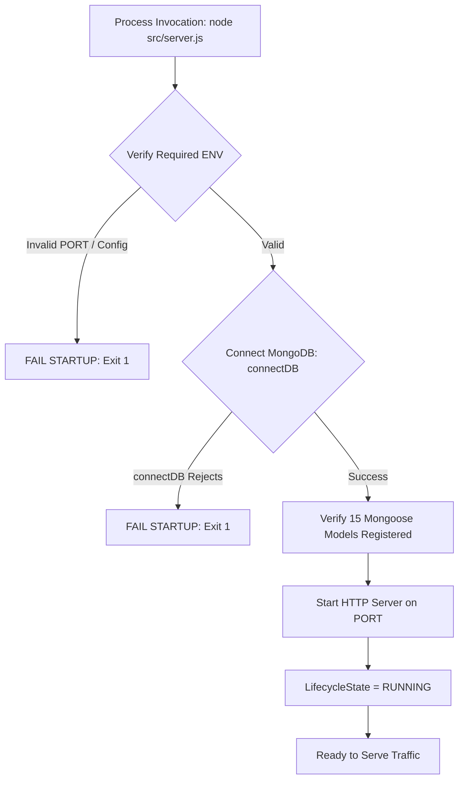

# PHASE 13 — RELIABILITY, OBSERVABILITY & PRODUCTION HARDENING (ROPH)
## ARCHITECTURE PROPOSAL (RECONCILED)

```text
Document: docs/PHASE13_ARCHITECTURE_PROPOSAL.md
Version: 1.0.4-PROPOSED
Status: VERIFIED / READY FOR PRESCRIPTIVE SPECIFICATION
Base Architecture: Phase 12 PPVG v1.7.10 (VERIFIED / COMPLETE)
Target Phase: Phase 13 — Reliability, Observability & Production Hardening (ROPH)
```

---

## 1. Status / Metadata

* **Document Identifier**: `PHASE13_ARCHITECTURE_PROPOSAL`
* **Version**: `1.0.4-PROPOSED`
* **Lifecycle State**: `VERIFIED / READY FOR PRESCRIPTIVE SPECIFICATION`
* **Authority Gate**: Reliability-Isolation Final Architecture Reconciliation Complete
* **Implementation Authorization**: **NONE** (No Phase 13 production or test implementation may begin until formal prescriptive specification freeze)
* **Base Platform State**:
  * Phase 12 Prescriptive Policy Versioning & Governance (PPVG): **VERIFIED / COMPLETE**
  * Models: **15**
  * Collections: **15**
  * Test Suite: **81 / 81 suites passing, 1090 / 1090 tests passing**
  * Question Bank: **12,000 / 12,000 questions verified (0 mismatches, 0 DAG cycles)**

---

## 2. Frozen Phase 1–12 Baseline

Phase 13 operates strictly as an operational hardening, diagnostic, and telemetry layer atop the completed, verified Phase 1–12 platform. The following platform invariants are immutable and permanently frozen:

```text
================================================================================
FROZEN BASELINE INVENTORY & INVARIANTS (PHASES 1–12)
================================================================================
Question Corpus:                 12,000 verified questions
Canonical Topics:                24
Canonical Patterns:              278
Legacy Topic/Pattern Mappings:   308
Patterns with Prerequisites:     218
Foundational Patterns:           60
Prerequisite DAG Edges:          410
Prerequisite Dependency Cycles:  0
Mongoose Registered Models:      15
MongoDB Active Collections:      15
Active Question Content Hashes:  12,000 / 12,000 SHA-256 matching
Jest Suites:                     81 / 81 passing
Jest Tests:                      1090 / 1090 passing
================================================================================
```

### Complete Registered Models Inventory (Exactly 15)
1. `Question` (`questions`) — [src/models/questionModel.js](file:///Users/rajakumaran/Documents/Aptitude/adaptive-aptitude-api/src/models/questionModel.js)
2. `User` (`users`) — [src/models/userModel.js](file:///Users/rajakumaran/Documents/Aptitude/adaptive-aptitude-api/src/models/userModel.js)
3. `Goal` (`goals`) — [src/models/goalModel.js](file:///Users/rajakumaran/Documents/Aptitude/adaptive-aptitude-api/src/models/goalModel.js)
4. `StudyPlan` (`studyplans`) — [src/models/studyPlanModel.js](file:///Users/rajakumaran/Documents/Aptitude/adaptive-aptitude-api/src/models/studyPlanModel.js)
5. `DailyObjective` (`dailyobjectives`) — [src/models/dailyObjectiveModel.js](file:///Users/rajakumaran/Documents/Aptitude/adaptive-aptitude-api/src/models/dailyObjectiveModel.js)
6. `Attempt` (`attempts`) — [src/models/attemptModel.js](file:///Users/rajakumaran/Documents/Aptitude/adaptive-aptitude-api/src/models/attemptModel.js)
7. `StudentProgress` (`studentprogresses`) — [src/models/studentProgressModel.js](file:///Users/rajakumaran/Documents/Aptitude/adaptive-aptitude-api/src/models/studentProgressModel.js)
8. `RevisionItem` (`revisionitems`) — [src/models/revisionItemModel.js](file:///Users/rajakumaran/Documents/Aptitude/adaptive-aptitude-api/src/models/revisionItemModel.js)
9. `RevisionProcessingRecord` (`revisionprocessingrecords`) — [src/models/revisionProcessingRecordModel.js](file:///Users/rajakumaran/Documents/Aptitude/adaptive-aptitude-api/src/models/revisionProcessingRecordModel.js)
10. `MockBlueprint` (`mockblueprints`) — [src/models/mockBlueprintModel.js](file:///Users/rajakumaran/Documents/Aptitude/adaptive-aptitude-api/src/models/mockBlueprintModel.js)
11. `MockSession` (`mocksessions`) — [src/models/mockSessionModel.js](file:///Users/rajakumaran/Documents/Aptitude/adaptive-aptitude-api/src/models/mockSessionModel.js)
12. `MockResponse` (`mockresponses`) — [src/models/mockResponseModel.js](file:///Users/rajakumaran/Documents/Aptitude/adaptive-aptitude-api/src/models/mockResponseModel.js)
13. `MockAttemptFinalizationRecord` (`mockattemptfinalizationrecords`) — [src/models/mockAttemptFinalizationRecordModel.js](file:///Users/rajakumaran/Documents/Aptitude/adaptive-aptitude-api/src/models/mockAttemptFinalizationRecordModel.js)
14. `PrescriptionExecutionRecord` (`prescriptionexecutionrecords`) — [src/models/prescriptionExecutionRecordModel.js](file:///Users/rajakumaran/Documents/Aptitude/adaptive-aptitude-api/src/models/prescriptionExecutionRecordModel.js)
15. `OrchestrationPolicyVersion` (`orchestrationpolicyversions`) — [src/models/orchestrationPolicyVersionModel.js](file:///Users/rajakumaran/Documents/Aptitude/adaptive-aptitude-api/src/models/orchestrationPolicyVersionModel.js)

---

## 3. Current Reliability / Observability Source Audit

A comprehensive inspection of the live repository yielded the following source-level findings:

### 3.1. Server Bootstrap & Lifecycle
* **Source**: [src/server.js:L10-L25](file:///Users/rajakumaran/Documents/Aptitude/adaptive-aptitude-api/src/server.js#L10-L25)
* **Current Implementation**:
  ```javascript
  const start = async () => {
    try {
      await connectDB();
      const app = createApp();
      app.listen(PORT, () => {
        console.log(`[Server] Listening on port ${PORT} [${process.env.NODE_ENV || 'development'}]`);
      });
    } catch (err) {
      console.error('[Server] Failed to start:', err.message);
      process.exit(1);
    }
  };
  ```
* **Deficiencies**:
  1. **Zero Graceful Shutdown**: No handlers registered for `SIGTERM` or `SIGINT`. Container termination immediately aborts the process, severing active HTTP sockets and in-flight transactions.
  2. **Zero Signal Traps / Draining**: No mechanism to track in-flight requests or call `server.close()`.
  3. **No Uncaught Rejection Handlers**: Unhandled promise rejections and uncaught exceptions fall through to default Node.js runtime behavior without structured operational logging, draining, or controlled exit.

### 3.2. Express Application Pipeline & Global Middleware
* **Source**: [src/app.js:L43-L98](file:///Users/rajakumaran/Documents/Aptitude/adaptive-aptitude-api/src/app.js#L43-L98)
* **Current Implementation**:
  ```javascript
  app.use(express.json());
  app.use(cors());
  app.get('/health', (req, res) => {
    res.status(200).json({ success: true, status: 'ok' });
  });
  // Mount API routers...
  app.use(notFound);
  app.use(errorHandler);
  ```
* **Deficiencies**:
  1. **No Correlation Tracking**: Requests lack correlation IDs. There is no `X-Correlation-ID` header inspection, generation, or forwarding.
  2. **Indiscriminate Health Check**: `/health` unconditionally returns `200 OK` without checking database connectivity, query capability, or process drain state.
  3. **No Liveness vs. Readiness Distinction**: Orchestrators cannot differentiate between a live container and a container ready to accept learner traffic.
  4. **No Telemetry Middleware**: No request duration tracking, status code logging, or route performance measurement.

### 3.3. Database Lifecycle & Health
* **Source**: [src/config/database.js:L9-L38](file:///Users/rajakumaran/Documents/Aptitude/adaptive-aptitude-api/src/config/database.js#L9-L38)
* **Current Implementation**:
  * Connects with `serverSelectionTimeoutMS: 5000`.
  * Logs connection success/error via `console.log` / `console.error`.
* **Deficiencies**:
  1. **No Connection Event Listeners**: Does not hook `disconnected`, `reconnected`, or `error` events on `mongoose.connection`.
  2. **No Active Ping Mechanism**: Does not implement an addressable database ping probe to verify end-to-end database responsiveness.
  3. **Speculative Pool Tuning Rejected**: Pool behavior maintains standard Mongoose defaults; speculative tuning is explicitly excluded from Phase 13.

### 3.4. Error Handling Pipeline
* **Source**: [src/middleware/errorHandler.js:L1-L24](file:///Users/rajakumaran/Documents/Aptitude/adaptive-aptitude-api/src/middleware/errorHandler.js#L1-L24)
* **Current Implementation**:
  ```javascript
  const errorHandler = (err, req, res, next) => {
    const statusCode = err.statusCode || 500;
    const message = err.message || 'Internal Server Error';
    res.status(statusCode).json({
      success: false,
      error: {
        code: err.code || 'INTERNAL_SERVER_ERROR',
        message
      }
    });
  };
  ```
* **Deficiencies**:
  1. **Completely Silent Errors**: Centralized error middleware never emits a log statement. When an unhandled error occurs, it is returned to the client with zero server-side operational visibility.
  2. **Zero Operational Classification**: Infrastructure faults, validation errors, and policy violations are indistinguishable in telemetry.
  3. **No Correlation Context**: The error response envelope and server-side traces lack correlation IDs.

### 3.5. Logging Landscape Audit & Option B Scope Selection
A live repository audit of logging calls revealed:
* `src/config/database.js`: `console.log`, `console.error`
* `src/server.js`: `console.log`, `console.error`
* `src/services/governance/policyGovernanceService.js`: `console.warn` (`POLICY_REGISTRY_UNSEEDED_FALLBACK`, `POLICY_REGISTRY_QUERY_FAILURE_FALLBACK`)
* `scripts/managePolicy.js`: `console.warn` (`GOVERNANCE_SECRET_NOT_CONFIGURED`)
* `src/services/learning/hintService.js`: `console.warn` (degradation warnings)
* `src/controllers/*.js`: various legacy `console.log` statements

#### Logging Strategy: Option B (Phase-13-Owned Logging Only)
To strictly protect Phase 1–12 production stability and avoid altering business files:
* Phase 13 introduces a high-performance native structured JSON logger (`src/utils/logger.js`).
* Phase 13 structured logging strictly covers Phase-13-owned operational surfaces:
  1. Global Express request correlation & telemetry middleware (`src/middleware/correlationMiddleware.js`, `src/middleware/metricsMiddleware.js`)
  2. Centralized Express error handler (`src/middleware/errorHandler.js`)
  3. Server startup, signal traps, and graceful shutdown lifecycle (`src/server.js`)
  4. Database connection lifecycle event listeners (`src/config/database.js`)
  5. Diagnostic CLI output (`scripts/diagnoseSystem.js`)
* Legacy domain service logs remain untouched, preserving Phase 1–12 production code files without modification.
* The frozen warning identities (`POLICY_REGISTRY_UNSEEDED_FALLBACK`, `POLICY_REGISTRY_QUERY_FAILURE_FALLBACK`, `GOVERNANCE_SECRET_NOT_CONFIGURED`) remain exact.

---

## 4. Existing Operational Capabilities

The live repository currently possesses the following positive operational capabilities that Phase 13 preserves and leverages:
1. **Deterministic Phase 12 Fallbacks**: [policyGovernanceService.js:L630-L667](file:///Users/rajakumaran/Documents/Aptitude/adaptive-aptitude-api/src/services/governance/policyGovernanceService.js#L630-L667) implements zero-downtime runtime policy snapshot resolution with automatic fallback to `CODE_BASELINE_FALLBACK` if the database registry is unseeded or queries fail.
2. **Phase 7 Graceful LLM Degradation**: [src/services/learning/hintService.js:L73-L89](file:///Users/rajakumaran/Documents/Aptitude/adaptive-aptitude-api/src/services/learning/hintService.js#L73-L89) handles absent, timed-out, or failing LLM providers by returning deterministic local fallbacks with an `isDegraded: true` delivery envelope.
3. **Transaction Capability Classification**: Phase 12 established an exact 9-case MongoDB transaction capability classifier ([policyGovernanceService.js:L116-L150](file:///Users/rajakumaran/Documents/Aptitude/adaptive-aptitude-api/src/services/governance/policyGovernanceService.js#L116-L150)), distinguishing deployment incapability from genuine transactional conflict.
4. **Authoritative Verification Scripts**: Complete offline invariant validation scripts (`verify:phase2`, `verify:content`) run deterministically, verifying 12,000 questions with zero tolerance for corruption.

---

## 5. Reliability & Observability Gaps

Despite the strengths of Phases 1–12, critical production-hardening gaps exist:
1. **Uncontrolled Process Termination**: SIGTERM/SIGINT immediately kills the process without draining requests or closing DB connections.
2. **Silent Failure Blindspot**: Uncaught exceptions, unhandled rejections, and 500 errors in HTTP handlers generate zero server log entries.
3. **Missing Telemetry & Request Traceability**: Requests lack correlation IDs. There is no automated record of endpoint response times, status codes, or error rates.
4. **Indiscriminate Health Reporting**: `/health` returns HTTP 200 even if MongoDB is completely disconnected.
5. **No Runtime Metrics**: The platform cannot report request counts, error counts, latency distributions, or active connections.
6. **No Production Diagnostic CLI**: Operators cannot perform a fast, non-destructive health probe of database connectivity, index integrity, and policy topology without running heavy question-bank verification.

---

## 6. Candidate ROPH Sub-Capabilities

We evaluate 15 candidate sub-capabilities for Phase 13:

1. **CAP-1: Separate Liveness and Readiness Probes (`/health/live`, `/health/ready`)**: Distinguish process existence from readiness to serve traffic.
2. **CAP-2: Deterministic Graceful Shutdown & Request Draining**: Intercept SIGTERM/SIGINT, stop accepting traffic, drain in-flight requests, and disconnect Mongoose cleanly via an authoritative reliability request tracker.
3. **CAP-3: Zero-Dependency Structured JSON Logger**: Native, high-performance structured JSON logger with timestamp, severity, event, and correlation context.
4. **CAP-4: Request Correlation ID Middleware**: Generate or validate incoming `X-Correlation-ID` / `X-Request-ID`, propagate through response headers and log context via `AsyncLocalStorage`.
5. **CAP-5: Request Latency & Performance Telemetry**: Middleware capturing duration in milliseconds, status codes, and normalized route patterns.
6. **CAP-6: Bounded In-Memory Operational Metrics (Prometheus & JSON)**: In-process counters, gauges, and latency histograms exposed via gated `/metrics`.
7. **CAP-7: Centralized Error Logging & Operational Failure Classifier**: Instrument centralized error handling to log 500s and classify operational metadata without altering public API error codes.
8. **CAP-8: MongoDB Connection Lifecycle & Addressable Ping Probe**: Event listeners on Mongoose connection (`error`, `disconnected`, `reconnected`) and active ping probing with driver `maxTimeMS` and timer race.
9. **CAP-9: Operator Diagnostic CLI (`scripts/diagnoseSystem.js`)**: Fast, lightweight read-only CLI checking MongoDB connectivity, replica set topology, 15-model index presence, and Phase 12 active policy state via sole-writer compliant access.
10. **CAP-10: Telemetry Redaction & PII Protection**: Strict redaction of secrets, database credentials, learner answers, and tokens from operational logs and health outputs.
11. **CAP-11: Observability Failure Isolation Guard**: Enforce that logger failures, metrics recording errors, or diagnostic serialization faults never abort or fail learner-facing requests, and never corrupt the authoritative shutdown request counter.
12. **CAP-12: External Heavy Logging Packages (Winston/Pino/Morgan)**: Adding third-party logging packages to `package.json`.
13. **CAP-13: Background Polling Watchdog / Event-Loop Sampler**: Repeating timers periodically running database checks or sampling event loop lag.
14. **CAP-14: Database Application Telemetry Collection (`telemetryrecords`)**: Persisting logs or metrics inside a new MongoDB model and collection.
15. **CAP-15: Speculative MongoDB Pool Tuning**: Arbitrarily configuring `maxPoolSize`, `minPoolSize`, or `socketTimeoutMS` without workload evidence.

---

## 7. Weighted Decision Matrix

To objectively evaluate candidate sub-capabilities, we establish a weighted scoring rubric using 10 architectural criteria summing to exactly 100%:

### 7.1. Evaluation Criteria & Weights
1. **Production Risk Reduction (Weight: 15%)**: Prevents data loss, outage, unhandled crashes, or silent failures.
2. **Failure Isolation Quality (Weight: 15%)**: Ensures instrumentation failure cannot impact learner transactions or lifecycle draining.
3. **Architectural Fit & Simplicity (Weight: 12%)**: Harmonizes with existing Express/Mongoose architecture without bloat.
4. **Diagnostic & Operational Visibility (Weight: 12%)**: Provides actionable intelligence to platform operators.
5. **Deterministic Testability (Weight: 12%)**: Can be fully verified in automated tests without sleeps or flaky wall-clocks.
6. **Security & Privacy Protection (Weight: 10%)**: Protects credentials, learner PII, and infrastructure internals from exposure.
7. **Performance Overhead Minimization (Weight: 8%)**: CPU/memory bounded by design on question answering and orchestration.
8. **Zero Learner Invariant Impact (Weight: 6%)**: Guarantees zero mutation to Phases 1–12 learning mathematics.
9. **Zero Dependency Growth (Weight: 5%)**: Avoids expanding `package.json` with external dependencies.
10. **Low Maintenance Burden (Weight: 5%)**: Clean, maintainable code with minimal operational drag.

**Total Weight Verification**:
$$\sum W_i = 15 + 15 + 12 + 12 + 12 + 10 + 8 + 6 + 5 + 5 = 100\%$$

---

## 8. Capability Evaluation & Prioritization

Each capability is scored from 1 (poor) to 5 (excellent) across the 10 criteria:

| Candidate Capability | C1 (15) | C2 (15) | C3 (12) | C4 (12) | C5 (12) | C6 (10) | C7 (8) | C8 (6) | C9 (5) | C10 (5) | Weighted Score | Architectural Verdict |
| :--- | :---: | :---: | :---: | :---: | :---: | :---: | :---: | :---: | :---: | :---: | :---: | :--- |
| **CAP-1: Liveness & Readiness Probes** | 5 | 5 | 5 | 5 | 5 | 5 | 5 | 5 | 5 | 5 | **5.00** | **NECESSARY** |
| **CAP-2: Graceful Shutdown & Draining** | 5 | 5 | 5 | 4 | 5 | 5 | 5 | 5 | 5 | 4 | **4.83** | **NECESSARY** |
| **CAP-3: Native Structured JSON Logger** | 4 | 5 | 5 | 5 | 5 | 5 | 5 | 5 | 5 | 5 | **4.85** | **NECESSARY** |
| **CAP-4: Request Correlation Middleware**| 4 | 5 | 5 | 5 | 5 | 5 | 5 | 5 | 5 | 5 | **4.85** | **NECESSARY** |
| **CAP-5: Request Telemetry Middleware** | 4 | 5 | 5 | 5 | 5 | 5 | 5 | 5 | 5 | 5 | **4.85** | **NECESSARY** |
| **CAP-6: Bounded In-Process Metrics** | 4 | 5 | 4 | 5 | 5 | 5 | 5 | 5 | 5 | 4 | **4.68** | **NECESSARY** |
| **CAP-7: Centralized Error Logging** | 5 | 5 | 5 | 5 | 5 | 5 | 5 | 5 | 5 | 5 | **5.00** | **NECESSARY** |
| **CAP-8: Addressable Ping Probe** | 5 | 5 | 5 | 5 | 5 | 5 | 5 | 5 | 5 | 4 | **4.95** | **NECESSARY** |
| **CAP-9: Operator Diagnostic CLI** | 4 | 5 | 5 | 5 | 5 | 5 | 5 | 5 | 5 | 5 | **4.85** | **NECESSARY** |
| **CAP-10: Telemetry Redaction & PII** | 5 | 5 | 5 | 4 | 5 | 5 | 5 | 5 | 5 | 5 | **4.88** | **NECESSARY** |
| **CAP-11: Observability Failure Guard** | 5 | 5 | 5 | 4 | 5 | 5 | 5 | 5 | 5 | 5 | **4.88** | **NECESSARY** |
| **CAP-12: External Logging Packages** | 3 | 3 | 2 | 4 | 3 | 4 | 3 | 5 | 1 | 2 | **2.97** | **REJECTED (Dependency bloat)** |
| **CAP-13: Background Polling Watchdog** | 2 | 2 | 2 | 3 | 2 | 4 | 2 | 5 | 5 | 2 | **2.67** | **REJECTED (Resource leak / jitter)** |
| **CAP-14: Database Telemetry Collection**| 2 | 2 | 2 | 4 | 3 | 2 | 2 | 4 | 5 | 2 | **2.68** | **REJECTED (Violates 15-model invariant)** |
| **CAP-15: Speculative Pool Tuning** | 1 | 2 | 2 | 1 | 2 | 4 | 2 | 5 | 5 | 2 | **2.21** | **REJECTED (Unjustified DB tuning)** |

---

## 9. Selected Phase 13 Architecture Scope

Phase 13 adopts all 11 **NECESSARY** capabilities (CAP-1 through CAP-11) organized into 7 cohesive subsystems:
1. **Health & Readiness Subsystem**: Dedicated `/health/live` and `/health/ready` endpoints with addressable MongoDB ping deadlines.
2. **Process Lifecycle Subsystem**: Deterministic graceful shutdown coordinator, authoritatively tracked request draining, fatal process error handling (`uncaughtException`, `unhandledRejection`), and signal handling (`SIGTERM`/`SIGINT`).
3. **Structured Logging & Redaction Subsystem**: Native zero-dependency JSON logger writing to stdout/stderr with automatic redaction of credentials and PII on Phase-13-owned surfaces, backed by an isolated static failsafe fallback.
4. **Traceability & Correlation Subsystem**: `AsyncLocalStorage` request-scoped correlation context propagation.
5. **Operational Telemetry & Metrics Subsystem**: In-memory bounded metrics registry (Prometheus text format + JSON) gated behind `process.env.METRICS_ENABLED === 'true'`.
6. **Centralized Error Observation Subsystem**: Structured classification and logging of unhandled errors in Express middleware without modifying Phase 1–12 HTTP error contracts.
7. **Operational Diagnostics CLI**: Read-only `scripts/diagnoseSystem.js` command providing operators with fast health audits while strictly respecting the Phase 12 model-import boundary and existing public read APIs.

---

## 10. Why Phase 13 Does Not Duplicate Phases 1–12

* **Phases 1–6 (Core Learning & Adaptive Intelligence)**: Phase 13 does not modify question schemas, scoring formulas, study plans, or mock exam calculations. It instruments HTTP boundaries to measure request duration and log unhandled faults.
* **Phase 7 (Intelligent Learning & LLM Advisory)**: Phase 13 preserves frozen Phase 7 provider fallback semantics without modification. Detailed provider degradation metrics are deferred from Phase 13 V1 to keep HTTP metrics middleware strictly boundary-oriented without parsing response bodies.
* **Phase 8 (Cognitive Analytics & Mastery Diagnostics)**: Phase 13 does not alter diagnostic thresholds or mathematics. It observes analytics endpoint latency via generic HTTP route telemetry.
* **Phase 9 (Prescriptive Orchestration & NBA)**: Phase 13 does not touch the 13 governed policy dimensions or 7-tier comparator. Internal arbitration timing is deferred from Phase 13 V1.
* **Phase 10 (Attribution & Execution Recording)**: Phase 13 does not touch attribution issuance or terminal barriers. Internal issuance timing is deferred from Phase 13 V1.
* **Phase 11 (Offline Simulation Engine)**: Phase 13 does not touch simulation mathematics or candidate generation.
* **Phase 12 (Policy Versioning & Governance)**: Phase 13 does not mutate governance records or implement auto-promotion. It acts as a strictly read-only observer of policy registry health using only frozen Phase 12 public read APIs.

---

## 11. Phase 13 Ownership Boundary

```text
+-------------------------------------------------------------------------------+
| PHASE 13 OWNS:                                                                |
|  - Process lifecycle & graceful shutdown coordinator                          |
|  - Authoritative in-flight request tracker (activeRequestCount)               |
|  - Fatal error termination (uncaughtException, unhandledRejection)            |
|  - Separate liveness (/health/live) and readiness (/health/ready) probes       |
|  - Addressable MongoDB ping readiness probe with driver & client timeout      |
|  - Zero-dependency structured JSON logger (Phase-13-owned surfaces)           |
|  - Telemetry redaction (URI credentials, secrets, tokens, PII)                |
|  - Request correlation propagation via AsyncLocalStorage                      |
|  - HTTP latency measurement, route normalization & status telemetry           |
|  - In-process bounded metrics registry (/metrics gated by METRICS_ENABLED)    |
|  - Error logging & operational categorization in Express error handler        |
|  - Read-only system diagnostic CLI (scripts/diagnoseSystem.js)                |
+-------------------------------------------------------------------------------+
| PHASE 13 DOES NOT OWN (PERMANENTLY FORBIDDEN):                                |
|  - Business logic of question serving, scoring, or sessions (Phases 1-6)       |
|  - LLM prompts, schemas, fallback logic (Phase 7)                             |
|  - Mastery calculations, cognitive drift thresholds (Phase 8)                 |
|  - Policy arbitration rules or comparator logic (Phase 9)                     |
|  - Attribution issuance or ledger records (Phase 10)                          |
|  - Simulation replay or candidate evaluation (Phase 11)                       |
|  - Policy promotion, hashing, or governance records (Phase 12)               |
|  - Learner authentication, passwords, or JWTs (Out of Scope)                  |
|  - Any new Mongoose models or MongoDB collections (MUST REMAIN 15)            |
+-------------------------------------------------------------------------------+
```

---

## 12. Cross-Phase Interaction Contract

| Phase | Phase 13 Interaction Mode | Boundary Contract |
| :--- | :---: | :--- |
| **Phase 1–6 (Core Learner Engine)** | **OBSERVE** | Measures HTTP request duration and error rates. Zero modification to controllers or services. |
| **Phase 7 (LLM Advisory)** | **OBSERVE / PRESERVE** | Preserves local fallback delivery envelopes without modification. |
| **Phase 8 (Cognitive Analytics)** | **OBSERVE** | Measures route latency for mastery queries. |
| **Phase 9 (NBA Orchestration)** | **OBSERVE** | Observes HTTP endpoint throughput; zero mutation to arbitration state. |
| **Phase 10 (Attribution Ledger)** | **OBSERVE** | Observes execution recording HTTP transactions. |
| **Phase 11 (Offline Simulation)** | **ISOLATE** | Zero runtime telemetry footprint during simulation scripts. |
| **Phase 12 (Policy Governance)** | **OBSERVE & SAFEGUARD**| Inspects active policy count via read-only queries; strictly preserves Phase 12 model-import boundary, public API signatures, and error semantics. |

---

## 13. Health & Readiness Architecture

### 13.1. Probe Separation Contract (Deterministic Freeze)
To eliminate conflicting contracts between liveness and readiness:

```text
================================================================================
FROZEN HEALTH PROBE CONTRACT
================================================================================
GET /health/live:
  Purpose: Process liveness probe.
  Meaning: The Node.js process is alive, the event loop runs, and the HTTP
           listener can respond.
  Behavior: ALWAYS returns 200 OK while the listener can respond.
            - MongoDB connected    -> 200 OK
            - MongoDB disconnected -> 200 OK
            - Policy unseeded      -> 200 OK
            - Process SHUTTING_DOWN -> 200 OK (listener is still answering)

GET /health/ready:
  Purpose: Traffic readiness probe.
  Meaning: The container is fully initialized, connected to required backing
           services (MongoDB), and ready to accept new learner requests.
  Behavior: Evaluates the complete readiness condition on EVERY call:
            - LifecycleState === RUNNING
              AND mongoose.connection.readyState === 1
              AND active MongoDB ping succeeds within 2000ms
              -> 200 OK (READY)
            - MongoDB disconnected           -> 503 Service Unavailable (NOT_READY)
            - MongoDB ping > 2000ms          -> 503 Service Unavailable (NOT_READY)
            - Process SHUTTING_DOWN / DRAIN  -> 503 Service Unavailable (SHUTTING_DOWN)
================================================================================
```

### 13.2. Detailed Readiness Probe Evaluation
`GET /health/ready` evaluates readiness criteria:
1. **Lifecycle State**: Must be `RUNNING`. If `STARTING` or `SHUTTING_DOWN`, returns 503.
2. **MongoDB Connection State**: `mongoose.connection.readyState === 1` (connected).
3. **MongoDB Addressable Ping Probe**: Active ping succeeds within $2,000 \text{ ms}$.

#### 13.2.1. Addressable MongoDB Ping Mechanism (Driver-Supported)
* **Driver Versions**: Mongoose `8.24.4` / MongoDB Driver `6.20.0`.
* **Execution**:
  ```javascript
  const pingDatabase = async (timeoutMs = 2000) => {
    let timerId;
    let isSettled = false;

    const timeoutPromise = new Promise((_, reject) => {
      timerId = setTimeout(() => {
        isSettled = true;
        const err = new Error(`MongoDB ping exceeded deadline of ${timeoutMs}ms`);
        err.code = 'ETIMEDOUT';
        reject(err);
      }, timeoutMs);
      if (timerId.unref) timerId.unref();
    });

    const pingPromise = (async () => {
      try {
        const adminDb = mongoose.connection.db.admin();
        return await adminDb.ping({ maxTimeMS: timeoutMs });
      } catch (err) {
        throw err;
      }
    })();

    try {
      const result = await Promise.race([pingPromise, timeoutPromise]);
      isSettled = true;
      clearTimeout(timerId);
      return result;
    } catch (err) {
      clearTimeout(timerId);
      // Late resolution of pingPromise after timeout is safely caught/swallowed
      pingPromise.catch(() => {});
      throw err;
    }
  };
  ```
* **Cancellation & Cleanup**: Timer is explicitly cleared on either branch. Late-resolving or late-rejecting promises are safely handled without unhandled rejections, double-resolution, or memory leaks.

* **Response Contracts**:
  * Success (`200 OK`):
    ```json
    {
      "status": "READY",
      "components": {
        "database": "UP"
      },
      "timestamp": "2026-10-11T12:00:00.000Z"
    }
    ```
  * Failure — Database Down (`503 Service Unavailable`):
    ```json
    {
      "status": "NOT_READY",
      "components": {
        "database": "DOWN"
      },
      "timestamp": "2026-10-11T12:00:00.000Z"
    }
    ```
  * Failure — Draining / Shutdown (`503 Service Unavailable`):
    ```json
    {
      "status": "NOT_READY",
      "state": "SHUTTING_DOWN",
      "timestamp": "2026-10-11T12:00:00.000Z"
    }
    ```

### 13.3. Backward-Compatible Root Health (`GET /health`)
* Preserved exactly as established in Phase 2: returns `200 OK` with `{ "success": true, "status": "ok" }`.

---

## 14. Logging Architecture (Option B — Phase-13-Owned Surfaces)

### 14.1. Implementation Mechanism
* Built using native Node.js stdout/stderr streams.
* No `winston`, `pino`, or `morgan` dependencies.
* Emits single-line newline-delimited JSON (`ndjson`).
* **Non-Recursive Failsafe Fallback**: If serialization or stream writing throws, attempts exactly ONE static constant write to stderr. If that also fails, swallows silently without recursive logger calls.

### 14.2. Canonical Two-Layer Structured Log Schema

#### 14.2.1. Required Universal Base Fields (Present on EVERY Log Entry)
Every Phase-13 structured log entry emitted to stdout/stderr MUST contain:
```json
{
  "timestamp": "2026-10-11T12:00:00.123Z",
  "level": "info",
  "event": "SERVER_STARTUP_COMPLETED",
  "component": "server",
  "message": "Server started successfully on port 5001"
}
```
* `timestamp`: ISO-8601 UTC string.
* `level`: One of `'debug'`, `'info'`, `'warn'`, `'error'`.
* `event`: Bounded canonical operational event identifier.
* `component`: Bounded operational component (`'http'`, `'server'`, `'database'`, `'health'`, `'cli'`).
* `message`: Sanitized human-readable operational message.

#### 14.2.2. Conditional Request-Context Fields
When a log is emitted inside an active `AsyncLocalStorage` request context, the logger automatically attaches:
```json
{
  "correlationId": "c8a1b2c3-4d5e-6f7a-8b9c-0d1e2f3a4b5c",
  "method": "POST",
  "normalizedRoute": "/api/v1/orchestration/next-action"
}
```
* **Outside-Request Behavior**: When logging occurs outside an HTTP request context (server startup, shutdown, database events, diagnostic CLI), `correlationId`, `method`, and `normalizedRoute` are **completely omitted** from the log payload (no `null`, `'SYSTEM_NO_CORRELATION'`, or fake values).

#### 14.2.3. Event-Specific Optional Fields
Permitted event-specific payload fields:
* **HTTP completion (`HTTP_REQUEST_COMPLETED`)**: `statusCode` (number), `durationMs` (number).
* **Database lifecycle (`MONGODB_ERROR`, etc.)**: `errorCode` (string, when applicable).
* **Shutdown milestones (`PROCESS_SHUTDOWN_STARTED`, `PROCESS_SHUTDOWN_COMPLETED`)**: `reason` (string), `exitCode` (number), `drainTimeoutMs` (number), `elapsedMs` (number).
* **Fatal process errors (`UNCAUGHT_EXCEPTION`, `UNHANDLED_REJECTION`)**: `errorType` (string), `sanitizedErrorName` (string), `sanitizedStack` (string).

### 14.3. Standard Log Levels & Preserved Warnings
* `debug`: Fine-grained operational diagnostics.
* `info`: Lifecycle milestones (server listening, graceful shutdown initiated, request completed).
* `warn`: Degraded operations and fallback activations.
  * **Frozen Warning Identities Preserved**:
    * `POLICY_REGISTRY_UNSEEDED_FALLBACK` (emitted by `policyGovernanceService.js`)
    * `POLICY_REGISTRY_QUERY_FAILURE_FALLBACK` (emitted by `policyGovernanceService.js`)
    * `GOVERNANCE_SECRET_NOT_CONFIGURED` (emitted by `scripts/managePolicy.js`)
* `error`: Uncaught exceptions, database disconnections, 500 internal errors.

---

## 15. Correlation & Traceability Architecture

### 15.1. Context Propagation Mechanism (`AsyncLocalStorage`)
Phase 13 establishes zero-dependency request context propagation using `node:async_hooks.AsyncLocalStorage`:
* **Module**: `src/utils/requestContext.js`
* **Context Shape**:
  ```javascript
  {
    correlationId: 'c8a1b2c3-4d5e-6f7a-8b9c-0d1e2f3a4b5c',
    method: 'POST',
    normalizedRoute: 'UNRESOLVED'
  }
  ```
* **Context Lifecycle & Route Updating**:
  1. `correlationMiddleware` executes as the first global middleware:
     * Extracts `X-Correlation-ID` or `X-Request-ID`.
     * Sanitizes using regex: `^[a-zA-Z0-9_-]{1,64}$`.
     * If absent or invalid, generates a new UUID v4 via `node:crypto.randomUUID()`.
     * Initializes context:
       ```javascript
       requestContext.run({
         correlationId,
         method: req.method,
         normalizedRoute: 'UNRESOLVED'
       }, next);
       ```
  2. Route resolution update:
     * When Express route resolution completes (inside `metricsMiddleware` or route handler):
       ```javascript
       const normalizedRoute = req.baseUrl + (req.route ? req.route.path : '');
       requestContext.setNormalizedRoute(normalizedRoute);
       ```
     * For 404 unmatched requests: `requestContext.setNormalizedRoute('UNMATCHED')`.
     * For pre-routing errors: `normalizedRoute` remains `'UNRESOLVED'`.
     * Controlled update helper in `requestContext.js`:
       ```javascript
       const setNormalizedRoute = (route) => {
         const store = asyncLocalStorage.getStore();
         if (store) store.normalizedRoute = route;
       };
       ```
* **Logger Integration**:
  * When `logger.info()` or `logger.error()` is invoked, it queries `requestContext.getStore()`.
  * If present, automatically attaches `correlationId`, `method`, and `normalizedRoute` to the log payload without requiring manual parameter passing.
  * If outside an HTTP request context (e.g. startup, shutdown, CLI), request-context fields are cleanly omitted.
* **Outbound Header**:
  * Attached via `res.setHeader('X-Correlation-ID', correlationId)`.

---

## 16. Metrics Architecture & Trust Boundary

### 16.1. In-Process Bounded Registry
* Phase 13 introduces an in-memory `MetricsRegistry` in `src/utils/metrics.js` without adding `prom-client`.
* Provides Prometheus text exposition and JSON exposition.
* Pre-allocated counter keys, fixed histogram buckets, and bounded label spaces.

### 16.2. Trust & Disclosure Boundary for `/metrics`
* **Exact Enablement Rule**:
  * Enabled **ONLY** when `process.env.METRICS_ENABLED === 'true'` (exact string equality).
  * If `process.env.METRICS_ENABLED !== 'true'`: the `/metrics` route is **NOT** registered in Express; requests fall through to standard 404 handling.
  * If `process.env.METRICS_ENABLED === 'true'`: `/metrics` route is registered and exposes non-sensitive aggregate operational metrics.
* **Network Posture**:
  * Management-port isolation and internal cluster network gating are deployment recommendations for operators, NOT application-level security guarantees. Because Phase 13 introduces no authentication, the endpoint is safe by design.
* **Strict Non-Disclosure Contract**:
  * The metrics exposition **MUST NEVER** reveal:
    * `userId`, `goalId`, `attemptId`, `questionId`, `correlationId`, `prescriptionId`
    * `policyFingerprint`, `policyDefinition`
    * `MongoDB URI`, host credentials, secrets
    * Raw error messages, stack traces, filesystem paths

### 16.3. Mechanically Bounded Metric Definitions (Exactly 8 Metrics)

To ensure bounded memory usage, every metric has a mechanical upper limit on distinct series, and the series count is verified before allocation:

| Metric Name | Type | Allowed Labels | Allowed Values | Max Distinct Series | Overflow / Fallback Behavior | Reset Behavior |
| :--- | :---: | :--- | :--- | :---: | :--- | :--- |
| `http_requests_total` | Counter | `method`, `route`, `statusClass` | `method`: GET, POST, PUT, PATCH, DELETE, OPTIONS, HEAD, OTHER (8)<br>`route`: max 30 routes + UNMATCHED + UNRESOLVED + OTHER (33)<br>`statusClass`: 2xx, 3xx, 4xx, 5xx, OTHER (5) | Theoretical: 1,320<br>Hard Cap: **500** | Checked before allocation. If cap reached, sample remapped to pre-allocated overflow series (`route: OTHER`, `statusClass: OTHER`) within the 500-cap. | Monotonic for lifetime of Node.js process. Resets naturally on process restart. |
| `http_request_duration_ms` | Histogram | `method`, `route` | `method`: 8 enum values<br>`route`: 33 bounded values<br>Buckets: `[5, 10, 25, 50, 100, 250, 500, 1000, 2500, 5000, 10000]` ms (11 buckets + `+Inf`) | Theoretical: 264<br>Hard Cap: **150** | Checked before allocation. If cap reached, sample remapped to pre-allocated overflow series (`route: OTHER`) within the 150-cap. | Monotonic for lifetime of Node.js process. Resets naturally on process restart. |
| `http_active_requests` | Gauge | None | Integer $\ge 0$ | **1** | Observational mirror of authoritative process-local `activeRequestCount`. | Dynamically reflects concurrent requests. |
| `mongodb_connection_status` | Gauge | None | 0 (disconnected), 1 (connected), 2 (connecting), 3 (disconnecting) | **1** | None | Updated on Mongoose connection events. |
| `mongodb_ping_duration_ms` | Gauge | None | Numeric ms latency $\ge 0$ | **1** | None | Updated on each readiness ping probe. |
| `process_uptime_seconds` | Gauge | None | Seconds since bootstrap | **1** | None | Computed via `process.uptime()`. |
| `health_probe_status` | Gauge | `probe` | `live`, `ready` (value: 0 or 1) | **2** | None | Updated on probe invocation. |
| `phase13_lifecycle_events_total` | Counter | `event` | `STARTUP`, `SHUTDOWN`, `FATAL_ERROR`, `DB_DISCONNECT`, `OTHER` | **5** | Event collapses to `OTHER`. | Monotonic for lifetime of Node.js process. Resets naturally on process restart. |

**Total Registry Series Bound**: The entire metric registry is mechanically bounded to $< 700$ distinct series total across the application. No undocumented metrics exist.

---

## 17. Cardinality Contract & Metric Route Normalization

### 17.1. Forbidden High-Cardinality Dimensions
The metric system strictly bans: `userId`, `goalId`, `attemptId`, `questionId`, `prescriptionId`, `correlationId`, `policyFingerprint`, raw unnormalized URLs, error messages, and query parameter strings.

### 17.2. Metric Route Normalization Contract & Determinism
`metricsMiddleware` derives `normalizedRoute` deterministically:
1. Matched routes: `req.baseUrl + (req.route ? req.route.path : '')` (e.g. `/api/v1/questions/:id` instead of `/api/v1/questions/65a12b4c`).
2. 404 / unmatched paths: Collapsed into canonical bounded label `UNMATCHED`.
3. Pre-routing errors: Collapsed into canonical label `UNRESOLVED`.
4. Template overflow & discovery determinism:
   * Route-template membership may vary by request arrival order during dynamic template discovery up to the 30-template cap, but total series cardinality remains strictly bounded and business behavior is unaffected.
   * Once 30 route templates are registered, all subsequent new route patterns collapse deterministically into `OTHER`.

---

## 18. Latency & Performance Measurement

### 18.1. Architectural Measurement Boundaries
Phase 13 instruments strictly boundary-oriented metrics:
1. **HTTP Request Boundary**: Inbound-to-outbound duration measured via `node:perf_hooks` (`performance.now()`).
2. **MongoDB Ping Boundary**: Round-trip database heartbeat latency measured during readiness probes.

### 18.2. Deferred Internal Telemetry (Not in Phase 13 V1)
To keep generic HTTP middleware strictly decoupled from internal domain internals:
* Phase 7 LLM provider degradation counters: **DEFERRED / NOT IN PHASE 13 V1**
* Phase 9 orchestration arbitration latency: **DEFERRED / NOT IN PHASE 13 V1**
* Phase 10 attribution issuance latency: **DEFERRED / NOT IN PHASE 13 V1**
* Phase 11 simulation execution timing: **DEFERRED / NOT IN PHASE 13 V1**

---

## 19. Performance Budget & System Timeout Strategy

### 19.1. Explicit Timeout Ownership Matrix
Phase 13 distinguishes existing preserved timeouts from new Phase 13 reliability deadlines:

```text
================================================================================
EXPLICIT TIMEOUT OWNERSHIP MATRIX
================================================================================
Existing Preserved System Timeouts:
  - Phase 7 LLM Provider Timeout:       15,000 ms (frozen Phase 7 contract)
  - DB Bootstrap Selection Timeout:      5,000 ms (serverSelectionTimeoutMS)

New Phase 13 Reliability Timeouts:
  - MongoDB Readiness Ping Deadline:     2,000 ms (driver maxTimeMS + timer race)
  - Normal Graceful Drain Deadline:     10,000 ms (SIGTERM / SIGINT)
  - Fatal Process Drain Deadline:        5,000 ms (uncaughtException / rejection)
================================================================================
```
* Note: Global MongoDB query timeouts (e.g. 30,000 ms) are explicitly removed from Phase 13 scope as no such configuration exists in the baseline.

### 19.2. Elimination of Unmeasured Guarantees
Arbitrary unmeasured numerical claims (such as `< 5 MB`, `< 0.2 ms`, `< 1 s`) are strictly removed as architectural guarantees. Instead, Phase 13 defines:
* **Bounded-by-Design Architecture**:
  * Telemetry structures enforce hard cardinality caps and fixed histogram buckets.
  * In-memory metrics use bounded maps with O(1) key lookups.
  * AsyncLocalStorage context contains exactly three small string fields.
* **Post-Implementation Benchmark Gates**:
  * Performance overhead will be measured on actual hardware after implementation and reported as benchmark evidence.
  * Automated Jest test suites will not include brittle wall-clock assertions.

---

## 20. Database Lifecycle & Addressable Readiness Contract

### 20.1. Mongoose Connection Event Listeners
[src/config/database.js](file:///Users/rajakumaran/Documents/Aptitude/adaptive-aptitude-api/src/config/database.js) registers:
* `mongoose.connection.on('connected')`: Logs info event `MONGODB_CONNECTED`. Updates connection telemetry; does **NOT** independently declare readiness READY.
* `mongoose.connection.on('disconnected')`: Logs warn event `MONGODB_DISCONNECTED`. Updates connection telemetry; future readiness probes return NOT_READY.
* `mongoose.connection.on('reconnected')`: Logs info event `MONGODB_RECONNECTED`. Updates connection telemetry; does **NOT** independently declare readiness READY.
* `mongoose.connection.on('error', (err))`: Logs error event `MONGODB_ERROR`. Future readiness probe evaluates the full readiness contract.

### 20.2. Connection State Mapping & Probe Contract
* `readyState === 1`: Backing connection is UP.
* `readyState !== 1`: Backing connection is DOWN.
* Readiness is **NEVER** determined by a stale boolean flag. `GET /health/ready` dynamically evaluates the entire 3-part contract (`RUNNING` state, `readyState === 1`, and active ping within 2000ms) on every invocation.

### 20.3. Rejection of Speculative Pool Tuning
Speculative tuning of `maxPoolSize`, `minPoolSize`, and `socketTimeoutMS` is removed from Phase 13. The platform maintains Mongoose default pool management.

---

## 21. Startup Contract (No Retry Algorithm)

Phase 13 introduces **NO** startup database retry algorithm. The process either succeeds or fails fast:



* **Startup Failures (Fail Fast)**:
  * Malformed configuration or unparseable `PORT`.
  * Database connection rejection on initial `connectDB()`.
* **Permitted Degraded Operation (Does NOT Fail Startup)**:
  * Phase 12 Policy Registry unseeded $\rightarrow$ runtime uses `CODE_BASELINE_FALLBACK`.
  * Phase 7 LLM provider credentials absent $\rightarrow$ degrades to disabled fallback-only mode.

---

## 22. Graceful Shutdown & Fatal Process Error Contract

All process terminations are coordinated through a single, reusable shutdown coordinator guaranteeing that active HTTP requests drain before MongoDB disconnects.

### 22.1. Authoritative Request Lifecycle Tracker (Reliability Primitive)
To strictly decouple shutdown correctness from the metrics registry:
* **Module Ownership**: `src/middleware/metricsMiddleware.js` maintains and exports an authoritative process-local counter:
  ```javascript
  let activeRequestCount = 0;

  const getActiveRequestCount = () => activeRequestCount;
  ```
* **Per-Request Once-Guard Semantics**:
  ```javascript
  // On request entry:
  activeRequestCount++;
  try {
    metrics.setGauge('http_active_requests', activeRequestCount);
  } catch (err) {
    // Failure isolation: metrics errors NEVER corrupt activeRequestCount
  }

  // Once-guarded finalization on response completion or termination:
  let completed = false;
  const finalizeRequest = () => {
    if (completed) return;
    completed = true;
    activeRequestCount = Math.max(0, activeRequestCount - 1);
    try {
      metrics.setGauge('http_active_requests', activeRequestCount);
    } catch (err) {
      // Failure isolation
    }
  };

  res.once('finish', finalizeRequest);
  res.once('close', finalizeRequest);
  ```
* **Invariants**:
  1. Starts at 0, increments synchronously once per request, decrements exactly once per request.
  2. Finish and close events are deduplicated via per-request once-guard; counter never becomes negative.
  3. Metric `http_active_requests` is strictly an observational mirror; metrics errors never compromise `activeRequestCount`.

### 22.2. Unified Shutdown Coordinator Contract
```javascript
let isShuttingDown = false;

const coordinateShutdown = async ({ reason, exitCode = 0, drainTimeoutMs = 10000 }) => {
  // 1. Atomically claim shutdown ownership to prevent duplicate/recursive execution
  if (isShuttingDown) {
    process.exit(exitCode !== 0 ? exitCode : 1);
    return;
  }
  isShuttingDown = true;

  logger.info({
    event: 'PROCESS_SHUTDOWN_STARTED',
    reason,
    exitCode,
    drainTimeoutMs
  });

  // 2. Mark readiness SHUTTING_DOWN immediately so upstream load balancers stop sending traffic
  healthService.setLifecycleState('SHUTTING_DOWN');

  // 3. Stop accepting new HTTP connections
  if (httpServer && httpServer.listening) {
    httpServer.close();
    httpServer.closeIdleConnections?.();
  }

  // 4. Wait for authoritative in-flight requests to complete OR until drain deadline expires
  const drainStart = Date.now();
  await new Promise((resolve) => {
    const checkDrain = () => {
      if (getActiveRequestCount() <= 0 || Date.now() - drainStart >= drainTimeoutMs) {
        resolve();
      } else {
        setTimeout(checkDrain, 50);
      }
    };
    checkDrain();
  });

  // 5. Only after active request drain completes/times out: disconnect MongoDB
  if (mongoose.connection.readyState !== 0) {
    try {
      await mongoose.disconnect();
    } catch (err) {
      // Swallowed safely
    }
  }

  // 6. Log final shutdown milestone
  logger.info({
    event: 'PROCESS_SHUTDOWN_COMPLETED',
    reason,
    exitCode,
    elapsedMs: Date.now() - drainStart
  });

  // 7. Exit with required exit code
  process.exit(exitCode);
};
```

### 22.3. Signal Handling (`SIGTERM`/`SIGINT`)
* `process.on('SIGTERM', () => coordinateShutdown({ reason: 'SIGTERM', exitCode: 0, drainTimeoutMs: 10000 }));`
* `process.on('SIGINT', () => coordinateShutdown({ reason: 'SIGINT', exitCode: 0, drainTimeoutMs: 10000 }));`
* Second signal received while draining forces immediate `process.exit(1)`.

### 22.4. Fatal Process Error Contract (`uncaughtException` / `unhandledRejection`)
* Handlers:
  * `uncaughtException`: Logs sanitized fatal error event and calls `coordinateShutdown({ reason: 'UNCAUGHT_EXCEPTION', exitCode: 1, drainTimeoutMs: 5000 })`.
  * `unhandledRejection`: Logs sanitized fatal error event and calls `coordinateShutdown({ reason: 'UNHANDLED_REJECTION', exitCode: 1, drainTimeoutMs: 5000 })`.
* Special Contexts:
  * *Before HTTP server creation*: Logs fatal error and exits with code 1 immediately.
  * *After HTTP server creation*: Stops accepting traffic, drains for up to 5 seconds, disconnects MongoDB, and exits with code 1.
  * *While already shutting down*: Atomic `isShuttingDown` flag halts recursion and calls `process.exit(1)` immediately.

---

## 23. Error & Failure Classification (Preserving Phase 12 Contracts)

```text
================================================================================
CRITICAL ARCHITECTURAL INVARIANT:
Operational classification is observational metadata only.
It MUST NEVER override an existing Phase 1–12 status code or domain error contract.
================================================================================
```

| Domain Error / Fault | Frozen Phase 1–12 HTTP Status | Phase 13 Internal Operational Category | Log Severity | Public Response Envelope |
| :--- | :---: | :--- | :---: | :--- |
| `VALIDATION_ERROR` | 400 | `CLIENT_VALIDATION` | `warn` | Preserved exact DTO |
| `POLICY_VERSION_ALREADY_EXISTS` | 409 | `GOVERNANCE_CONFLICT` | `warn` | Preserved exact DTO |
| `IMMUTABLE_FIELD_MUTATION` | 400 | `INTEGRITY_PROTECTION_VIOLATION` | `warn` | Preserved exact DTO |
| `LIFECYCLE_MUTATION_PROHIBITED` | 400 | `INTEGRITY_PROTECTION_VIOLATION` | `warn` | Preserved exact DTO |
| `DIRECT_QUERY_UPDATE_PROHIBITED` | 400 | `INTEGRITY_PROTECTION_VIOLATION` | `warn` | Preserved exact DTO |
| `DIRECT_MODEL_WRITE_PROHIBITED` | 400 | `INTEGRITY_PROTECTION_VIOLATION` | `warn` | Preserved exact DTO |
| `UNAUTHORIZED_DELETION` | 400 | `INTEGRITY_PROTECTION_VIOLATION` | `warn` | Preserved exact DTO |
| `ROUTE_NOT_FOUND` | 404 | `CLIENT_NOT_FOUND` | `info` | Preserved exact DTO |
| `DB_ERROR` / `INTERNAL_SERVER_ERROR` | 500 | `INFRASTRUCTURE_FAULT` | `error` | Emits error log with correlationId |

---

## 24. Health & Diagnostics Data Flow

```text
1. LIVENESS PROBE (GET /health/live):
   Client -> Express -> /health/live -> Returns 200 OK (Process Alive)

2. READINESS PROBE (GET /health/ready):
   Client -> Express -> /health/ready
      |-> Check LifecycleState (Must be RUNNING)
      |-> Check Mongoose.connection.readyState === 1
      |-> Check Active Ping with maxTimeMS: 2000 & Promise.race deadline
      |-> Returns 200 OK if all pass, 503 if any fail or during drain

3. OPERATOR CLI DIAGNOSTICS (scripts/diagnoseSystem.js):
   Operator -> CLI Invocation
      |-> Ping MongoDB
      |-> Check Replica Set & Transaction Capability
      |-> Verify Model Index Presence (15 collections)
      |-> Inspect Phase 12 Active Policy via Sanctioned Read APIs
      |-> Prints Clean Status Report
```

---

## 25. Diagnostic CLI Sole-Writer Compliance & Governance Access Strategy

To protect the Phase 12 architecture guard and sole-writer boundary:
* `scripts/diagnoseSystem.js` **MUST NOT** import `src/models/orchestrationPolicyVersionModel.js`. Direct imports of this model are restricted exclusively to `policyGovernanceService.js`.
* `scripts/diagnoseSystem.js` uses only existing, frozen Phase 12 public APIs and read-only MongoDB driver methods. No nonexistent methods (such as `getActivePolicy`) are referenced.

### 25.1. Exact Diagnostic Operation Mapping
1. **Active Runtime Policy Resolution**:
   `await policyGovernanceService.resolveActivePolicySnapshot(referenceNow)`
2. **Policy Version Listing & Status**:
   `await policyGovernanceService.listVersions({ limit: 10, status: 'active' })`
3. **Policy Document Inspection**:
   `await policyGovernanceService.showPolicy({ policyVersion })`
4. **Physical MongoDB Index Inspection**:
   Native read-only: `await mongoose.connection.db.collection('orchestrationpolicyversions').indexes()`
5. **Active-Document Topology Count**:
   Native read-only: `await mongoose.connection.db.collection('orchestrationpolicyversions').countDocuments({ status: 'active' })`

### 25.2. Native Read-Only Projection & Mutation Prohibition
* For physical topology inspection, the collection name is strictly `orchestrationpolicyversions` (no underscores).
* Any direct projection uses canonical Phase 12 schema field names:
  `{ projection: { policyVersion: 1, policyFingerprint: 1, status: 1, isBaseline: 1 } }` (never `version: 1`).
* **Zero Mutation Guarantee**: The diagnostic CLI is strictly read-only. It MUST NOT execute `insert`, `update`, `replace`, `delete`, `bulkWrite`, `findOneAndUpdate`, or `findOneAndDelete` against `orchestrationpolicyversions` or any other collection.

---

## 26. Cross-Phase Degradation & Observability Relationship

Phase 13 maintains strict boundary-oriented observation:
* Preserves frozen Phase 7 behavior: provider failures never mutate learner state and seamlessly return deterministic local fallbacks with `isDegraded: true`.
* Internal Phase 7 degradation metrics and Phase 9/10/11 internal latencies are deferred from Phase 13 V1, avoiding response-body parsing or internal instrumentation hooks.

---

## 27. Operational Privacy & Stack Trace Sanitization

### 27.1. Data Redaction Rules
* Always redacts passwords, tokens (`POLICY_GOVERNANCE_SECRET`, `GEMINI_API_KEY`), connection strings (`mongodb+srv://***@host...`), question option arrays, and learner answers.
* Redaction applies to all logs emitted by Phase-13-owned surfaces.

### 27.2. Stack Trace Sanitization Contract
* **HTTP Responses**:
  * Production (`NODE_ENV === 'production'`): Stacks are **NEVER** returned to HTTP clients.
  * Development (`NODE_ENV === 'development'`): Stack traces are allowed in the response error body.
* **Server Logs**:
  * Stack traces logged to server logs pass through the redaction engine to strip database URIs, file path credentials, or sensitive headers before serialization.

---

## 28. Observability Failure Isolation

```text
================================================================================
OBSERVABILITY FAILURE ISOLATION PRINCIPLE
================================================================================
Instrumentation must NEVER become the cause of learner-facing transaction failure,
nor may it corrupt authoritative process-lifecycle tracking.
================================================================================
```

### 28.1. Telemetry Isolation
* All metrics recording, gauge updates, and header attachment logic are wrapped in defensive try/catch blocks.
* If a metric increment or gauge update throws, the sample is dropped silently.
* Telemetry errors **NEVER** corrupt `activeRequestCount` or fail an HTTP response.

### 28.2. Logger Failsafe & Privacy Isolation
* Sequence:
  1. Attempt redaction.
  2. Attempt JSON serialization.
  3. Attempt normal stdout/stderr write.
  4. If any logging operation fails: attempt **ONE** minimal static constant failsafe write to stderr:
     ```json
     {
       "level": "error",
       "event": "OBSERVABILITY_LOG_WRITE_FAILURE",
       "component": "logger",
       "message": "Structured log emission failed"
     }
     ```
  5. The failsafe message contains **NO** user-controlled data, **NO** raw error messages, **NO** stack traces, **NO** URIs, and **NO** original payload content.
  6. If the failsafe write also throws, swallow the error silently.
  7. The logger failure path is strictly non-recursive: it **NEVER** re-invokes `logger.error()`.

---

## 29. Technology Stack & Zero-Dependency Invariant

* Runtime Language: Node.js (ESM / CommonJS hybrid)
* Native Modules Used:
  * `node:async_hooks` (`AsyncLocalStorage`) — Request correlation propagation.
  * `node:crypto` (`randomUUID`) — Correlation ID generation.
  * `node:perf_hooks` (`performance.now`) — Latency calculation.
  * `node:http` — Native connection & server management.
* External Packages:
  * **Zero new dependencies**. No `winston`, `pino`, `morgan`, or `prom-client`.
  * Runtime dependencies added: **0**
  * Dev dependencies added: **0**

---

## 30. File & Directory Conventions

All Phase 13 files strictly follow existing repository directory conventions:
* Middleware: Placed in `src/middleware/` (e.g. `src/middleware/correlationMiddleware.js`, `src/middleware/metricsMiddleware.js`).
* Utilities: Placed in `src/utils/` (`logger.js`, `metrics.js`, `requestContext.js`).
* Services: Placed in `src/services/` (`healthService.js`).
* Scripts: Placed in `scripts/` (`diagnoseSystem.js`).
* Tests: Placed in `tests/reliability/`.

---

## 31. Model & Collection Invariant (Strictly 15)

Phase 13 introduces **ZERO** new Mongoose models and **ZERO** new MongoDB collections:
* Mongoose Models: Exactly **15**
* MongoDB Collections: Exactly **15**
Observability telemetry is in-process and stream-based (stdout/stderr). No database collections are created.

---

## 32. Revised Exact Implementation Footprint (Reconciled)

Under Option B (Phase-13-Owned Logging Only) and using the canonical `src/middleware/` directory convention:

### 32.1. New Production Files (Exactly 6)
1. `src/utils/logger.js` — Native structured JSON logger, redaction engine, and isolated static failsafe handler.
2. `src/utils/metrics.js` — Bounded in-process metrics registry (Prometheus + JSON exporter).
3. `src/utils/requestContext.js` — `AsyncLocalStorage` wrapper for correlation context propagation.
4. `src/middleware/correlationMiddleware.js` — Inbound correlation extraction, sanitization, and context binding.
5. `src/middleware/metricsMiddleware.js` — Authoritative reliability request tracker (`activeRequestCount`), request latency, status code telemetry, and route normalization.
6. `src/services/healthService.js` — Liveness, readiness, and addressable ping probe evaluator.

### 32.2. New Script Files (Exactly 1)
1. `scripts/diagnoseSystem.js` — Fast operator diagnostic CLI utility (sole-writer compliant).

### 32.3. Modified Production Files (Exactly 4)
1. `src/server.js` — Integration of graceful shutdown coordinator reading `getActiveRequestCount()`, signal traps, and fatal error handlers.
2. `src/app.js` — Registration of correlation middleware, metrics middleware, and `/health/live`, `/health/ready`, `/metrics` routes.
3. `src/config/database.js` — Addition of connection lifecycle listeners and addressable ping readiness probe.
4. `src/middleware/errorHandler.js` — Addition of structured error logging and operational classification.

### 32.4. New Test Files (Exactly 3)
1. `tests/reliability/healthAndLifecycle.test.js` — Liveness, readiness, graceful shutdown, request tracker once-guard, fatal process errors, and connection recovery.
2. `tests/reliability/observabilityTelemetry.test.js` — Logger shape, redaction, non-recursive failsafe, correlation context, route normalization, metrics formatting, and cardinality bounds.
3. `tests/reliability/diagnosticsCli.test.js` — Operator diagnostic CLI testing and Phase 12 sole-writer compliance.

### 32.5. Modified Existing Test Files (Exactly 1)
1. `tests/architecture_guard.test.js` — Addition of Phase 13 guards (telemetry read-only guard, banned high-cardinality label check, sole-writer diagnostic check, zero new models check).

---

## 33. Test Strategy

Every Phase 13 capability will be validated through deterministic automated tests without arbitrary wall-clock sleeps:
* **Authoritative Request Tracker**:
  * One request increments `activeRequestCount` to 1.
  * Response `finish` decrements `activeRequestCount` to 0.
  * Response `close` decrements `activeRequestCount` to 0.
  * `finish` followed by `close` does not double-decrement.
  * `close` followed by `finish` does not double-decrement.
  * Counter never becomes negative under any sequence.
  * Two concurrent requests track independently.
  * Metrics registry failure does NOT corrupt `activeRequestCount`.
  * Logger failure does NOT corrupt `activeRequestCount`.
* **Graceful Shutdown & Draining**:
  * Coordinator waits while `activeRequestCount > 0`.
  * Coordinator proceeds immediately when `activeRequestCount === 0`.
  * Coordinator proceeds after drain timeout even if `activeRequestCount > 0`.
  * MongoDB disconnect occurs strictly after `activeRequestCount === 0` or deadline expiration.
  * `SIGTERM` / `SIGINT` exits 0 after drain; second signal forces immediate exit 1.
  * Fatal `uncaughtException` / `unhandledRejection` exits 1 after drain; second fatal crash forces immediate exit 1.
* **Liveness Independence**: `/health/live` returns 200 with DB connected, DB disconnected, and while `SHUTTING_DOWN`.
* **Readiness Lifecycle**: `/health/ready` returns 200 on success; 503 on disconnected DB, ping timeout, internal probe error, or during shutdown. Reconnected event alone does NOT mark readiness READY without a full probe pass.
* **Deterministic Ping Deadline**: Driver `maxTimeMS` + `Promise.race` client-side deadline verified with fake timers/mocked driver delays.
* **Correlation ID Lifecycle**: Valid IDs accepted; invalid or oversized IDs replaced; `X-Correlation-ID` precedence over `X-Request-ID`; `X-Request-ID` fallback.
* **AsyncLocalStorage Propagation**: Correlation and `normalizedRoute` propagated across async await boundaries; request-context fields cleanly omitted when outside request context.
* **Route Normalization**: Matched routes, parameterized routes, `UNMATCHED` (404), `UNRESOLVED` (pre-routing error), and `OTHER` (cardinality overflow).
* **Metrics Enablement & Trust Boundary**: Flag absent $\rightarrow$ 404; `METRICS_ENABLED=false` $\rightarrow$ 404; `METRICS_ENABLED=true` $\rightarrow$ 200 Prometheus text. Forbidden label verification.
* **Metric Series Hard Bounds**: Proves series count cannot exceed registry bounds; excess labels collapse into `OTHER` within the cap. Proves no undocumented `other_series` metric exists.
* **Structured Logger Redaction**: Verifies base fields schema; strips MongoDB URIs, tokens, secrets, and question answers. Verifies non-HTTP logs do not require HTTP fields.
* **Logger Failsafe Privacy & Non-Recursion**:
  * JSON serialization failure or stream write failure falls back to static constant failsafe message.
  * Failsafe message contains zero raw payload data, zero MongoDB URIs, zero tokens, zero error messages.
  * Failsafe write failure is swallowed cleanly without infinite recursion.
* **Stack Sanitization**: Verifies production logs omit credentials/URIs; HTTP responses in production omit stack traces.
* **Diagnostic CLI Verification**: Inspects DB health, transaction topology, policy active count, index checks, verifies zero policy model imports, zero writes, exact `orchestrationpolicyversions` collection name, `policyVersion` field, and references no nonexistent `getActivePolicy` method.
* **Architecture Guards**: Zero learner mutation, zero new models (15), zero new collections (15), zero new dependencies.
* **Full Regression Suite**: All 81 existing test suites (1090 tests) pass with zero regressions; Phase 2 question bank invariants remain 100% verified.

---

## 34. Architecture Guard Strategy

[tests/architecture_guard.test.js](file:///Users/rajakumaran/Documents/Aptitude/adaptive-aptitude-api/tests/architecture_guard.test.js) will be extended to enforce:
1. **Model Count Invariant**: Exactly 15 models preserved in `src/models/`.
2. **Telemetry Read-Only Guard**: Proves zero write operations (`save()`, `create()`, `updateOne()`) exist inside telemetry or health modules.
3. **Metric Cardinality Guard**: Scans `metrics.js` for forbidden high-cardinality labels (`userId`, `attemptId`, `questionId`, `policyFingerprint`).
4. **Diagnostic Sole-Writer Guard**: Verifies `scripts/diagnoseSystem.js` does NOT import `orchestrationPolicyVersionModel.js`.
5. **Secret Leak Guard**: Proves logger and health components never print credentials or unredacted database strings.

---

## 35. Performance & Load Verification Strategy

* **Bounded-by-Design Structures**: Fixed-size arrays, bounded histogram buckets, O(1) in-memory lookups.
* **Post-Implementation Benchmark Verification**: Measured duration, throughput, and memory footprint will be evaluated in dedicated benchmark runs post-implementation rather than freezing unmeasured SLOs in the architecture proposal.

---

## 36. Complete Failure-Mode Matrix (16 Cases)

| # | Failure Mode | Detection Mechanism | Operational Classification | Canonical Event | User / API Surface | Fallback or Fail-Closed Action | Cleanup & Recovery | Deterministic Test Method |
| :---: | :--- | :--- | :--- | :--- | :--- | :--- | :--- | :--- |
| **1** | **MongoDB Down at Startup** | `connectDB()` rejects | `CRITICAL_STARTUP_FAILURE` | `SERVER_STARTUP_FAILED` | Process exit code 1 | Process halts immediately (no retry) | Release all sockets | Process mock exit test |
| **2** | **MongoDB Disconnect at Runtime** | `mongoose.connection.on('disconnected')` | `INFRASTRUCTURE_UNAVAILABLE` | `MONGODB_DISCONNECTED` | `/health/ready` $\rightarrow$ 503; `/health/live` $\rightarrow$ 200 | Read-only routes fail gracefully; Phase 12 uses fallback | Auto-reconnects when MongoDB returns | Mock disconnect event test |
| **3** | **MongoDB Slow / Ping Timeout** | `pingDatabase()` exceeds 2000ms | `DATABASE_LATENCY_SPIKE` | `MONGODB_PING_TIMEOUT` | `/health/ready` $\rightarrow$ 503; `/health/live` $\rightarrow$ 200 | Upstream pauses routing new traffic | Resumes when ping recovers | Mock delayed ping with fake timers |
| **4** | **MongoDB Non-Transaction-Capable** | Code 20 / Code 148 classifier | `TRANSACTION_NOT_SUPPORTED` | `GOVERNANCE_TX_INCAPABLE` | Governance activation $\rightarrow$ 500; Learner API unaffected | Refuses governance mutation; preserves active policy | Operator upgrades topology | Capability classifier unit test |
| **5** | **LLM Provider Unavailable** | Provider rejects with network error | `DEPENDENCY_DEGRADED` | `LLM_PROVIDER_UNAVAILABLE` | Returns 200 with `isDegraded: true` | Delivers deterministic local fallback envelope | Retries on next request | Fake provider unavailable test |
| **6** | **LLM Provider Timeout** | Provider call exceeds 15,000ms | `DEPENDENCY_DEGRADED` | `LLM_PROVIDER_TIMEOUT` | Returns 200 with `isDegraded: true` | Delivers deterministic local fallback envelope | Retries on next request | Fake provider timeout test |
| **7** | **Policy Registry Unseeded** | `findOne({ status: 'active' })` is null | `GOVERNANCE_FALLBACK` | `POLICY_REGISTRY_UNSEEDED_FALLBACK` | Returns valid Phase 9 response | Delivers frozen `CODE_BASELINE_FALLBACK` | Operator seeds baseline via CLI | Phase 12 integration test |
| **8** | **Policy Registry Query Failure** | Query throws database error | `GOVERNANCE_FALLBACK` | `POLICY_REGISTRY_QUERY_FAILURE_FALLBACK`| Returns valid Phase 9 response | Delivers frozen `CODE_BASELINE_FALLBACK` | Recovers on next DB read | Phase 12 query error mock test |
| **9** | **Invalid Active-Policy Topology** | CLI detects 0 or $>1$ active policies | `TOPOLOGY_INTEGRITY_VIOLATION` | `POLICY_TOPOLOGY_INVALID` | Diagnostic CLI $\rightarrow$ UNHEALTHY; HTTP serves fallback | Read-only CLI alert; zero automated mutation | Operator resolves via CLI | Diagnostic topology test |
| **10**| **Health-Check Internal Failure** | Unhandled error in `healthService` | `OBSERVABILITY_FAULT` | `HEALTH_CHECK_FAILED` | `/health/ready` $\rightarrow$ 503 failsafe; `/health/live` $\rightarrow$ 200 | Fails safe to protect upstream routing | Restores on next probe | Intentional probe error test |
| **11**| **Logger Output Error** | `stdout.write` throws exception | `OBSERVABILITY_FAULT` | Failsafe internal error | Swallowed silently; HTTP response unaffected | Failsafe write static JSON to stderr; non-recursive | Logger recovers on next write | Intentional throw mock test |
| **12**| **Metrics Registry / Export Failure**| Registry throws or serialization fails| `OBSERVABILITY_FAULT` | Failsafe internal error | Swallowed silently; HTTP response unaffected | Metric sample dropped; `activeRequestCount` unaffected | Registry recovers on next sample | Mock registry failure test |
| **13**| **Uncaught Exception** | `process.on('uncaughtException')` | `FATAL_PROCESS_ERROR` | `UNCAUGHT_EXCEPTION` | Server logs fatal error; marks readiness 503 | Drains active requests for up to 5s, disconnects DB, exits 1 | Bounded drain before DB disconnect | Process exception trap test |
| **14**| **Unhandled Rejection** | `process.on('unhandledRejection')` | `FATAL_PROCESS_ERROR` | `UNHANDLED_REJECTION` | Server logs fatal error; marks readiness 503 | Drains active requests for up to 5s, disconnects DB, exits 1 | Bounded drain before DB disconnect | Process rejection trap test |
| **15**| **SIGTERM During Active Requests** | `process.on('SIGTERM')` | `LIFECYCLE_TERMINATION` | `PROCESS_SHUTDOWN_STARTED` | `/health/ready` $\rightarrow$ 503; in-flight requests drain | Drains active requests for up to 10s, disconnects DB, exits 0 | Closes server, drains, closes DB, exits 0 | Shutdown handler test |
| **16**| **SIGINT During Active Requests** | `process.on('SIGINT')` | `LIFECYCLE_TERMINATION` | `PROCESS_SHUTDOWN_STARTED` | `/health/ready` $\rightarrow$ 503; in-flight requests drain | Drains active requests for up to 10s, disconnects DB, exits 0 | Closes server, drains, closes DB, exits 0 | Shutdown handler test |

---

## 37. Backward Compatibility

Phase 13 maintains 100% backward compatibility:
1. All existing endpoints (`/api/v1/*`) preserve their exact request payloads, response DTOs, and HTTP status codes.
2. Root `/health` continues returning `{ success: true, status: 'ok' }`.
3. All existing domain error codes (`VALIDATION_ERROR`, `POLICY_VERSION_ALREADY_EXISTS`, `IMMUTABLE_FIELD_MUTATION`, etc.) remain identical.
4. Database documents and indexes remain unaltered.
5. All 81 existing test suites continue to pass without modification to their business assertions.

---

## 38. Security & Scope Exclusions

The following capabilities are explicitly **EXCLUDED** from Phase 13:
* **No Authentication / Authorization**: No passwords, JWTs, OAuth, API key auth, or user login systems.
* **No Institutional Roles**: No teachers, mentors, administrators, or multi-tenant organizations.
* **No Frontend Changes**: No UI, dashboard, or client-side telemetry code.
* **No Automated ML / RL**: No bandit algorithms, reinforcement learning, or auto-tuning of policy weights.
* **No Data Migrations**: Zero changes to existing collections or records.

---

## 39. Risks & Mitigations

1. **Risk: Observability Overhead on High-Volume Routes**
   * *Mitigation*: Native stream writing, bounded metric-series growth, fixed histogram bucket definitions, and no unbounded per-request metric-label storage.
2. **Risk: Metric Cardinality Explosion**
   * *Mitigation*: Hard architectural guard banning dynamic labels (`userId`, `questionId`, `correlationId`) and capping distinct series at $< 700$.
3. **Risk: Flaky Shutdown Tests in CI**
   * *Mitigation*: Testing lifecycle logic using virtual mock servers and simulated signal callbacks without OS-level `kill` or real wall-clock sleeps.
4. **Risk: Log Flooding during Database Outages**
   * *Mitigation*: Connection lifecycle events emit structured warnings per Mongoose event without background timers or debouncing state; operational log level filtering and external collector log-rate throttling manage volume in production.

---

## 40. Phase 13 Acceptance Gate

To pass the Phase 13 Acceptance Gate, the future implementation must prove:
1. `GET /health/live` returns 200 independently of MongoDB connectivity or shutdown state.
2. `GET /health/ready` returns 200 when MongoDB is connected and 503 when disconnected, slow ($>2000\text{ms}$), or during shutdown draining. Mongoose `reconnected` event alone does not mark readiness READY without a full probe pass.
3. Structured logs adhere strictly to the universal base JSON schema (`timestamp`, `level`, `event`, `component`, `message`). Non-HTTP logs cleanly omit HTTP-specific fields (`correlationId`, `method`, `normalizedRoute`).
4. All logs emitted by Phase-13-owned structured logging surfaces (server bootstrap/shutdown, correlation middleware, centralized error handler, database connection lifecycle, and diagnostic CLI) must pass the Phase 13 redaction contract.
5. In the event of a logger serialization or write failure, the logger falls back to a static constant failsafe message with zero user/error payload, and non-recursively swallows subsequent errors without failing learner transactions.
6. The authoritative process-local request tracker (`activeRequestCount`) starts at 0, increments once per request, decrements once on finish/close without double-decrementing, never goes negative, and survives metrics registry failures.
7. SIGTERM and SIGINT trigger graceful connection draining (stopping HTTP traffic, draining active requests via authoritative `activeRequestCount`, and only then disconnecting MongoDB before exiting with code 0).
8. Fatal process errors (`uncaughtException`, `unhandledRejection`) trigger structured fatal logging, bounded draining via authoritative `activeRequestCount`, MongoDB disconnect after drain, and non-zero exit (code 1) without recursive loops.
9. `scripts/diagnoseSystem.js` must complete deterministically, must not hang indefinitely, its measured execution duration must be reported during post-implementation benchmark verification, it must use sanctioned Phase 12 read APIs, exact collection name `orchestrationpolicyversions`, field `policyVersion`, and it must not import `orchestrationPolicyVersionModel.js` or execute writes.
10. Metric route normalization bounds routes to templates, collapsing unmatched requests to `UNMATCHED`, pre-routing errors to `UNRESOLVED`, and template overflow to `OTHER`.
11. `GET /metrics` registration is strictly gated by `process.env.METRICS_ENABLED === 'true'`; when absent or false, `/metrics` falls through to standard 404 behavior.
12. Metric series growth is mechanically bounded to $< 700$ distinct series across exactly 8 defined metrics; series cap is verified before allocation; `http_active_requests` is strictly an observational mirror of `activeRequestCount`.
13. Registered Mongoose model count remains exactly 15; collection count remains exactly 15.
14. Runtime dependencies added: 0; dev dependencies added: 0.
15. All 81 existing test suites (1090 tests) pass with zero regressions.
16. Phase 2 question bank invariants (12,000 questions, 24 topics, 278 patterns, 0 cycles) remain 100% verified.

---
*End of Phase 13 Reconciled Architecture Proposal.*
