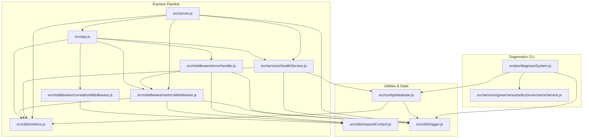

# PHASE 13 — RELIABILITY, OBSERVABILITY & PRODUCTION HARDENING (ROPH)
# PRESCRIPTIVE SPECIFICATION

```text
Document: docs/PHASE13_RELIABILITY_OBSERVABILITY_HARDENING_SPECIFICATION.md
Version: 1.0.9-FROZEN
Status: VERIFIED / IMPLEMENTED / COMPLETE / FROZEN
Architecture Basis: PHASE13_ARCHITECTURE_PROPOSAL v1.0.4-PROPOSED (VERIFIED / COMPLETE)
Implementation Authorization: GRANTED / EXECUTED
```

---

## 1. Specification Status & Precedence

### 1.1. Purpose & Authority
This prescriptive specification defines the exact, deterministic implementation contracts for Phase 13: Reliability, Observability & Production Hardening (ROPH).

This document translates the verified Phase 13 architecture ([docs/PHASE13_ARCHITECTURE_PROPOSAL.md](file:///Users/rajakumaran/Documents/Aptitude/adaptive-aptitude-api/docs/PHASE13_ARCHITECTURE_PROPOSAL.md), version `1.0.4-PROPOSED`) into implementation-addressable contracts.

### 1.2. Precedence Invariant
Where this specification and the frozen architecture appear to conflict, the frozen architecture remains authoritative and any conflict must be reported. This specification removes all implementation ambiguity without altering any Phase 1–12 contract.

---

## 2. Frozen Phase 1–12 Baseline Invariants

Phase 13 introduces zero modifications to learning mathematics, schema definitions, transaction boundaries, or question intelligence. The following platform invariants are immutable:

```text
================================================================================
FROZEN BASELINE INVENTORY & INVARIANTS (PHASES 1–12)
================================================================================
Question Corpus:                 12,000 verified questions
Canonical Topics:                24
Canonical Patterns:              278
Legacy Topic/Pattern Mappings:   308
Patterns with Prerequisites:     218
Foundational Patterns:           60
Prerequisite DAG Edges:          410
Prerequisite Dependency Cycles:  0
Mongoose Registered Models:      15
MongoDB Active Collections:      15
Active Question Content Hashes:  12,000 / 12,000 SHA-256 matching
Pre-Phase-13 Jest Suites:        81 / 81 passing (Baseline Invariant)
Pre-Phase-13 Jest Tests:         1090 / 1090 passing (Baseline Invariant)
Runtime Dependencies Added:      0
Dev Dependencies Added:          0
================================================================================
```

### 2.1. Regression Invariant & Suite Count Semantics
* **Baseline Regression Invariant**:
  * All 81 pre-Phase-13 suites remain passing.
  * All 1090 pre-Phase-13 tests remain passing.
  * Zero existing business assertion may be weakened, skipped, deleted, or rewritten merely to make Phase 13 pass.
* **Phase 13 Additions**:
  * Add the 3 specified Phase 13 reliability test suites.
  * Extend `tests/architecture_guard.test.js` as specified.
* **Full Suite**:
  * Run the COMPLETE Jest suite after Phase 13 implementation.
  * Every existing and newly added test must pass.
  * Do **NOT** hardcode or predict the final suite count in advance.
  * Do **NOT** hardcode or predict the final test count in advance.
  * Final aggregate suite and test totals must be reported strictly from actual execution rather than predicted in advance.

### Complete Registered Models Inventory (Exactly 15)
1. `Question` (`questions`) — [src/models/questionModel.js](file:///Users/rajakumaran/Documents/Aptitude/adaptive-aptitude-api/src/models/questionModel.js)
2. `User` (`users`) — [src/models/userModel.js](file:///Users/rajakumaran/Documents/Aptitude/adaptive-aptitude-api/src/models/userModel.js)
3. `Goal` (`goals`) — [src/models/goalModel.js](file:///Users/rajakumaran/Documents/Aptitude/adaptive-aptitude-api/src/models/goalModel.js)
4. `StudyPlan` (`studyplans`) — [src/models/studyPlanModel.js](file:///Users/rajakumaran/Documents/Aptitude/adaptive-aptitude-api/src/models/studyPlanModel.js)
5. `DailyObjective` (`dailyobjectives`) — [src/models/dailyObjectiveModel.js](file:///Users/rajakumaran/Documents/Aptitude/adaptive-aptitude-api/src/models/dailyObjectiveModel.js)
6. `Attempt` (`attempts`) — [src/models/attemptModel.js](file:///Users/rajakumaran/Documents/Aptitude/adaptive-aptitude-api/src/models/attemptModel.js)
7. `StudentProgress` (`studentprogresses`) — [src/models/studentProgressModel.js](file:///Users/rajakumaran/Documents/Aptitude/adaptive-aptitude-api/src/models/studentProgressModel.js)
8. `RevisionItem` (`revisionitems`) — [src/models/revisionItemModel.js](file:///Users/rajakumaran/Documents/Aptitude/adaptive-aptitude-api/src/models/revisionItemModel.js)
9. `RevisionProcessingRecord` (`revisionprocessingrecords`) — [src/models/revisionProcessingRecordModel.js](file:///Users/rajakumaran/Documents/Aptitude/adaptive-aptitude-api/src/models/revisionProcessingRecordModel.js)
10. `MockBlueprint` (`mockblueprints`) — [src/models/mockBlueprintModel.js](file:///Users/rajakumaran/Documents/Aptitude/adaptive-aptitude-api/src/models/mockBlueprintModel.js)
11. `MockSession` (`mocksessions`) — [src/models/mockSessionModel.js](file:///Users/rajakumaran/Documents/Aptitude/adaptive-aptitude-api/src/models/mockSessionModel.js)
12. `MockResponse` (`mockresponses`) — [src/models/mockResponseModel.js](file:///Users/rajakumaran/Documents/Aptitude/adaptive-aptitude-api/src/models/mockResponseModel.js)
13. `MockAttemptFinalizationRecord` (`mockattemptfinalizationrecords`) — [src/models/mockAttemptFinalizationRecordModel.js](file:///Users/rajakumaran/Documents/Aptitude/adaptive-aptitude-api/src/models/mockAttemptFinalizationRecordModel.js)
14. `PrescriptionExecutionRecord` (`prescriptionexecutionrecords`) — [src/models/prescriptionExecutionRecordModel.js](file:///Users/rajakumaran/Documents/Aptitude/adaptive-aptitude-api/src/models/prescriptionExecutionRecordModel.js)
15. `OrchestrationPolicyVersion` (`orchestrationpolicyversions`) — [src/models/orchestrationPolicyVersionModel.js](file:///Users/rajakumaran/Documents/Aptitude/adaptive-aptitude-api/src/models/orchestrationPolicyVersionModel.js)

---

## 3. Exact Implementation File Inventory

Phase 13 implementation is strictly confined to the following 15-file footprint:

### 3.1. New Production Files (Exactly 6)
1. `src/utils/logger.js` — Zero-dependency native structured JSON logger, canonical field protection, recursive redaction engine, event catalog validation (with `OBSERVABILITY_LOG_WRITE_FAILURE` strictly reserved for out-of-band failsafe), event-specific optional field filtering, absolute local path sanitizer, and out-of-band static non-recursive failsafe fallback constant without timestamp.
2. `src/utils/metrics.js` — Bounded in-process metrics registry managing exactly 8 canonical operational metrics with fixed histogram buckets, preallocated overflow series, cap-before-allocation checking, non-throwing Prometheus text serialization (`toPrometheusText()`), and non-throwing internal JSON exposition (`getMetricsJSON()`).
3. `src/utils/requestContext.js` — `AsyncLocalStorage` wrapper for request-scoped correlation ID and mutable normalized route propagation.
4. `src/middleware/correlationMiddleware.js` — Inbound correlation extraction, sanitization regex validation, failure-isolated `X-Correlation-ID` header attachment, and `AsyncLocalStorage` boundary initialization.
5. `src/middleware/metricsMiddleware.js` — Authoritative request tracker (`activeRequestCount`), request latency, status code telemetry, route/method/status normalization with effective status routing, and `HTTP_REQUEST_COMPLETED` log emission.
6. `src/services/healthService.js` — Lifecycle state store, liveness evaluation, readiness evaluation with `HEALTH_CHECK_FAILED` emission, dual-deadline database ping probe with `MONGODB_PING_TIMEOUT` emission, and failure-isolated probe metric emission.

### 3.2. New Script Files (Exactly 1)
1. `scripts/diagnoseSystem.js` — Read-only operator diagnostic CLI probing database health, read-only topology verification (`hello: 1`), physical collection presence (15 collections), physical index verification (`.indexes()`), active policy count (`countDocuments({ status: 'active' })`), and Phase 12 policy governance topology using sanctioned read APIs without mutation.

### 3.3. Modified Production Files (Exactly 4)
1. `src/server.js` — Integration of synchronous process handler registration before startup, three deterministic fatal startup states (Case A pre-DB, Case B post-DB pre-server, Case C server active), authoritative request drain coordinator, signal traps (`SIGTERM`, `SIGINT`), fatal error handlers (`uncaughtException`, `unhandledRejection` with safe non-introspecting normalization), and lifecycle state transitions.
2. `src/app.js` — Mounting `correlationMiddleware`, `metricsMiddleware`, `/health/live`, `/health/ready`, and conditionally `/metrics` (with non-throwing empty body on export failure) using direct inline handlers without introducing extra controller files.
3. `src/config/database.js` — Registration of failure-isolated connection lifecycle listeners (`connected`, `disconnected`, `reconnected`, `connecting`, `disconnecting`, `error`) before initial `mongoose.connect()`, initial best-effort connection gauge update, while preserving MongoDB `serverSelectionTimeoutMS = 5000`.
4. `src/middleware/errorHandler.js` — Structured operational logging, observational operational error classification without new Phase-13-owned status/code translations (preserving proven legacy `ValidationError` and duplicate-key translations), route context updating using effective status code before logging, and correlation preservation.

### 3.4. New Test Files (Exactly 3)
1. `tests/reliability/healthAndLifecycle.test.js` — Deterministic verification of liveness, readiness, ping deadlines, timeout log emission, internal error catch, request tracker once-guard, graceful shutdown drain, and fatal crash handling.
2. `tests/reliability/observabilityTelemetry.test.js` — Deterministic verification of correlation propagation, header failure isolation, logger schema, absolute path redaction including node_modules, failsafe fallback, route normalization with effective status, metrics exposition (Prometheus text & JSON), and series caps.
3. `tests/reliability/diagnosticsCli.test.js` — Verification of diagnostic CLI report, JSON output, exit codes, physical index verification, active policy count, and Phase 12 read-only governance compliance.

### 3.5. Modified Existing Test Files (Exactly 1)
1. `tests/architecture_guard.test.js` — Addition of Phase 13 guards: model invariant (strictly 15), telemetry read-only guard, banned high-cardinality metric labels guard, diagnostic sole-writer compliance guard, zero uninventoried controllers guard, and zero-dependency growth guard.

---

## 4. Module Public API Contracts

Every Phase 13 module exposes an exact, frozen public API. No public symbol may remain implied only by pseudocode:

### 4.1. `src/utils/requestContext.js`
```javascript
/**
 * Executes a callback within an AsyncLocalStorage context.
 * @param {{ correlationId: string, method: string, normalizedRoute: string }} context
 * @param {Function} callback
 * @returns {*}
 */
const run = (context, callback) => {};

/**
 * Returns the current request context store, or undefined outside request scope.
 * @returns {{ correlationId: string, method: string, normalizedRoute: string } | undefined}
 */
const getStore = () => {};

/**
 * Updates the normalizedRoute property of the current store if in request scope.
 * @param {string} route
 */
const setNormalizedRoute = (route) => {};

module.exports = { run, getStore, setNormalizedRoute };
```

### 4.2. `src/middleware/correlationMiddleware.js`
```javascript
/**
 * Express middleware extracting/sanitizing correlation ID, attaching X-Correlation-ID
 * with failure isolation, and initializing requestContext boundary.
 * @param {import('express').Request} req
 * @param {import('express').Response} res
 * @param {import('express').NextFunction} next
 */
const correlationMiddleware = (req, res, next) => {};

module.exports = correlationMiddleware;
```

### 4.3. `src/middleware/metricsMiddleware.js`
```javascript
/**
 * Express middleware tracking authoritative activeRequestCount and finalizing telemetry.
 * @param {import('express').Request} req
 * @param {import('express').Response} res
 * @param {import('express').NextFunction} next
 */
const metricsMiddleware = (req, res, next) => {};

/**
 * Returns the current authoritative in-flight request count.
 * @returns {number}
 */
const getActiveRequestCount = () => {};

/**
 * Mechanically derives the normalized route template for a request/response pair using effective status code.
 * @param {import('express').Request} req
 * @param {import('express').Response} res
 * @param {number|string} [effectiveStatusCode]
 * @returns {string}
 */
const determineNormalizedRoute = (req, res, effectiveStatusCode = res?.statusCode) => {};

/**
 * Normalizes HTTP methods to the canonical 8-value metric enum.
 * @param {string} method
 * @returns {'GET'|'POST'|'PUT'|'PATCH'|'DELETE'|'OPTIONS'|'HEAD'|'OTHER'}
 */
const normalizeHttpMethod = (method) => {};

/**
 * Normalizes HTTP status codes to canonical status class strings.
 * @param {number|string} statusCode
 * @returns {'2xx'|'3xx'|'4xx'|'5xx'|'OTHER'}
 */
const normalizeStatusClass = (statusCode) => {};

module.exports = {
  metricsMiddleware,
  getActiveRequestCount,
  determineNormalizedRoute,
  normalizeHttpMethod,
  normalizeStatusClass
};
```

### 4.4. `src/utils/logger.js`
```javascript
/**
 * Logs a debug-level structured event.
 * @param {Object} payload
 */
const debug = (payload) => {};

/**
 * Logs an info-level structured event.
 * @param {Object} payload
 */
const info = (payload) => {};

/**
 * Logs a warn-level structured event.
 * @param {Object} payload
 */
const warn = (payload) => {};

/**
 * Logs an error-level structured event.
 * @param {Object} payload
 */
const error = (payload) => {};

/**
 * Deeply redacts sensitive keys, URIs, tokens, and cyclic/depth-limited nodes.
 * @param {*} value
 * @returns {*}
 */
const redact = (value) => {};

/**
 * Sanitizes MongoDB URIs, Bearer tokens, secrets, and local filesystem paths from a string.
 * @param {string} value
 * @returns {string}
 */
const sanitizeString = (value) => {};

module.exports = { debug, info, warn, error, redact, sanitizeString };
```

### 4.5. `src/utils/metrics.js`
```javascript
/**
 * Increments a Prometheus counter metric with cap-before-allocation checking.
 * @param {string} name
 * @param {Object<string, string>} [labels={}]
 * @param {number} [value=1]
 */
const incrementCounter = (name, labels = {}, value = 1) => {};

/**
 * Records an observation in a fixed-bucket histogram metric with cap-before-allocation checking.
 * @param {string} name
 * @param {Object<string, string>} [labels={}]
 * @param {number} value
 */
const recordHistogram = (name, labels = {}, value) => {};

/**
 * Sets the value of a Prometheus gauge metric.
 * @param {string} name
 * @param {Object<string, string>} [labels={}]
 * @param {number} value
 */
const setGauge = (name, labels = {}, value) => {};

/**
 * Formats all active metrics into canonical Prometheus 0.0.4 text format.
 * @returns {string}
 */
const toPrometheusText = () => {};

/**
 * Returns a structured JSON snapshot of all active metrics for test/diagnostic use.
 * @returns {Object}
 */
const getMetricsJSON = () => {};

/**
 * Resets all metric series for deterministic testing and re-initializes overflow series.
 */
const resetRegistryForTesting = () => {};

module.exports = {
  incrementCounter,
  recordHistogram,
  setGauge,
  toPrometheusText,
  getMetricsJSON,
  resetRegistryForTesting
};
```

### 4.6. `src/services/healthService.js`
```javascript
/**
 * Returns the current lifecycle state string.
 * @returns {'STARTING'|'RUNNING'|'SHUTTING_DOWN'}
 */
const getLifecycleState = () => {};

/**
 * Transitions the lifecycle state with strict deterministic state validation.
 * @param {'STARTING'|'RUNNING'|'SHUTTING_DOWN'} nextState
 * @returns {'STARTING'|'RUNNING'|'SHUTTING_DOWN'}
 */
const setLifecycleState = (nextState) => {};

/**
 * Executes a dual-deadline ping command against the MongoDB admin database.
 * @param {number} [timeoutMs=2000]
 * @returns {Promise<boolean>}
 */
const pingDatabase = async (timeoutMs = 2000) => {};

/**
 * Evaluates process liveness.
 * @returns {{ status: 'LIVE', timestamp: string }}
 */
const evaluateLiveness = () => {};

/**
 * Evaluates dynamic readiness including database reachability and lifecycle state.
 * @returns {Promise<{ statusCode: number, body: Object }>}
 */
const evaluateReadiness = async () => {};

module.exports = {
  getLifecycleState,
  setLifecycleState,
  pingDatabase,
  evaluateLiveness,
  evaluateReadiness
};
```

---

## 5. Canonical Constants & Configuration

All Phase 13 operational behavior is parameterized by explicit constants:

```javascript
// ── Preserved Existing Baseline Configuration (NOT Modified by Phase 13) ───
const PRESERVED_DB_SERVER_SELECTION_TIMEOUT_MS = 5000; // MongoDB serverSelectionTimeoutMS = 5000
const PRESERVED_PHASE7_LLM_TIMEOUT_MS = 15000;

// ── New Phase 13 Operational Timeouts & Deadlines ──────────────────────────
const READINESS_PING_TIMEOUT_MS = 2000;
const NORMAL_SHUTDOWN_DRAIN_TIMEOUT_MS = 10000;
const FATAL_SHUTDOWN_DRAIN_TIMEOUT_MS = 5000;
const REQUEST_DRAIN_POLL_INTERVAL_MS = 50;

// ── Phase 13 Telemetry & Cardinality Caps ─────────────────────────────────
const MAX_ROUTE_TEMPLATES = 30;
const FIXED_OPERATIONAL_ROUTES_COUNT = 4; // /health, /health/live, /health/ready, /metrics
const MAX_DYNAMIC_APPLICATION_ROUTE_TEMPLATES = 26; // 30 - 4
const MAX_ROUTE_LABEL_VALUES = 33; // 30 matched + UNMATCHED + UNRESOLVED + OTHER

const HTTP_REQUEST_THEORETICAL_COMBINATIONS = 1320; // 8 methods * 33 routes * 5 status classes
const HTTP_DURATION_THEORETICAL_COMBINATIONS = 264; // 8 methods * 33 routes

const HTTP_REQUEST_SERIES_CAP = 500;
const HTTP_DURATION_SERIES_CAP = 150;
const CORRELATION_ID_MAX_LENGTH = 64;
const CORRELATION_ID_REGEX = /^[a-zA-Z0-9_-]{1,64}$/;

// ── Canonical Fixed Histogram Latency Buckets (Milliseconds) ──────────────
const HTTP_DURATION_BUCKETS_MS = [
  5, 10, 25, 50, 100, 250, 500, 1000, 2500, 5000, 10000
];
```

* Note: Global MongoDB query timeouts (e.g. 30,000 ms) are explicitly excluded from Phase 13 scope.
* `MongoDB serverSelectionTimeoutMS = 5000` is an existing preserved contract. Phase 13 MUST NOT modify it.

---

## 6. Module Dependency Graph

Phase 13 establishes a strict acyclic dependency graph across all new and modified components:



* **Acyclic Guarantee**: No circular dependencies exist. `metrics.js` and `logger.js` do not depend on each other. `requestContext.js` has zero internal dependencies. `healthService.js` does not import `server.js` or `app.js`. Zero new controller modules exist.

---

## 7. Lifecycle State Machine Specification

### 7.1. State Enum & Transitions
The process lifecycle state is managed within `src/services/healthService.js`:
* **States**:
  * `STARTING` (Initial state upon module loading)
  * `RUNNING` (Active state, ready to serve learner traffic)
  * `SHUTTING_DOWN` (Terminal state, draining requests, rejecting new traffic)
* **Permitted Transitions**:
  * `STARTING -> RUNNING` (Upon successful DB connection, app instantiation, and HTTP listener start)
  * `STARTING -> SHUTTING_DOWN` (Upon early fatal error or abort before listener start)
  * `RUNNING -> SHUTTING_DOWN` (Upon SIGTERM, SIGINT, uncaughtException, or unhandledRejection)
* **Forbidden Transitions**:
  * `RUNNING -> STARTING` (Forbidden)
  * `SHUTTING_DOWN -> RUNNING` (Forbidden: `SHUTTING_DOWN` is strictly terminal)
  * `SHUTTING_DOWN -> STARTING` (Forbidden)

### 7.2. Transition Implementation Contract
```javascript
let lifecycleState = 'STARTING';

const getLifecycleState = () => lifecycleState;

const setLifecycleState = (nextState) => {
  const VALID_STATES = ['STARTING', 'RUNNING', 'SHUTTING_DOWN'];
  if (!VALID_STATES.includes(nextState)) {
    throw new Error(`INVALID_LIFECYCLE_STATE: State "${nextState}" is not recognized.`);
  }

  // Idempotent assignment: same state -> no-op
  if (lifecycleState === nextState) {
    return lifecycleState;
  }

  // Enforce permitted transition rules
  if (lifecycleState === 'STARTING' && (nextState === 'RUNNING' || nextState === 'SHUTTING_DOWN')) {
    lifecycleState = nextState;
    return lifecycleState;
  }

  if (lifecycleState === 'RUNNING' && nextState === 'SHUTTING_DOWN') {
    lifecycleState = nextState;
    return lifecycleState;
  }

  throw new Error(
    `INVALID_LIFECYCLE_TRANSITION: Cannot transition lifecycle from "${lifecycleState}" to "${nextState}".`
  );
};
```

---

## 8. Express Middleware Pipeline & Registration Order

In [src/app.js](file:///Users/rajakumaran/Documents/Aptitude/adaptive-aptitude-api/src/app.js), middlewares and routes must be mounted in the following exact sequence. This guarantees that malformed JSON and other early request failures still receive correlation context, active-request tracking, `X-Correlation-ID`, and `UNRESOLVED` route identity:

```javascript
const createApp = () => {
  const app = express();

  // 1. Phase 13 Correlation Context (FIRST global middleware)
  app.use(correlationMiddleware);

  // 2. Phase 13 Authoritative Request Tracking & Metrics Middleware
  app.use(metricsMiddleware);

  // 3. Security & Body Parsing (Failures here still have correlation & tracking)
  app.use(cors());
  app.use(express.json());

  // 4. Legacy Root Health Check (Preserved Phase 2 contract)
  app.get('/health', (_req, res) => {
    res.status(200).json({ success: true, status: 'ok' });
  });

  // 5. Phase 13 Dedicated Health Probes (Direct inline handlers — NO CONTROLLER)
  app.get('/health/live', async (_req, res) => {
    const result = healthService.evaluateLiveness();
    res.status(200).json(result);
  });

  app.get('/health/ready', async (_req, res) => {
    const result = await healthService.evaluateReadiness();
    res.status(result.statusCode).json(result.body);
  });

  // 6. Phase 13 Conditional Metrics Route (Direct inline handler — NO CONTROLLER)
  if (process.env.METRICS_ENABLED === 'true') {
    app.get('/metrics', (_req, res) => {
      const body = metrics.toPrometheusText();

      res
        .status(200)
        .set(
          'Content-Type',
          'text/plain; version=0.0.4; charset=utf-8'
        )
        .send(body);
    });
  }

  // 7. API v1 Routers (Phases 2–10 business routes mounted unchanged)
  app.use('/api/v1/questions', questionRoutes);
  app.use('/api/v1/users', userRoutes);
  app.use('/api/v1/goals', goalRoutes);
  app.use('/api/v1/study-plans', studyPlanRoutes);
  app.use('/api/v1/daily-objectives', dailyObjectiveRoutes);
  app.use('/api/v1/attempts', attemptRoutes);
  app.use('/api/v1/progress', progressRoutes);
  app.use('/api/v1/adaptive', adaptiveRoutes);
  app.use('/api/v1/planning', planningRoutes);
  app.use('/api/v1/revisions', revisionRoutes);
  app.use('/api/v1/mock-blueprints', mockBlueprintRoutes);
  app.use('/api/v1/mock-sessions', mockSessionRoutes);
  app.use('/api/v1/learning', learningRoutes);
  app.use('/api/v1/analytics', analyticsRoutes);
  app.use('/api/v1/orchestration', orchestrationRoutes);
  app.use('/api/v1/attribution', attributionRoutes);

  // 8. 404 Handler
  app.use(notFound);

  // 9. Centralized Error Handler (MUST BE LAST)
  app.use(errorHandler);

  return app;
};
```

* **No Extra Controllers**: Routes are wired directly to `healthService` and `metrics` using inline handlers. No `healthController` or `metricsController` exists or may be created.
* **Pre-Parser Guarantees**:
  * Correlation context is initialized before `cors()` and `express.json()`.
  * `activeRequestCount` is incremented before any parser can fail.
  * Parser failures (e.g. malformed JSON throwing `SyntaxError`) pass into `errorHandler` with active-request tracking, `X-Correlation-ID`, and `UNRESOLVED` route identity.

---

## 9. Request Context & Correlation Architecture

### 9.1. Header Extraction & Precedence
`correlationMiddleware` checks inbound headers with strict precedence:
1. `req.headers['x-correlation-id']`
2. `req.headers['x-request-id']`
3. Fallback: Generated UUID v4 via `node:crypto.randomUUID()`.

### 9.2. Sanitization Contract
* Inbound header value is trimmed.
* Validated against `CORRELATION_ID_REGEX` (`/^[a-zA-Z0-9_-]{1,64}$/`).
* If header is absent, empty, longer than 64 characters, or contains illegal characters:
  * A fresh UUID v4 is generated.
  * No error is returned to the client (correlation normalization is non-fatal).

### 9.3. Store Initialization & Failure-Isolated Response Header
* In `src/middleware/correlationMiddleware.js`:
  ```javascript
  const correlationMiddleware = (req, res, next) => {
    const rawHeader = req.headers['x-correlation-id'] || req.headers['x-request-id'];
    let effectiveCorrelationId = typeof rawHeader === 'string' ? rawHeader.trim() : '';

    if (!CORRELATION_ID_REGEX.test(effectiveCorrelationId)) {
      effectiveCorrelationId = crypto.randomUUID();
    }

    // Response header attachment is strictly failure-isolated:
    try {
      res.setHeader('X-Correlation-ID', effectiveCorrelationId);
    } catch (_err) {
      // Observability failure isolation:
      // continue request without failing learner transaction or blocking next()
    }

    requestContext.run({
      correlationId: effectiveCorrelationId,
      method: req.method.toUpperCase(),
      normalizedRoute: 'UNRESOLVED'
    }, () => next());
  };
  ```

---

## 10. Authoritative In-Flight Request Tracker

### 10.1. Reliability Primitive Specification
In `src/middleware/metricsMiddleware.js`:
* `activeRequestCount` is an authoritative module-scoped integer initialized to `0`.
* Increments synchronously when a request enters `metricsMiddleware`.
* Scope: **ALL** incoming HTTP requests entering the Express app (`/health`, `/health/live`, `/health/ready`, `/metrics`, API v1 routes, body parser failures, and unmatched 404s).

### 10.2. Per-Request Once-Guard Finalization
To guarantee exactly one decrement per request across `finish`, `close`, or client-abort events, `metricsMiddleware` executes the strict 9-step finalization sequence:

```javascript
let activeRequestCount = 0;

const getActiveRequestCount = () => activeRequestCount;

const metricsMiddleware = (req, res, next) => {
  const startTime = performance.now();
  activeRequestCount++;

  // Best-effort mirror gauge update whenever activeRequestCount changes
  try {
    metrics.setGauge('http_active_requests', {}, activeRequestCount);
  } catch (_err) {}

  let completed = false;
  const finalize = () => {
    if (completed) return;
    completed = true;

    // 1. Decrement authoritative activeRequestCount exactly once
    activeRequestCount = Math.max(0, activeRequestCount - 1);

    // 2. Mirror active request gauge best-effort
    try {
      metrics.setGauge('http_active_requests', {}, activeRequestCount);
    } catch (_err) {}

    // 3. Determine normalizedRoute mechanically using effective status
    const normalizedRoute = determineNormalizedRoute(req, res, res.statusCode);

    // 4. Update AsyncLocalStorage normalizedRoute before logging
    requestContext.setNormalizedRoute(normalizedRoute);

    // 5. Normalize metric method
    const metricMethod = normalizeHttpMethod(req.method);

    // 6. Normalize status class
    const statusClass = normalizeStatusClass(res.statusCode);

    // 7. Record http_requests_total
    try {
      metrics.incrementCounter('http_requests_total', {
        method: metricMethod,
        route: normalizedRoute,
        statusClass
      });
    } catch (_err) {}

    // 8. Record http_request_duration_ms
    const durationMs = performance.now() - startTime;
    try {
      metrics.recordHistogram('http_request_duration_ms', {
        method: metricMethod,
        route: normalizedRoute
      }, durationMs);
    } catch (_err) {}

    // 9. Emit HTTP_REQUEST_COMPLETED structured log
    try {
      logger.info({
        event: 'HTTP_REQUEST_COMPLETED',
        component: 'http',
        message: 'HTTP request completed',
        statusCode: res.statusCode,
        durationMs
      });
    } catch (_err) {}
  };

  res.once('finish', finalize);
  res.once('close', finalize);

  next();
};
```

---

## 11. Route, Method & Status-Class Normalization Contract

### 11.1. Exact 33 Route Values & Dynamic Application Budget Protection
The architecture freezes **maximum 30 matched route templates** and **3 synthetic values** for an exact total of **33 route values**:
* **Fixed Operational Routes Reserved (4)**:
  `{ '/health', '/health/live', '/health/ready', '/metrics' }`
  These 4 routes are pre-reserved and count toward the architecture's 30-template matched route budget. They can never be displaced by arrival order.
* **Maximum Dynamic Application Route Templates (26)**:
  `MAX_DYNAMIC_APPLICATION_ROUTE_TEMPLATES = 30 - 4 = 26`.
  Dynamically discovered business route templates (`req.baseUrl + req.route.path`) allocate up to 26 series. Any 27th or subsequent application route collapses to `'OTHER'`.
* **Total Matched Route Templates**: Strictly $\le 30$.
* **Synthetic Route Sentinels (3)**:
  * `UNMATCHED`: Requests where `req.route` is undefined and `Number(effectiveStatusCode) === 404`.
  * `UNRESOLVED`: Requests where error occurred before route resolution (`req.route` undefined and `effectiveStatusCode !== 404`).
  * `OTHER`: Collapsed overflow for dynamic application routes beyond 26.
* **Total Route Label Values**: Strictly **33** (`30 matched + UNMATCHED + UNRESOLVED + OTHER`).

### 11.2. Disabled `/metrics` Normalization
Although `/metrics` is one of the 4 reserved operational templates, it is registered in Express **ONLY** when `process.env.METRICS_ENABLED === 'true'`.
When disabled:
`GET /metrics` $\rightarrow$ no `req.route` $\rightarrow$ falls through to `notFound` $\rightarrow$ effective status `404` $\rightarrow$ normalizes strictly to `'UNMATCHED'`.

### 11.3. Route Normalization Implementation
```javascript
const MAX_ROUTE_TEMPLATES = 30;

const FIXED_OPERATIONAL_ROUTES = new Set([
  '/health',
  '/health/live',
  '/health/ready',
  '/metrics'
]);

const MAX_DYNAMIC_APPLICATION_ROUTE_TEMPLATES =
  MAX_ROUTE_TEMPLATES - FIXED_OPERATIONAL_ROUTES.size; // 26

const knownDynamicApplicationRoutes = new Set();

const getBoundedRouteTemplate = (template) => {
  // Pre-reserved fixed operational routes bypass dynamic discovery set
  if (FIXED_OPERATIONAL_ROUTES.has(template)) {
    return template;
  }
  if (knownDynamicApplicationRoutes.has(template)) {
    return template;
  }
  if (knownDynamicApplicationRoutes.size >= MAX_DYNAMIC_APPLICATION_ROUTE_TEMPLATES) {
    return 'OTHER';
  }
  knownDynamicApplicationRoutes.add(template);
  return template;
};

const determineNormalizedRoute = (req, res, effectiveStatusCode = res?.statusCode) => {
  // 1. Matched business / probe route (req.route resolved)
  if (req.route && req.route.path) {
    const rawTemplate = `${req.baseUrl || ''}${req.route.path}`;
    return getBoundedRouteTemplate(rawTemplate);
  }

  // 2. Normal 404 unmatched route (completed request or error with effective status 404, no req.route)
  if (Number(effectiveStatusCode) === 404) {
    return 'UNMATCHED';
  }

  // 3. Pre-route failure (e.g. malformed JSON in express.json() before route resolution)
  return 'UNRESOLVED';
};
```

### 11.4. HTTP Method & Status-Class Normalization
```javascript
const ALLOWED_METRIC_HTTP_METHODS = new Set([
  'GET', 'POST', 'PUT', 'PATCH', 'DELETE', 'OPTIONS', 'HEAD'
]);

const normalizeHttpMethod = (method) => {
  if (typeof method !== 'string') return 'OTHER';
  const upper = method.toUpperCase();
  return ALLOWED_METRIC_HTTP_METHODS.has(upper) ? upper : 'OTHER';
};

const normalizeStatusClass = (statusCode) => {
  const code = Number(statusCode);
  if (code >= 200 && code < 300) return '2xx';
  if (code >= 300 && code < 400) return '3xx';
  if (code >= 400 && code < 500) return '4xx';
  if (code >= 500 && code < 600) return '5xx';
  return 'OTHER';
};
```

---

## 12. Bounded Operational Metrics Registry (Exact 8 Metrics)

### 12.1. Exact Cardinality Mathematics
* Route values: **33** (4 fixed + 26 dynamic + UNMATCHED + UNRESOLVED + OTHER)
* Method values: **8** (GET, POST, PUT, PATCH, DELETE, OPTIONS, HEAD, OTHER)
* Status classes: **5** (2xx, 3xx, 4xx, 5xx, OTHER)
* `http_requests_total` theoretical combinations: $8 \times 33 \times 5 = \mathbf{1320}$. Hard series cap: **500**.
* `http_request_duration_ms` theoretical combinations: $8 \times 33 = \mathbf{264}$. Hard series cap: **150**.
* Total active series across all 8 metrics: strictly $< 700$.

### 12.2. Metric Definitions & Update Sites

| Metric Name | Type | Allowed Labels | Allowed Values | Hard Cap | Exact Update Site | Reset Behavior |
| :--- | :---: | :--- | :--- | :---: | :--- | :--- |
| `http_requests_total` | Counter | `method`, `route`, `statusClass` | `method`: 8 enum values<br>`route`: 33 bounded values<br>`statusClass`: 5 enum values | **500** | On request finalization in `metricsMiddleware.finalize()`: increment once using normalized `method`, `route`, `statusClass`. | Monotonic for process lifetime. Resets on restart. |
| `http_request_duration_ms` | Histogram | `method`, `route` | `method`: 8 enum values<br>`route`: 33 bounded values<br>Buckets: `[5, 10, 25, 50, 100, 250, 500, 1000, 2500, 5000, 10000]` ms + `+Inf` | **150** | On request finalization in `metricsMiddleware.finalize()`: record exactly one duration observation into canonical fixed Phase 13 bucket set. | Monotonic bucket counts for process lifetime. |
| `http_active_requests` | Gauge | None | Integer $\ge 0$ | **1** | Best-effort mirror updated in `metricsMiddleware` whenever authoritative `activeRequestCount` changes (entry and finalize). | Dynamically reflects concurrent requests. |
| `mongodb_connection_status` | Gauge | None | 0 (disconnected), 1 (connected), 2 (connecting), 3 (disconnecting) | **1** | Updated in `src/config/database.js` connection listeners: `connected` (1), `disconnected` (0), `reconnected` (1), `connecting` (2), `disconnecting` (3). | Dynamically reflects connection state. |
| `mongodb_ping_duration_ms` | Gauge | None | Numeric ms latency $\ge 0$ | **1** | Overwritten in `healthService.pingDatabase()` after every completed readiness ping attempt whose duration can be measured (success or timeout/error), recording elapsed attempt duration while never exposing raw failure details. | Overwritten on each probe ping. |
| `process_uptime_seconds` | Gauge | None | Seconds since bootstrap | **1** | Computed dynamically from `process.uptime()` during serialization (`toPrometheusText()` and `getMetricsJSON()`). No background timer. | Monotonic seconds. |
| `health_probe_status` | Gauge | `probe` | `live`, `ready` (values: 0 or 1) | **2** | On every probe invocation: `live = 1` on successful liveness response; `ready = 1` for READY; `ready = 0` for NOT_READY. | Overwritten on probe invocation. |
| `phase13_lifecycle_events_total` | Counter | `event` | `STARTUP`, `SHUTDOWN`, `FATAL_ERROR`, `DB_DISCONNECT`, `OTHER` | **5** | Emitted at exact lifecycle milestones:<br>• `STARTUP` -> successful server startup (`app.listen`)<br>• `SHUTDOWN` -> shutdown ownership successfully claimed (`coordinateShutdown`)<br>• `FATAL_ERROR` -> `uncaughtException` / `unhandledRejection`<br>• `DB_DISCONNECT` -> Mongoose `disconnected` event<br>• `OTHER` -> any explicitly allowed unmatched lifecycle event | Monotonic for process lifetime. |

### 12.3. Cap-Before-Allocation & Preallocated Overflow Algorithm
To prevent unbounded memory growth, `MetricsRegistry` enforces cap-before-allocation:
* **Preallocated Overflow Series**:
  During registry initialization, exactly 8 counter overflow series (`{ method: M, route: 'OTHER', statusClass: 'OTHER' }`) and 8 histogram overflow series (`{ method: M, route: 'OTHER' }`) are preallocated for each of the 8 canonical methods.
  There is NO `other_series` metric.
* **Counter Algorithm (`incrementCounter`)**:
  1. Construct requested series key from normalized labels.
  2. If requested series key already exists: increment value by $1$.
  3. Else if `activeCounterSeriesCount < HTTP_REQUEST_SERIES_CAP` (500):
     Allocate new series key and increment.
  4. Else:
     Increment preallocated overflow series `{ method: normalizedMethod, route: 'OTHER', statusClass: 'OTHER' }` without allocating a new series.
* **Histogram Algorithm (`recordHistogram`)**:
  1. Construct requested histogram key from normalized labels.
  2. If requested series key already exists: record duration observation into fixed buckets.
  3. Else if `activeHistogramSeriesCount < HTTP_DURATION_SERIES_CAP` (150):
     Allocate new histogram series key and record observation.
  4. Else:
     Record observation into preallocated overflow series `{ method: normalizedMethod, route: 'OTHER' }` without allocating a new series.

### 12.4. Metric API Signature Contract
Every call to `src/utils/metrics.js` must conform to the frozen signature:
```javascript
incrementCounter(name, labels = {}, value = 1)
recordHistogram(name, labels = {}, value)
setGauge(name, labels = {}, value)
toPrometheusText()
getMetricsJSON()
resetRegistryForTesting()
```

### 12.5. Prometheus & JSON Exposition Contracts & Failure Isolation
Both metrics serialization APIs MUST be non-throwing across their public boundary:
* `toPrometheusText()`:
  * **Normal Path**: Formats all active series in Prometheus 0.0.4 text format with stable alphabetical family/label ordering, label escaping, TYPE and HELP lines, histogram format (`_bucket{le="..."}`, `_sum`, `_count`), and final `\n`.
  * **Failure Path**: If any unexpected internal serialization or registry error occurs, catch internally and return `''` (empty string). No exception escapes the public API. No logger recursion is required. No database interaction. Zero mutation of `activeRequestCount`, learner state, or business state.
* `getMetricsJSON()`:
  * **Normal Path**: Returns a deterministic in-process JSON snapshot (`uptimeSeconds`, `counters`, `gauges`, `histograms`) for automated testing and diagnostics without mounting an extra HTTP endpoint.
  * **Failure Path**: If any unexpected serialization or internal error occurs, catch internally and return:
    ```javascript
    {
      uptimeSeconds: Number(process.uptime()),
      counters: {},
      gauges: {},
      histograms: {}
    }
    ```
    No exception escapes. Zero invention of a ninth metric.

---

## 13. Structured Logging, Canonical Field Protection & Event Catalog

### 13.1. Canonical Base Fields & Override Protection
Every normal structured log emitted to stdout/stderr conforms to:
```json
{
  "timestamp": "2026-10-11T12:00:00.123Z",
  "level": "info",
  "event": "SERVER_STARTUP_COMPLETED",
  "component": "server",
  "message": "Server started successfully on port 5001"
}
```
* **Protected Canonical Fields**: `timestamp`, `level`, `correlationId`, `method`, `normalizedRoute`. Caller `payload` is strictly **forbidden** from overwriting these fields.
* **Validated Core Fields**: `event`, `component`, `message`.
* **Standard Component Enum**: Must be one of `'http' | 'server' | 'database' | 'health' | 'cli'`. Defaults to `'server'`.
* **Sole Failsafe Component & Timestamp Exception**: The emergency failsafe event `'OBSERVABILITY_LOG_WRITE_FAILURE'` emitted directly to stderr uses `component: 'logger'` and contains NO timestamp. This is the sole authorized exception across the platform, designed exclusively for out-of-band emergency crash reporting without invoking `new Date()`, `Date.now()`, or passing through the standard validation/serialization pipeline. Every normal structured log continues strictly to require a timestamp.
* **Outside-Request Behavior**: Outside an active request context, `correlationId`, `method`, and `normalizedRoute` are **completely omitted** (no `null`, `'SYSTEM_NO_CORRELATION'`, or synthetic placeholders).

### 13.2. Bounded Phase 13 Log Event Catalog
The logger strictly validates `payload.event` against the canonical catalog:
```javascript
const PHASE13_LOG_EVENTS = new Set([
  'SERVER_STARTUP_COMPLETED',
  'SERVER_STARTUP_FAILED',
  'PROCESS_SHUTDOWN_STARTED',
  'PROCESS_SHUTDOWN_COMPLETED',
  'UNCAUGHT_EXCEPTION',
  'UNHANDLED_REJECTION',
  'MONGODB_CONNECTED',
  'MONGODB_DISCONNECTED',
  'MONGODB_RECONNECTED',
  'MONGODB_ERROR',
  'MONGODB_PING_TIMEOUT',
  'HTTP_REQUEST_COMPLETED',
  'HTTP_REQUEST_ERROR',
  'HEALTH_CHECK_FAILED'
]);

// Preserved Phase 12 warning events
const PHASE12_PRESERVED_EVENTS = new Set([
  'POLICY_REGISTRY_UNSEEDED_FALLBACK',
  'POLICY_REGISTRY_QUERY_FAILURE_FALLBACK',
  'GOVERNANCE_SECRET_NOT_CONFIGURED'
]);
```
* **Strict Reservation of `OBSERVABILITY_LOG_WRITE_FAILURE`**:
  `OBSERVABILITY_LOG_WRITE_FAILURE` is the sole out-of-band fallback event and MUST NOT be accepted as an ordinary caller-provided event:
  * Emitted only through the static constant `OBSERVABILITY_FAILSAFE_LINE`.
  * Never accepted through `logger.debug/info/warn/error`.
  * Never passes event validation.
  * Never passes component validation.
  * Never receives request context.
  * Never receives optional fields.
  * Never invokes redaction.
  * Never invokes standard serialization.
  If a caller attempts:
  ```javascript
  logger.error({
    event: 'OBSERVABILITY_LOG_WRITE_FAILURE',
    message: 'test'
  });
  ```
  the normal unknown-event rule applies and it maps strictly to: `'LOG_EVENT'`.
  The actual failsafe identity is reserved exclusively for the emergency static stderr path.
* Any other event not present in `PHASE13_LOG_EVENTS` or `PHASE12_PRESERVED_EVENTS` maps to the bounded fallback `'LOG_EVENT'`.

### 13.3. Event-Specific Optional Field Mapping
```javascript
const EVENT_OPTIONAL_FIELDS = {
  HTTP_REQUEST_COMPLETED: ['statusCode', 'durationMs'],
  HTTP_REQUEST_ERROR: ['statusCode', 'errorCode', 'operationalCategory', 'sanitizedStack'],
  MONGODB_ERROR: ['errorCode'],
  MONGODB_PING_TIMEOUT: ['elapsedMs'],
  PROCESS_SHUTDOWN_STARTED: ['reason', 'exitCode', 'drainTimeoutMs'],
  PROCESS_SHUTDOWN_COMPLETED: ['reason', 'exitCode', 'elapsedMs'],
  UNCAUGHT_EXCEPTION: ['operationalCategory', 'errorType', 'sanitizedErrorName', 'sanitizedStack'],
  UNHANDLED_REJECTION: ['operationalCategory', 'errorType', 'sanitizedErrorName', 'sanitizedStack'],
  SERVER_STARTUP_FAILED: ['errorCode', 'sanitizedStack'],
  HEALTH_CHECK_FAILED: ['errorCode', 'operationalCategory']
};
```
Optional fields not permitted for a specific event are dropped and ignored.

### 13.4. Absolute Path Sanitization & Recursive Redaction Engine
`src/utils/logger.js` implements deep object traversal and string sanitization:
* **Key Matching**: Keys matching `/password|token|secret|authorization|key|auth|answers|selectedoptions|options/i` are replaced with `'[REDACTED]'`.
* **String Sanitization**:
  * MongoDB URIs: `mongodb(\+srv)?:\/\/[^\s]+` -> credentials stripped (`'mongodb://[REDACTED_URI]'`).
  * Bearer Tokens: `Bearer\s+[a-zA-Z0-9_\-\.]+` -> `'Bearer [REDACTED]'`.
  * Known environment secrets (`process.env.POLICY_GOVERNANCE_SECRET`, `process.env.GEMINI_API_KEY`) replaced with `'[REDACTED]'`.
  * Local filesystem paths: Any absolute path beginning with `/Users/<user>/...` or `/home/<user>/...` is unconditionally sanitized to `'[PATH]'`. The presence of `node_modules` **never** prevents sanitization.
* **Cycle Guard**: A `WeakSet` tracks visited object references. Any revisited reference is replaced with `'[CIRCULAR]'`.
* **Depth Limit**: Traversal stops at depth 8. Any node exceeding depth 8 is replaced with `'[REDACTED_DEPTH_LIMIT]'`. Never returns unredacted raw structures past the limit.

### 13.5. Deterministic Logger Implementation Contract
```javascript
const OBSERVABILITY_FAILSAFE_LINE =
  '{"level":"error","event":"OBSERVABILITY_LOG_WRITE_FAILURE","component":"logger","message":"Structured log emission failed"}\n';

const sanitizeString = (str) => {
  if (typeof str !== 'string') return str;
  let sanitized = str.replace(/mongodb(\+srv)?:\/\/[^\s]+/gi, 'mongodb://[REDACTED_URI]');
  sanitized = sanitized.replace(/Bearer\s+[a-zA-Z0-9_\-\.]+/gi, 'Bearer [REDACTED]');
  if (process.env.POLICY_GOVERNANCE_SECRET) {
    sanitized = sanitized.split(process.env.POLICY_GOVERNANCE_SECRET).join('[REDACTED]');
  }
  if (process.env.GEMINI_API_KEY) {
    sanitized = sanitized.split(process.env.GEMINI_API_KEY).join('[REDACTED]');
  }

  // Absolute local path sanitization: unconditionally sanitizes /Users/<user> and /home/<user>
  // Even if containing node_modules (zero bypass)
  sanitized = sanitized.replace(/(?:\/Users\/[^\s\/\):]+|\/home\/[^\s\/\):]+)(?:\/[^\s\):]+)?/g, () => '[PATH]');

  return sanitized;
};

const redact = (val, depth = 0, seen = new WeakSet()) => {
  if (val === null || val === undefined) return val;
  if (typeof val === 'string') return sanitizeString(val);
  if (typeof val !== 'object') return val;

  if (depth > 8) {
    return '[REDACTED_DEPTH_LIMIT]';
  }

  if (seen.has(val)) {
    return '[CIRCULAR]';
  }
  seen.add(val);

  if (Array.isArray(val)) {
    return val.map((item) => redact(item, depth + 1, seen));
  }

  const result = {};
  for (const [key, value] of Object.entries(val)) {
    if (/password|token|secret|authorization|key|auth|answers|selectedoptions|options/i.test(key)) {
      result[key] = '[REDACTED]';
    } else {
      result[key] = redact(value, depth + 1, seen);
    }
  }
  return result;
};

const pickAllowedOptionalFields = (event, payload) => {
  const safe = {};
  if (!payload || typeof payload !== 'object') return safe;
  const allowed = EVENT_OPTIONAL_FIELDS[event] || [];
  for (const key of allowed) {
    if (payload[key] !== undefined) {
      safe[key] = payload[key];
    }
  }
  return safe;
};

const writeLog = (level, payload) => {
  try {
    const context = requestContext.getStore();
    const event = (PHASE13_LOG_EVENTS.has(payload?.event) || PHASE12_PRESERVED_EVENTS.has(payload?.event))
      ? payload.event
      : 'LOG_EVENT';
    const safeOptionalFields = pickAllowedOptionalFields(event, payload);

    const fullPayload = {
      timestamp: new Date().toISOString(),
      level,
      event,
      component: ['http', 'server', 'database', 'health', 'cli'].includes(payload?.component)
        ? payload.component
        : 'server',
      message: sanitizeString(payload?.message || ''),
      ...(context ? {
        correlationId: context.correlationId,
        method: context.method,
        normalizedRoute: context.normalizedRoute
      } : {}),
      ...safeOptionalFields
    };

    const redacted = redact(fullPayload);
    const line = JSON.stringify(redacted) + '\n';

    if (level === 'error') {
      process.stderr.write(line);
    } else {
      process.stdout.write(line);
    }
  } catch (_err) {
    // ONE static non-recursive emergency failsafe write with component: 'logger' and NO timestamp.
    // MUST NOT invoke: new Date(), Date.now(), requestContext, redact(), sanitizeString(),
    // JSON serialization of caller data, logger methods, or metrics APIs.
    try {
      process.stderr.write(OBSERVABILITY_FAILSAFE_LINE);
    } catch (_failsafeErr) {
      // swallow permanently
    }
  }
};
```

---

## 14. Health & Readiness Subsystem Specification

### 14.1. Liveness Probe (`GET /health/live`)
* **Contract**: Evaluates process liveliness only.
* **Response**: Always returns HTTP `200 OK` while the listener can respond.
* **Payload**:
  ```json
  {
    "status": "LIVE",
    "timestamp": "2026-10-11T12:00:00.000Z"
  }
  ```

### 14.2. Readiness Probe (`GET /health/ready`)
* **Contract**: Evaluates traffic readiness dynamically on every call.
* **Readiness Conditions**:
  1. `healthService.getLifecycleState() === 'RUNNING'`
  2. `mongoose.connection.readyState === 1`
  3. `healthService.pingDatabase(2000)` resolves successfully.
* **Response Contracts**:
  * Success (`200 OK`):
    ```json
    {
      "status": "READY",
      "components": {
        "database": "UP"
      },
      "timestamp": "2026-10-11T12:00:00.000Z"
    }
    ```
  * Failure — Database Down / Timeout / Error (`503 Service Unavailable`):
    ```json
    {
      "status": "NOT_READY",
      "components": {
        "database": "DOWN"
      },
      "timestamp": "2026-10-11T12:00:00.000Z"
    }
    ```
  * Failure — Shutdown Drain (`503 Service Unavailable`):
    ```json
    {
      "status": "NOT_READY",
      "state": "SHUTTING_DOWN",
      "timestamp": "2026-10-11T12:00:00.000Z"
    }
    ```

### 14.3. Dual-Deadline Addressable Ping & `MONGODB_PING_TIMEOUT` Emission
In `src/services/healthService.js`:
```javascript
const pingDatabase = async (timeoutMs = READINESS_PING_TIMEOUT_MS) => {
  const pingStart = performance.now();
  let timerId;
  const timeoutPromise = new Promise((_, reject) => {
    timerId = setTimeout(() => {
      const err = new Error(`MongoDB ping exceeded deadline of ${timeoutMs}ms`);
      err.code = 'ETIMEDOUT';
      reject(err);
    }, timeoutMs);
    if (timerId.unref) timerId.unref();
  });

  const pingPromise = (async () => {
    const adminDb = mongoose.connection.db.admin();
    return adminDb.ping({ maxTimeMS: timeoutMs });
  })();

  try {
    await Promise.race([pingPromise, timeoutPromise]);
    clearTimeout(timerId);
    const elapsedMs = performance.now() - pingStart;
    try {
      metrics.setGauge('mongodb_ping_duration_ms', {}, elapsedMs);
    } catch (_err) {}
    return true;
  } catch (err) {
    clearTimeout(timerId);
    pingPromise.catch(() => {}); // Safely swallow late rejections
    const elapsedMs = performance.now() - pingStart;
    try {
      metrics.setGauge('mongodb_ping_duration_ms', {}, elapsedMs);
    } catch (_err) {}

    // Emit MONGODB_PING_TIMEOUT specifically on ping deadline timeout
    if (err.code === 'ETIMEDOUT' || err.message?.includes('deadline') || err.message?.includes('maxTimeMS')) {
      try {
        logger.warn({
          event: 'MONGODB_PING_TIMEOUT',
          component: 'health',
          message: 'MongoDB readiness ping timed out',
          elapsedMs
        });
      } catch (_logErr) {}
    }

    throw err;
  }
};
```

### 14.4. Health Evaluation Implementation Contract & `HEALTH_CHECK_FAILED` Emission
In `src/services/healthService.js`:
```javascript
const evaluateLiveness = () => {
  try {
    metrics.setGauge('health_probe_status', { probe: 'live' }, 1);
  } catch (_err) {}
  return {
    status: 'LIVE',
    timestamp: new Date().toISOString()
  };
};

const evaluateReadiness = async () => {
  try {
    const currentState = getLifecycleState();
    if (currentState !== 'RUNNING') {
      try {
        metrics.setGauge('health_probe_status', { probe: 'ready' }, 0);
      } catch (_err) {}
      return {
        statusCode: 503,
        body: {
          status: 'NOT_READY',
          state: currentState,
          timestamp: new Date().toISOString()
        }
      };
    }

    if (mongoose.connection.readyState !== 1) {
      try {
        metrics.setGauge('health_probe_status', { probe: 'ready' }, 0);
      } catch (_err) {}
      return {
        statusCode: 503,
        body: {
          status: 'NOT_READY',
          components: { database: 'DOWN' },
          timestamp: new Date().toISOString()
        }
      };
    }

    try {
      await pingDatabase(READINESS_PING_TIMEOUT_MS);
      try {
        metrics.setGauge('health_probe_status', { probe: 'ready' }, 1);
      } catch (_err) {}
      return {
        statusCode: 200,
        body: {
          status: 'READY',
          components: { database: 'UP' },
          timestamp: new Date().toISOString()
        }
      };
    } catch (_pingErr) {
      try {
        metrics.setGauge('health_probe_status', { probe: 'ready' }, 0);
      } catch (_err) {}
      return {
        statusCode: 503,
        body: {
          status: 'NOT_READY',
          components: { database: 'DOWN' },
          timestamp: new Date().toISOString()
        }
      };
    }
  } catch (_unexpectedErr) {
    // Top-level failure protection: does not throw through HTTP route
    try {
      metrics.setGauge('health_probe_status', { probe: 'ready' }, 0);
    } catch (_err) {}
    try {
      logger.error({
        event: 'HEALTH_CHECK_FAILED',
        component: 'health',
        message: 'Readiness evaluation failed',
        errorCode: 'HEALTH_CHECK_INTERNAL_FAILURE',
        operationalCategory: 'OBSERVABILITY_FAULT'
      });
    } catch (_logErr) {}
    return {
      statusCode: 503,
      body: {
        status: 'NOT_READY',
        components: { database: 'DOWN' },
        timestamp: new Date().toISOString()
      }
    };
  }
};
```

---

## 15. Metrics HTTP Route Specification

### 15.1. Gating & Exposure Contract
* Route: `GET /metrics`
* Enablement: Mounted **ONLY** if `process.env.METRICS_ENABLED === 'true'`.
* If `METRICS_ENABLED !== 'true'`, route is not registered and falls through to `notFound` (HTTP 404, normalizes to `'UNMATCHED'`).
* Route Handler Implementation:
  ```javascript
  app.get('/metrics', (_req, res) => {
    const body = metrics.toPrometheusText();

    res
      .status(200)
      .set(
        'Content-Type',
        'text/plain; version=0.0.4; charset=utf-8'
      )
      .send(body);
  });
  ```
* Response Headers:
  * `Content-Type: text/plain; version=0.0.4; charset=utf-8` (set explicitly via `res.set()`)
* Response Body: Output of `metrics.toPrometheusText()`.
* **Export Failure Isolation**:
  Because `toPrometheusText()` is non-throwing across its public boundary (returning `''` on internal registry failure), on exporter failure:
  * Status remains HTTP `200 OK`.
  * `Content-Type` remains `text/plain; version=0.0.4; charset=utf-8`.
  * Body is an empty string `''`.
  * The failure MUST NOT reach `errorHandler`, produce a learner-facing 500, alter `activeRequestCount` correctness (which decrements exactly once via `finalize`), crash the process, or create a new metric.

### 15.2. Non-Disclosure Security Invariant
The `/metrics` endpoint exposes only aggregate numeric telemetry. It **NEVER** contains:
* `userId`, `goalId`, `attemptId`, `questionId`, `prescriptionId`, `correlationId`
* `policyFingerprint`, `policyDefinition`
* Database URIs, credentials, secrets, raw error messages, or file paths.

---

## 16. Database Lifecycle Observation Specification

In [src/config/database.js](file:///Users/rajakumaran/Documents/Aptitude/adaptive-aptitude-api/src/config/database.js):
* **Idempotent Registration & Failure-Isolated Telemetry**:
  ```javascript
  let listenersRegistered = false;

  const registerConnectionListeners = () => {
    if (listenersRegistered) return;
    listenersRegistered = true;

    mongoose.connection.on('connected', () => {
      try {
        metrics.setGauge('mongodb_connection_status', {}, 1);
      } catch (_err) {}
      logger.info({
        event: 'MONGODB_CONNECTED',
        component: 'database',
        message: 'MongoDB connection established'
      });
    });

    mongoose.connection.on('disconnected', () => {
      try {
        metrics.setGauge('mongodb_connection_status', {}, 0);
        metrics.incrementCounter('phase13_lifecycle_events_total', { event: 'DB_DISCONNECT' });
      } catch (_err) {}
      logger.warn({
        event: 'MONGODB_DISCONNECTED',
        component: 'database',
        message: 'MongoDB disconnected'
      });
    });

    mongoose.connection.on('reconnected', () => {
      try {
        metrics.setGauge('mongodb_connection_status', {}, 1);
      } catch (_err) {}
      logger.info({
        event: 'MONGODB_RECONNECTED',
        component: 'database',
        message: 'MongoDB reconnected'
      });
    });

    mongoose.connection.on('connecting', () => {
      try {
        metrics.setGauge('mongodb_connection_status', {}, 2);
      } catch (_err) {}
    });

    mongoose.connection.on('disconnecting', () => {
      try {
        metrics.setGauge('mongodb_connection_status', {}, 3);
      } catch (_err) {}
    });

    mongoose.connection.on('error', (err) => {
      logger.error({
        event: 'MONGODB_ERROR',
        component: 'database',
        message: err?.message || 'MongoDB connection error',
        errorCode: err?.code || 'UNKNOWN'
      });
    });
  };

  const connectDB = async () => {
    registerConnectionListeners();

    return mongoose.connect(process.env.MONGODB_URI, {
      serverSelectionTimeoutMS: 5000
    });
  };
  ```
* **Execution Timing Invariant**: `registerConnectionListeners()` **MUST** execute synchronously before the initial `mongoose.connect()`. This ensures the initial `connecting`, `connected`, `error`, `disconnected`, `reconnected`, and `disconnecting` events are captured from the first connection lifecycle.
* **Idempotency Guard**: `if (listenersRegistered) return;` guarantees listeners are registered at most once across the process lifetime.
* **Listener Non-Interference**: Do **NOT** use `removeAllListeners()`. Do NOT remove any existing application listener. Do NOT register duplicate handlers.
* **Initial Database Connection Gauge**: Because connection listeners are registered before `mongoose.connect()`, a successful initial Mongoose `connected` event results in `metrics.setGauge('mongodb_connection_status', {}, 1)` best-effort. A metric failure remains isolated in `try/catch` and MUST NOT cause `connectDB()` to fail or reject. Readiness must still NEVER depend on this gauge; readiness evaluates `LifecycleState === RUNNING && mongoose.connection.readyState === 1 && active ping <= 2000ms` on every probe.
* **Preserved DB Bootstrap Timeout**: `MongoDB serverSelectionTimeoutMS = 5000` is an existing preserved contract. Phase 13 MUST NOT modify it.

---

## 17. Server Bootstrap Sequence Specification

In [src/server.js](file:///Users/rajakumaran/Documents/Aptitude/adaptive-aptitude-api/src/server.js):

### 17.1. Top-Level Execution Order & Invariants
Fatal/signal handling MUST be active before the first asynchronous network/database operation begins. The top-level startup order is strictly frozen:
```text
1. Load environment/configuration: require('dotenv').config().
2. Load required modules (logger, metrics, healthService, connectDB, disconnectDB, createApp, etc.).
3. Initialize lifecycle state as STARTING.
4. Register process handlers: registerProcessHandlers() (synchronous).
5. ONLY AFTER handlers are registered: Invoke start().
6. start() invokes connectDB().
   - If connectDB() rejects: log SERVER_STARTUP_FAILED and process.exit(1). Zero retry.
7. createApp(): instantiates Express application.
8. app.listen(PORT, callback): starts HTTP listener.
9. On listening callback: transition lifecycle state to RUNNING, increment STARTUP event, and log SERVER_STARTUP_COMPLETED.
```

### 17.2. Synchronous Idempotent Process Handler Registration
```javascript
let processHandlersRegistered = false;

const registerProcessHandlers = () => {
  if (processHandlersRegistered) return;
  processHandlersRegistered = true;

  process.on('SIGTERM', handleSigterm);
  process.on('SIGINT', handleSigint);
  process.on('uncaughtException', handleUncaughtException);
  process.on('unhandledRejection', handleUnhandledRejection);
};
```
* **Registration Point Invariant**: `registerProcessHandlers()` **MUST** execute synchronously before the first asynchronous startup operation (`await connectDB()`) begins.
* **Idempotency**: `processHandlersRegistered` ensures handlers are attached at most once. Duplicate handler registration is strictly prohibited.

---

## 18. Graceful Shutdown & Fatal Process Error Coordinator

### 18.1. Unified Coordinator Implementation
In [src/server.js](file:///Users/rajakumaran/Documents/Aptitude/adaptive-aptitude-api/src/server.js):
```javascript
let isShuttingDown = false;
let httpServer = null;

const coordinateShutdown = async ({ reason, exitCode = 0, drainTimeoutMs = NORMAL_SHUTDOWN_DRAIN_TIMEOUT_MS }) => {
  // 1. Atomically claim shutdown ownership to prevent duplicate/recursive execution
  if (isShuttingDown) {
    process.exit(exitCode !== 0 ? exitCode : 1);
    return;
  }
  isShuttingDown = true;

  try {
    metrics.incrementCounter('phase13_lifecycle_events_total', { event: 'SHUTDOWN' });
  } catch (_err) {}

  logger.info({
    event: 'PROCESS_SHUTDOWN_STARTED',
    component: 'server',
    message: `Process shutdown initiated: ${reason}`,
    reason,
    exitCode,
    drainTimeoutMs
  });

  // 2. Mark readiness SHUTTING_DOWN immediately
  healthService.setLifecycleState('SHUTTING_DOWN');

  // 3. Stop accepting new HTTP connections
  if (httpServer && httpServer.listening) {
    httpServer.close();
    httpServer.closeIdleConnections?.();
  }

  // 4. Bounded Request Drain: Wait for activeRequestCount === 0 OR drain deadline
  const drainStart = Date.now();
  await new Promise((resolve) => {
    const checkDrain = () => {
      if (getActiveRequestCount() <= 0 || (Date.now() - drainStart) >= drainTimeoutMs) {
        resolve();
      } else {
        setTimeout(checkDrain, REQUEST_DRAIN_POLL_INTERVAL_MS);
      }
    };
    checkDrain();
  });

  // 5. Disconnect MongoDB ONLY after requests have drained
  if (mongoose.connection.readyState !== 0) {
    try {
      await disconnectDB();
    } catch (_err) {}
  }

  // 6. Log shutdown completion milestone
  logger.info({
    event: 'PROCESS_SHUTDOWN_COMPLETED',
    component: 'server',
    message: 'Process shutdown completed successfully',
    reason,
    exitCode,
    elapsedMs: Date.now() - drainStart
  });

  // 7. Deterministic exit
  process.exit(exitCode);
};
```

### 18.2. Signal & Fatal Dispatch Handlers
```javascript
const handleSigterm = () => {
  coordinateShutdown({ reason: 'SIGTERM', exitCode: 0, drainTimeoutMs: NORMAL_SHUTDOWN_DRAIN_TIMEOUT_MS });
};

const handleSigint = () => {
  coordinateShutdown({ reason: 'SIGINT', exitCode: 0, drainTimeoutMs: NORMAL_SHUTDOWN_DRAIN_TIMEOUT_MS });
};

const handleUncaughtException = (err) => {
  handleFatalError(err, 'UNCAUGHT_EXCEPTION');
};

const handleUnhandledRejection = (reason) => {
  handleFatalError(reason, 'UNHANDLED_REJECTION');
};
```

### 18.3. Fatal Process Error Handlers & Safe Non-Introspecting Normalization
The fatal normalization layer enforces the strict invariant that **`normalizeFatalError` MUST NEVER throw for any JavaScript value**.

This invariant applies universally across all inputs:
* `Error` and Error subclasses
* strings and numbers
* `null` and `undefined`
* plain objects, arrays, functions, symbols, BigInts
* Proxy objects and Proxy-wrapped Error objects
* objects with throwing getters (`name`, `message`, `stack`)
* objects whose prototype inspection or `getPrototypeOf` trap throws

Under no circumstances may arbitrary object property access escape, prototype inspection throw, or `JSON.stringify` be called on an arbitrary fatal object. Fatal objects are NEVER passed directly into logger payloads or JSON serialization routines; `normalizeFatalError` always returns a bounded, safe object matching the canonical fatal log shape:
```javascript
{
  errorType,
  sanitizedErrorName,
  message,
  sanitizedStack
}
```

```javascript
const normalizeFatalError = (err, type) => {
  const fallback = {
    errorType: type,
    sanitizedErrorName: 'NonErrorObject',
    message: 'Unhandled non-Error object',
    sanitizedStack: undefined
  };

  try {
    if (typeof err === 'string' || typeof err === 'number') {
      return {
        errorType: type,
        sanitizedErrorName: 'NonErrorPrimitive',
        message: logger.sanitizeString(String(err)),
        sanitizedStack: undefined
      };
    }

    let isError = false;

    try {
      isError = err instanceof Error;
    } catch (_instanceofErr) {
      return fallback;
    }

    if (!isError) {
      return fallback;
    }

    let sanitizedErrorName = 'Error';
    let message = 'Fatal error';
    let sanitizedStack;

    try {
      if (typeof err.name === 'string' && err.name.length > 0) {
        sanitizedErrorName = logger.sanitizeString(err.name);
      }
    } catch (_nameErr) {}

    try {
      if (typeof err.message === 'string' && err.message.length > 0) {
        message = logger.sanitizeString(err.message);
      }
    } catch (_messageErr) {}

    try {
      if (typeof err.stack === 'string' && err.stack.length > 0) {
        sanitizedStack = logger.sanitizeString(err.stack);
      }
    } catch (_stackErr) {}

    return {
      errorType: type,
      sanitizedErrorName,
      message,
      sanitizedStack
    };
  } catch (_normalizationErr) {
    return fallback;
  }
};

const handleFatalError = async (err, type) => {
  const norm = normalizeFatalError(err, type);
  try {
    metrics.incrementCounter('phase13_lifecycle_events_total', { event: 'FATAL_ERROR' });
  } catch (_err) {}
  logger.error({
    event: type,
    component: 'server',
    operationalCategory: 'FATAL_PROCESS_ERROR',
    message: norm.message,
    errorType: norm.errorType,
    sanitizedErrorName: norm.sanitizedErrorName,
    sanitizedStack: norm.sanitizedStack
  });

  // Second fatal / signal during active shutdown triggers immediate fail-fast termination
  if (isShuttingDown) {
    process.exit(1);
    return;
  }

  // Branch deterministically across the three temporal startup states:
  // Case A — Before DB connection exists (httpServer === null && readyState === 0)
  if (httpServer === null && mongoose.connection.readyState === 0) {
    healthService.setLifecycleState('SHUTTING_DOWN');
    process.exit(1);
    return;
  }

  // Case B — DB connected, HTTP server not created (httpServer === null && readyState !== 0)
  if (httpServer === null && mongoose.connection.readyState !== 0) {
    healthService.setLifecycleState('SHUTTING_DOWN');
    try {
      await disconnectDB();
    } catch (_err) {}
    process.exit(1);
    return;
  }

  // Case C — HTTP server exists (httpServer !== null)
  await coordinateShutdown({
    reason: type,
    exitCode: 1,
    drainTimeoutMs: FATAL_SHUTDOWN_DRAIN_TIMEOUT_MS
  });
};
```

The fatal workflow strictly preserves deterministic shutdown ordering across all three startup states:
1. Safely normalize fatal value via non-throwing `normalizeFatalError`.
2. Best-effort increment `phase13_lifecycle_events_total` metric with `{ event: 'FATAL_ERROR' }` in isolated `try/catch`.
3. Emit sanitized fatal structured log (`operationalCategory: 'FATAL_PROCESS_ERROR'`).
4. If already shutting down (`isShuttingDown === true`), trigger immediate fail-fast `process.exit(1)`.
5. **Case A (pre-DB)**: If `httpServer === null && readyState === 0`: set `LifecycleState -> SHUTTING_DOWN`, `process.exit(1)`.
6. **Case B (DB connected, pre-server)**: If `httpServer === null && readyState !== 0`: set `LifecycleState -> SHUTTING_DOWN`, best-effort `disconnectDB()`, `process.exit(1)`.
7. **Case C (HTTP server exists)**: `coordinateShutdown({ reason: type, exitCode: 1, drainTimeoutMs: FATAL_SHUTDOWN_DRAIN_TIMEOUT_MS })`, bounded 5000ms drain, `disconnectDB()`, `process.exit(1)`.

### 18.4. Mechanical Branching of the Three Fatal States
* **Case A — Before DB connection (`httpServer === null && readyState === 0`)**:
  Sanitizes and logs fatal event, sets `LifecycleState -> SHUTTING_DOWN`, and exits 1 immediately. No drain polling is attempted because no HTTP server exists.
* **Case B — DB connected, server not created (`httpServer === null && readyState !== 0`)**:
  Sanitizes and logs fatal event, sets `LifecycleState -> SHUTTING_DOWN`, executes best-effort `disconnectDB()`, and exits 1. Does not wait for request draining because no HTTP listener exists.
* **Case C — Server exists (`httpServer !== null`)**:
  Delegates to `coordinateShutdown({ reason, exitCode: 1, drainTimeoutMs: 5000 })`. The coordinator stops accepting new connections, drains active requests up to the 5000ms deadline, disconnects DB, and exits 1.
* **Second-Signal / Second-Fatal Fail-Fast**: If already shutting down (`isShuttingDown === true`), immediately calls `process.exit(1)`.

---

## 19. Error Handler & Observational Classification Specification

### 19.1. HTTP Contract Preservation Invariant
Operational classification is **observational metadata only**. It **MUST NEVER** override an existing Phase 1–12:
* Status code
* Error code
* Response DTO
* Domain error contract

**Frozen Base Contract**:
Architecture v1.0.4 freezes the public error-handling contract as:
```javascript
let statusCode = err.statusCode || 500;
let code = err.code || 'INTERNAL_SERVER_ERROR';
let message = err.message || 'Internal Server Error';
```
Phase 13 introduces **ZERO NEW** exception-class HTTP translations. However, exception translations proven to be part of the pre-Phase-13 HTTP compatibility contract MUST be preserved exactly:
* Mongoose schema-level `ValidationError` $\rightarrow$ HTTP 400, `code: 'VALIDATION_ERROR'`, `message: messages.join('; ') || err.message`
* MongoServerError duplicate key `11000` $\rightarrow$ HTTP 409, `code: 'DUPLICATE_KEY'`, `message: 'A record with the provided unique fields already exists.'`

Phase 13 telemetry/classification must not remove, broaden, narrow, or otherwise change those legacy translations. Upstream Phase 1–12 services supply their own `err.statusCode`, `err.code`, and `err.message` when throwing custom errors, or rely on these preserved legacy translations for schema/duplicate constraints. Phase 13 observational classification only observes those resolved values.

### 19.2. Deterministic Observational Classifier & Severity Selection
In [src/middleware/errorHandler.js](file:///Users/rajakumaran/Documents/Aptitude/adaptive-aptitude-api/src/middleware/errorHandler.js):

#### Operational Category Classification
```javascript
const classifyOperationalError = ({ code, statusCode }) => {
  switch (code) {
    case 'VALIDATION_ERROR':
      return 'CLIENT_VALIDATION';
    case 'POLICY_VERSION_ALREADY_EXISTS':
      return 'GOVERNANCE_CONFLICT';
    case 'IMMUTABLE_FIELD_MUTATION':
    case 'LIFECYCLE_MUTATION_PROHIBITED':
    case 'DIRECT_QUERY_UPDATE_PROHIBITED':
    case 'DIRECT_MODEL_WRITE_PROHIBITED':
    case 'UNAUTHORIZED_DELETION':
      return 'INTEGRITY_PROTECTION_VIOLATION';
    case 'ROUTE_NOT_FOUND':
      return 'CLIENT_NOT_FOUND';
    case 'DB_ERROR':
    case 'INTERNAL_SERVER_ERROR':
      return 'INFRASTRUCTURE_FAULT';
    default:
      if (statusCode >= 500) return 'INFRASTRUCTURE_FAULT';
      if (statusCode >= 400) return 'CLIENT_ERROR';
      return 'OPERATIONAL_UNCLASSIFIED';
  }
};
```
`classifyOperationalError` returns telemetry metadata only and has no ability to alter `statusCode`, `code`, `message`, or public response DTOs.

#### Frozen HTTP Error Log Severity Mapping
To maintain architectural parity with frozen error contracts, centralized HTTP error logs must be dispatched at their exact architectural severity levels:
```javascript
const selectOperationalLogLevel = ({ code, statusCode }) => {
  switch (code) {
    case 'VALIDATION_ERROR':
    case 'POLICY_VERSION_ALREADY_EXISTS':
    case 'IMMUTABLE_FIELD_MUTATION':
    case 'LIFECYCLE_MUTATION_PROHIBITED':
    case 'DIRECT_QUERY_UPDATE_PROHIBITED':
    case 'DIRECT_MODEL_WRITE_PROHIBITED':
    case 'UNAUTHORIZED_DELETION':
      return 'warn';

    case 'ROUTE_NOT_FOUND':
      return 'info';

    case 'DB_ERROR':
    case 'INTERNAL_SERVER_ERROR':
      return 'error';

    default:
      if (statusCode >= 500) return 'error';
      if (statusCode >= 400) return 'warn';
      return 'info';
  }
};
```
* **Telemetry-Only Invariant**: `selectOperationalLogLevel` determines purely which logger method (`logger.warn`, `logger.info`, `logger.error`) is called. It **MUST NOT** alter `statusCode`, `code`, `message`, response DTO, or domain behavior.

### 19.3. Centralized Error Handler Implementation Contract
```javascript
const errorHandler = (err, req, res, next) => {
  // 1. Initial base values
  let statusCode = err.statusCode || 500;
  let code = err.code || 'INTERNAL_SERVER_ERROR';
  let message = err.message || 'Internal Server Error';

  // 2. Preserve proven pre-Phase-13 legacy error translations (Legacy Phase 1-12 compatibility)
  if (err.name === 'ValidationError') {
    statusCode = 400;
    code = 'VALIDATION_ERROR';
    const messages = Object.values(err.errors || {}).map((e) => e.message);
    message = messages.length > 0 ? messages.join('; ') : err.message;
  } else if (err.code === 11000 || (err.name === 'MongoServerError' && err.code === 11000)) {
    statusCode = 409;
    code = 'DUPLICATE_KEY';
    message = 'A record with the provided unique fields already exists.';
  }

  // 3. Determine telemetry route identity using effective status code before logging
  const bestRoute = determineNormalizedRoute(req, res, statusCode);
  requestContext.setNormalizedRoute(bestRoute);

  // 4. Telemetry classification & severity selection (purely observational, NEVER alters response)
  const operationalCategory = classifyOperationalError({ code, statusCode });
  const logLevel = selectOperationalLogLevel({ code, statusCode });

  // 5. Emit sanitized structured log at matching severity
  logger[logLevel]({
    event: 'HTTP_REQUEST_ERROR',
    component: 'http',
    message: logger.sanitizeString(message),
    statusCode,
    errorCode: code,
    operationalCategory,
    sanitizedStack: err.stack ? logger.sanitizeString(err.stack) : undefined
  });

  // 6. Return exact public DTO and status code across ALL environments
  return res.status(statusCode).json({
    success: false,
    error: {
      code,
      message
    }
  });
};
```

### 19.4. Strict Public Error DTO Preservation Invariant
Phase 13 preserves the existing public error response DTO exactly in **ALL environments** (both `production` and `development`):
* **NO stack field in production**: Stack traces are never exposed in production responses.
* **NO stack field in development**: To maintain strict baseline backward compatibility, development error responses do not append a `stack` field to the public DTO. Stack traces remain captured in server logs only after sanitization.
* **NO correlationId in public DTO**: Correlation IDs are propagated exclusively via the `X-Correlation-ID` HTTP header and server logs, never injected into `res.json()`.
* **NO operationalCategory in public DTO**: Operational categories are telemetry-only and never exposed to learners.
* **Zero Telemetry Metadata in Response Body**: The public error response DTO remains strictly `{ success: false, error: { code, message } }`.

---

## 20. Operator Diagnostic CLI Specification

### 20.1. CLI Invocation Contract
* File: `scripts/diagnoseSystem.js`
* Syntax: `node scripts/diagnoseSystem.js [--json]`

### 20.2. Read-Only Topology Inspection
To inspect database topology and verify transaction capability without mutating data, the CLI executes:
```javascript
const hello = await mongoose.connection.db.admin().command({ hello: 1 });

let topologyType = 'UNKNOWN';
if (hello.setName) {
  topologyType = 'REPLICA_SET';
} else if (hello.msg === 'isdbgrid') {
  topologyType = 'MONGOS';
} else if (hello.isWritablePrimary !== undefined || hello.ismaster) {
  topologyType = 'STANDALONE';
}

const transactionsSupported = (topologyType === 'REPLICA_SET' || topologyType === 'MONGOS');
```

### 20.3. Read-Only Collection Verification
The CLI verifies collection presence using read-only driver queries comparing against the frozen 15-collection expected set:
```javascript
const EXPECTED_COLLECTIONS = [
  'questions', 'users', 'goals', 'studyplans', 'dailyobjectives',
  'attempts', 'studentprogresses', 'revisionitems', 'revisionprocessingrecords',
  'mockblueprints', 'mocksessions', 'mockresponses', 'mockattemptfinalizationrecords',
  'prescriptionexecutionrecords', 'orchestrationpolicyversions'
];

const existingCollections = await mongoose.connection.db.listCollections().toArray();
const existingNames = new Set(existingCollections.map(c => c.name));

const missing = EXPECTED_COLLECTIONS.filter(name => !existingNames.has(name));
const unexpectedApplicationCollections = existingCollections
  .map(c => c.name)
  .filter(name => !EXPECTED_COLLECTIONS.includes(name) && !name.startsWith('system.'));

const collectionsHealthy =
  missing.length === 0 &&
  unexpectedApplicationCollections.length === 0;
```
* **Strict Invariant**: System collections starting with `system.` are ignored for unexpected collection verification.
* **Zero Mutation**: The CLI NEVER attempts silent repairs, collection creation, index recreation, or database state mutations.

### 20.4. Exact Phase 12 Diagnostic Access Mapping (All 5 Operations)
To protect the Phase 12 architecture guard and sole-writer boundary, `scripts/diagnoseSystem.js` **MUST NOT** import `src/models/orchestrationPolicyVersionModel.js`. It executes strictly the 5 frozen operations:
```javascript
// 1. Active Runtime Policy Snapshot Resolution
const snapshot = await policyGovernanceService.resolveActivePolicySnapshot(new Date());

// 2. Policy Version Listing & Active Status
const versions = await policyGovernanceService.listVersions({
  limit: 10,
  status: 'active'
});

// 3. Policy Document Deep Inspection (Receives snapshot.policyVersion exactly)
const policyDoc = await policyGovernanceService.showPolicy({
  policyVersion: snapshot.policyVersion
});

// 4. Physical MongoDB Index Inspection (Read-Only)
const physicalIndexes = await mongoose.connection.db
  .collection('orchestrationpolicyversions')
  .indexes();

// 5. Active-Document Topology Count (Read-Only)
const activeCount = await mongoose.connection.db
  .collection('orchestrationpolicyversions')
  .countDocuments({ status: 'active' });
```

### 20.5. Physical Policy Index Topology Verification Contract
The diagnostic CLI inspects `physicalIndexes` against the exact Phase 12 index contracts without relying on auto-generated MongoDB index names:
* Default index: `{ _id: 1 }`
* Custom index 1: `{ key: { policyVersion: 1 }, unique: true }`
* Custom index 2: `{ key: { policyFingerprint: 1 }, unique: true }`
* Custom index 3: `{ key: { status: 1 }, unique: true, partialFilterExpression: { status: 'active' } }`

```javascript
const EXPECTED_POLICY_INDEXES = [
  { key: { _id: 1 }, unique: false },
  { key: { policyVersion: 1 }, unique: true },
  { key: { policyFingerprint: 1 }, unique: true },
  { key: { status: 1 }, unique: true, partialFilterExpression: { status: 'active' } }
];

const indexesPresent = [];
const indexesMissing = [];

for (const expected of EXPECTED_POLICY_INDEXES) {
  const match = physicalIndexes.find((idx) => {
    const expectedKeys = Object.keys(expected.key);
    const actualKeys = Object.keys(idx.key || {});
    if (expectedKeys.length !== actualKeys.length) return false;
    if (!expectedKeys.every((k) => idx.key[k] === expected.key[k])) return false;
    if (expected.unique && !idx.unique) return false;
    if (expected.partialFilterExpression) {
      if (!idx.partialFilterExpression) return false;
      for (const pk of Object.keys(expected.partialFilterExpression)) {
        if (idx.partialFilterExpression[pk] !== expected.partialFilterExpression[pk]) return false;
      }
    }
    return true;
  });

  const desc = `${JSON.stringify(expected.key)}${expected.unique ? ' [unique]' : ''}${expected.partialFilterExpression ? ` [partialFilter: ${JSON.stringify(expected.partialFilterExpression)}]` : ''}`;
  if (match) {
    indexesPresent.push(desc);
  } else {
    indexesMissing.push(desc);
  }
}

const indexesHealthy = (indexesMissing.length === 0);
const topologyValid = (activeCount === 1);
```

### 20.6. Mechanical System Health Decision & CLI Presentation Contract
`system status = HEALTHY` is permitted only when all required mechanical checks pass:
* Database connectivity healthy (`databaseHealthy === true`).
* Collection invariant healthy (`collectionsHealthy === true`).
* Policy index topology healthy (`indexesHealthy === true`).
* Active-policy topology count healthy (`topologyValid === true`).
* All mandatory diagnostic operations complete successfully.

**Deterministic Health & Exit Contract**:
* `missing.length > 0` $\rightarrow$ `status = 'UNHEALTHY'` and exit code `1`.
* `unexpectedApplicationCollections.length > 0` $\rightarrow$ `status = 'UNHEALTHY'` and exit code `1`.
* `indexesMissing.length > 0` $\rightarrow$ `status = 'UNHEALTHY'` and exit code `1`.
* `activeCount !== 1` $\rightarrow$ `status = 'UNHEALTHY'` and exit code `1`.
* `snapshot.source` is copied directly without renaming it (must be one of `'GOVERNED_POLICY' | 'CODE_BASELINE' | 'CODE_BASELINE_FALLBACK'`; `'DATABASE_ACTIVE'` is strictly forbidden and never appears).
* Presentation field `activeVersion` is populated strictly from `snapshot.policyVersion`.
* If `--json` flag is provided:
  ```json
  {
    "status": "HEALTHY",
    "database": {
      "connected": true,
      "pingMs": 12,
      "topology": {
        "type": "REPLICA_SET",
        "transactionsSupported": true,
        "setName": "rs0"
      }
    },
    "collections": {
      "expected": 15,
      "present": 15,
      "missing": [],
      "unexpectedApplicationCollections": []
    },
    "policyGovernance": {
      "activeVersion": "v1.0.0",
      "source": "CODE_BASELINE",
      "topologyValid": true,
      "activeCount": 1,
      "indexesPresent": [
        "{\"_id\":1}",
        "{\"policyVersion\":1} [unique]",
        "{\"policyFingerprint\":1} [unique]",
        "{\"status\":1} [unique] [partialFilter: {\"status\":\"active\"}]"
      ],
      "indexesMissing": []
    },
    "warnings": []
  }
  ```
* Exit code `0`: System is healthy. Exit code `1`: Any health check fails or throws. Calls `disconnectDB()` before exiting.

---

## 21. Complete Failure-Mode Matrix (16 Cases)

| # | Failure Mode | Detection Mechanism | Operational Category | Canonical Event | User / API Surface | Fallback or Fail-Closed Action | Cleanup & Recovery | Deterministic Test Method |
| :---: | :--- | :--- | :--- | :--- | :--- | :--- | :--- | :--- |
| **1** | **MongoDB Down at Startup** | `connectDB()` rejects | `CRITICAL_STARTUP_FAILURE` | `SERVER_STARTUP_FAILED` | Process exit code 1 | Process halts immediately (no retry) | Sockets released | Mock exit trap test |
| **2** | **MongoDB Disconnect at Runtime** | `mongoose.connection.on('disconnected')` | `INFRASTRUCTURE_UNAVAILABLE` | `MONGODB_DISCONNECTED` | `/health/ready` $\rightarrow$ 503; `/health/live` $\rightarrow$ 200 | Learner routes fail safe; Phase 12 uses fallback | Auto-reconnects on DB recovery | Mock disconnect event test |
| **3** | **MongoDB Slow / Ping Timeout** | `pingDatabase()` exceeds 2000ms | `DATABASE_LATENCY_SPIKE` | `MONGODB_PING_TIMEOUT` | `/health/ready` $\rightarrow$ 503; `/health/live` $\rightarrow$ 200 | Emits `MONGODB_PING_TIMEOUT`; pauses new traffic | Resumes when ping recovers | Mock fake timer ping test |
| **4** | **MongoDB Non-Tx Capable** | Code 20 / Code 148 classifier | `TRANSACTION_NOT_SUPPORTED` | `GOVERNANCE_TX_INCAPABLE` | Governance activation $\rightarrow$ 500; Learner API 200 | Refuses policy mutation; active policy intact | Operator topology upgrade | Classifier unit test |
| **5** | **LLM Provider Unavailable** | Provider rejects with network error | `DEPENDENCY_DEGRADED` | `LLM_PROVIDER_UNAVAILABLE` | 200 with `isDegraded: true` | Delivers deterministic local fallback envelope | Retries on next request | Mock provider error test |
| **6** | **LLM Provider Timeout** | Provider exceeds 15,000ms | `DEPENDENCY_DEGRADED` | `LLM_PROVIDER_TIMEOUT` | 200 with `isDegraded: true` | Delivers deterministic local fallback envelope | Retries on next request | Mock provider timeout test |
| **7** | **Policy Registry Unseeded** | `findOne({ status: 'active' })` is null | `GOVERNANCE_FALLBACK` | `POLICY_REGISTRY_UNSEEDED_FALLBACK` | 200 valid Phase 9 response | Delivers frozen `CODE_BASELINE_FALLBACK` | Operator seeds baseline | Phase 12 integration test |
| **8** | **Policy Query Failure** | Query throws database error | `GOVERNANCE_FALLBACK` | `POLICY_REGISTRY_QUERY_FAILURE_FALLBACK`| 200 valid Phase 9 response | Delivers frozen `CODE_BASELINE_FALLBACK` | Recovers on next DB read | Mock query error test |
| **9** | **Invalid Policy Topology** | CLI detects 0 or $>1$ active policies | `TOPOLOGY_INTEGRITY_VIOLATION` | `POLICY_TOPOLOGY_INVALID` | CLI $\rightarrow$ UNHEALTHY; HTTP serves fallback | Read-only CLI alert; zero auto-mutation | Operator resolves via CLI | Diagnostic topology test |
| **10**| **Health-Check Internal Failure** | Unhandled error in `healthService` | `OBSERVABILITY_FAULT` | `HEALTH_CHECK_FAILED` | `/health/ready` $\rightarrow$ 503; `/health/live` $\rightarrow$ 200 | Emits `HEALTH_CHECK_FAILED`; fails safe without throwing | Restores on next probe | Intentional probe error test |
| **11**| **Logger Output Error** | `stdout.write` throws exception | `OBSERVABILITY_FAULT` | `OBSERVABILITY_LOG_WRITE_FAILURE` (out-of-band static constant without timestamp) | Swallowed silently; HTTP response unaffected | Writes static `OBSERVABILITY_FAILSAFE_LINE` directly to stderr; non-recursive | Logger recovers on next write | Intentional throw mock test |
| **12**| **Metrics Exporter Failure** | Registry throws or serialization fails | `OBSERVABILITY_FAULT` | Exporter internal catch | `/metrics` $\rightarrow$ 200 with empty body; JSON returns default empty snapshot | Non-throwing catch: returns `''` (Prometheus) or default snapshot (JSON); `activeRequestCount` intact | Recovers on next probe | Exporter failure mock test |
| **13**| **Uncaught Exception** | `process.on('uncaughtException')` | `FATAL_PROCESS_ERROR` | `UNCAUGHT_EXCEPTION` | Server logs fatal error; marks readiness 503 | Drains active requests for up to 5s if server exists; immediate exit 1 if pre-server | Closes DB, exits 1 | Process exception trap test |
| **14**| **Unhandled Rejection** | `process.on('unhandledRejection')` | `FATAL_PROCESS_ERROR` | `UNHANDLED_REJECTION` | Server logs fatal error; marks readiness 503 | Drains active requests for up to 5s if server exists; immediate exit 1 if pre-server | Closes DB, exits 1 | Process rejection trap test |
| **15**| **SIGTERM During Requests** | `process.on('SIGTERM')` | `LIFECYCLE_TERMINATION` | `PROCESS_SHUTDOWN_STARTED` | `/health/ready` $\rightarrow$ 503; in-flight requests drain | Drains active requests for up to 10s, exits 0 | Closes server, drains, closes DB | Shutdown handler test |
| **16**| **SIGINT During Requests** | `process.on('SIGINT')` | `LIFECYCLE_TERMINATION` | `PROCESS_SHUTDOWN_STARTED` | `/health/ready` $\rightarrow$ 503; in-flight requests drain | Drains active requests for up to 10s, exits 0 | Closes server, drains, closes DB | Shutdown handler test |

---

## 22. Deterministic Test Plan

All tests run deterministically using virtual clocks (`jest.useFakeTimers()`) and controlled mock streams. No wall-clock sleeps are permitted:

### 22.1. `tests/reliability/healthAndLifecycle.test.js`
* Server selection timeout: Proves `serverSelectionTimeoutMS` remains strictly `5000`.
* Legacy `/health`: Returns `{ success: true, status: 'ok' }` at 200 without DB dependency.
* `/health/live`: Returns 200 with DB connected, disconnected, and while `SHUTTING_DOWN`.
* `/health/ready`: Returns 200 when connected and 503 when disconnected, ping timed out, or during shutdown.
* Ping timeout emission: Proves `MONGODB_PING_TIMEOUT` structured log is emitted when ping deadline exceeds 2000ms, without exposing credentials or stack.
* Internal health failure protection: Proves unexpected internal errors during readiness evaluation emit `HEALTH_CHECK_FAILED`, return 503, set `health_probe_status` to 0, and never throw unhandled through Express route.
* Mongoose `reconnected` event alone does not mark readiness ready without a full probe pass.
* Authoritative `activeRequestCount`: Increments once per request, decrements once on finish/close without double-decrement, and never goes negative.
* Pre-parser request tracking: Correlation and metrics middleware execute before body parser, ensuring malformed JSON requests participate in `activeRequestCount`, receive `X-Correlation-ID`, and are drained properly.
* Correlation header failure isolation: Mocks `res.setHeader()` throwing and proves request context is initialized and `next()` is called without error.
* Lifecycle state machine:
  * `LifecycleState` initial value is `STARTING`.
  * Valid transitions succeed (`STARTING -> RUNNING`, `STARTING -> SHUTTING_DOWN`, `RUNNING -> SHUTTING_DOWN`).
  * Same-state re-assignment is an idempotent no-op.
  * Invalid state values throw deterministic error.
  * Invalid transitions throw deterministic error (`RUNNING -> STARTING`, `SHUTTING_DOWN -> STARTING`).
  * `SHUTTING_DOWN` is strictly terminal and cannot transition back to `RUNNING`.
* Graceful shutdown: `SIGTERM` / `SIGINT` waits for `activeRequestCount === 0`, then disconnects DB and exits 0.
* Process handler registration & lifecycle timing:
  * Fatal and signal handlers (`SIGTERM`, `SIGINT`, `uncaughtException`, `unhandledRejection`) are registered synchronously before `start()` and before `connectDB()`.
  * `registerProcessHandlers()` is strictly idempotent; repeated invocations do not attach duplicate listeners.
* Mechanical branching of fatal startup states:
  * Fatal before DB connection (`httpServer === null && readyState === 0`): sets `LifecycleState -> SHUTTING_DOWN` and exits 1 immediately without drain.
  * Fatal after DB connection but before HTTP server (`httpServer === null && readyState !== 0`): sets `LifecycleState -> SHUTTING_DOWN`, disconnects DB, and exits 1 without waiting for request draining.
  * Fatal after HTTP server creation (`httpServer !== null`): uses bounded 5-second request drain, disconnects DB, and exits 1.
  * Second signal or second fatal error received while already draining immediately exits 1 (fail-fast termination).
  * Hostile fatal input lifecycle proof: Proves that `uncaughtException` and `unhandledRejection` handlers receiving hostile values (throwing Proxies, throwing Error getters) never crash fatal normalization logic and deterministically reach the expected fatal shutdown branch (Case A, Case B, or Case C).
* Database listener registration & lifecycle observation:
  * `registerConnectionListeners()` executes synchronously before `mongoose.connect()`.
  * Repeated `connectDB()` calls do not duplicate Mongoose connection listeners.
  * Initial successful `connected` event updates `mongodb_connection_status` gauge to 1 best-effort.
  * Metric recording failure inside listener cannot reject `connectDB()` or crash the process.
* Deterministic timing: All shutdown and lifecycle tests use fake timers (`jest.useFakeTimers()`) and controlled mocks only. No wall-clock sleeps.

### 22.2. `tests/reliability/observabilityTelemetry.test.js`
* Correlation extraction & sanitization: `correlationMiddleware` accepts valid headers, replaces oversized or invalid headers, and propagates `X-Correlation-ID`.
* Context propagation: Context propagates through async/await boundaries via `AsyncLocalStorage`.
* Canonical logger field protection: `timestamp`, `level`, `correlationId`, `method`, `normalizedRoute` cannot be overwritten by caller payload.
* Logger field allowlist: Unsupported caller properties are dropped and ignored based on the event-specific allowlist.
* Log event catalog: Phase 13 event catalog rejects/remaps unknown events to `'LOG_EVENT'`.
* Redaction engine:
  * Scrubs passwords, tokens, MongoDB URIs, and learner answers.
  * Depth limit: Exceeding depth 8 returns static sentinel `'[REDACTED_DEPTH_LIMIT]'`.
  * Circular references: Revisited references return static sentinel `'[CIRCULAR]'`.
  * Never returns unredacted raw structures past the limit.
* Absolute filesystem path sanitization:
  * Proves `/Users/example/project/node_modules/pkg/index.js` is sanitized to `[PATH]`.
  * Proves `/home/example/project/node_modules/pkg/index.js` is sanitized to `[PATH]`.
  * Proves application routes (`/api/v1/...`, `/health`, `/metrics`) are NOT altered.
* Fatal error normalization (`normalizeFatalError`):
  * Guaranteed non-throwing invariant: `normalizeFatalError` MUST NEVER throw for any JavaScript value (including Error, Error subclasses, strings, numbers, null, undefined, plain objects, arrays, functions, symbols, BigInts, Proxy objects, Proxy-wrapped Error objects, objects with throwing getters, objects whose prototype inspection throws).
  * Ordinary Error: preserves sanitized `name`, `message`, and `sanitizedStack`.
  * String rejection reason: returns `sanitizedErrorName: 'NonErrorPrimitive'`, sanitized string `message`, `sanitizedStack: undefined`.
  * Number rejection reason: returns `sanitizedErrorName: 'NonErrorPrimitive'`, stringified `message`, `sanitizedStack: undefined`.
  * Plain object / array / function: returns `sanitizedErrorName: 'NonErrorObject'`, static message `'Unhandled non-Error object'`, `sanitizedStack: undefined`.
  * `null` / `undefined` / `Symbol` / `BigInt`: returns safe fallback `{ errorType, sanitizedErrorName: 'NonErrorObject', message: 'Unhandled non-Error object', sanitizedStack: undefined }` without throwing.
  * Hostile Proxy whose `getPrototypeOf` trap throws: `err instanceof Error` exception is trapped and isolated; safe fallback returned; `normalizeFatalError` does NOT throw.
  * Proxy-wrapped Error whose `message` getter throws: property access exception is isolated; returns default message `'Fatal error'`; `normalizeFatalError` does NOT throw.
  * Proxy-wrapped Error whose `name` getter throws: property access exception is isolated; returns default name `'Error'`; `normalizeFatalError` does NOT throw.
  * Proxy-wrapped Error whose `stack` getter throws: property access exception is isolated; returns `sanitizedStack: undefined`; `normalizeFatalError` does NOT throw.
  * Hostile fatal values: zero `JSON.stringify` invocation, zero arbitrary object serialization, zero property leak into logger payloads, zero recursive fatal failure.
  * Structural stability: `UNCAUGHT_EXCEPTION` and `UNHANDLED_REJECTION` schemas are strictly identical and conform to canonical `{ errorType, sanitizedErrorName, message, sanitizedStack }` shape.
* Exact static logger failsafe:
  * Failsafe output is byte-for-byte the exact static constant string `OBSERVABILITY_FAILSAFE_LINE`.
  * Failsafe contains NO timestamp property.
  * Failsafe execution does not invoke `Date`, `new Date()`, or `Date.now()`.
  * Failsafe remains non-recursive when `stderr.write` throws.
  * Event boundary: `OBSERVABILITY_LOG_WRITE_FAILURE` cannot be emitted through the normal logger pipeline (`logger.debug/info/warn/error`); attempted normal use maps strictly to `'LOG_EVENT'`.
* Route normalization:
  * Matched route returns normalized route template and updates `requestContext.setNormalizedRoute`.
  * Probe routes (`/health`, `/health/live`, `/health/ready`, enabled `/metrics`) bypass dynamic cap and never collapse to `'OTHER'`.
  * Completed 404 unmatched route returns `'UNMATCHED'`.
  * Error carrying `statusCode = 404` while `res.statusCode` has not yet been set to 404 normalizes to `'UNMATCHED'`.
  * Pre-route error (e.g. malformed JSON in `express.json()`) returns `'UNRESOLVED'`.
  * Disabled `/metrics` (when `METRICS_ENABLED !== 'true'`) normalizes to `'UNMATCHED'`.
  * Enabled `/metrics` normalizes to `'/metrics'`.
  * Dynamic application routes beyond 26 collapse to `'OTHER'`.
* Method & status-class normalization:
  * Unknown HTTP methods normalize to `'OTHER'`.
  * 1xx and invalid status classes normalize to `'OTHER'`.
* HTTP completion logging: `HTTP_REQUEST_COMPLETED` is emitted once per request with status code and latency.
* Error handler contract & HTTP error log severity:
  * Error classifier never changes existing `err.statusCode`.
  * Error classifier never changes existing `err.code`.
  * Zero NEW Phase-13 exception-class HTTP translations exist. Exactly two proven pre-Phase-13 legacy translations are preserved:
    * `ValidationError` $\rightarrow$ HTTP 400 / `VALIDATION_ERROR`
    * duplicate key `11000` $\rightarrow$ HTTP 409 / `DUPLICATE_KEY`
  * Phase 13 operational classification and severity selection occur only AFTER those preserved legacy translations have resolved the effective status code, error code, and message.
  * No additional exception-class translation is introduced by Phase 13.
  * Preserved legacy translation compatibility tests:
    * `ValidationError` compatibility test: proves legacy `ValidationError` resolves to HTTP 400, code `VALIDATION_ERROR`, historical message semantics preserved, Phase 13 severity `warn`, public DTO unchanged.
    * Duplicate-key compatibility test: proves legacy MongoDB `11000` resolves to HTTP 409, code `DUPLICATE_KEY`, historical duplicate-key message preserved, Phase 13 classifier does not alter the result, public DTO unchanged.
    * No third/new Phase-13 exception translation exists.
  * Default error message is strictly `'Internal Server Error'`.
  * Matched route errors log matched normalized route.
  * Exact log severity dispatch:
    * `VALIDATION_ERROR` $\rightarrow$ `warn`
    * `POLICY_VERSION_ALREADY_EXISTS` $\rightarrow$ `warn`
    * `IMMUTABLE_FIELD_MUTATION`, `LIFECYCLE_MUTATION_PROHIBITED`, `DIRECT_QUERY_UPDATE_PROHIBITED`, `DIRECT_MODEL_WRITE_PROHIBITED`, `UNAUTHORIZED_DELETION` $\rightarrow$ `warn`
    * `ROUTE_NOT_FOUND` $\rightarrow$ `info`
    * `DB_ERROR`, `INTERNAL_SERVER_ERROR` $\rightarrow$ `error`
    * Unlisted `statusCode >= 500` $\rightarrow$ `error`
    * Unlisted `statusCode >= 400` $\rightarrow$ `warn`
    * Unlisted other status codes $\rightarrow$ `info`
  * Severity selection is telemetry-only and never alters HTTP response code, message, error code, or response body.
  * Public Error DTO: Tested in both `NODE_ENV=production` and `NODE_ENV=development`, proving response is strictly `{ success: false, error: { code, message } }` with NO `stack`, NO `correlationId`, and NO `operationalCategory` in public JSON in any environment.
* Metrics registry contracts:
  * Metrics module exports exact frozen API (`incrementCounter`, `recordHistogram`, `setGauge`, `toPrometheusText`, `getMetricsJSON`, `resetRegistryForTesting`).
  * `setGauge` argument order is strictly `(name, labels = {}, value)` everywhere.
  * `getMetricsJSON()` exists and is deterministic.
  * No additional JSON HTTP route exists.
  * All 8 metrics have exact defined update sites.
  * Every external metric recording call (`setGauge`, `incrementCounter`, `recordHistogram`) is failure-isolated in `try/catch`.
  * Database connection metric failure cannot escape event listener or crash process.
  * Histogram records strictly into the canonical fixed Phase 13 bucket set (`[5, 10, 25, 50, 100, 250, 500, 1000, 2500, 5000, 10000]` + `+Inf`).
  * Cap-before-allocation: series limit is checked before allocation; counter overflow maps to preallocated `{ method, route: 'OTHER', statusClass: 'OTHER' }`; histogram overflow maps to preallocated `{ method, route: 'OTHER' }`.
  * `process_uptime_seconds` is computed dynamically from `process.uptime()` during serialization with no background timer; JSON and Prometheus uptime values follow the same source.
  * `health_probe_status` is updated on every probe: `live = 1`, `ready = 1` (READY) or `0` (NOT_READY).
  * `phase13_lifecycle_events_total` maps strictly: `STARTUP`, `SHUTDOWN`, `FATAL_ERROR`, `DB_DISCONNECT`, `OTHER`.
  * Metric series caps enforce maximum bounds without overflow (counter cap 500, histogram cap 150); forbidden labels are banned.
  * `METRICS_ENABLED !== 'true'` leaves `/metrics` unregistered (returns 404).
* Metrics exporter failure isolation:
  * `toPrometheusText()` unexpected internal failure returns `''` and does not throw.
  * `getMetricsJSON()` unexpected internal failure returns safe empty snapshot (`{ uptimeSeconds, counters: {}, gauges: {}, histograms: {} }`) and does not throw.
  * `/metrics` route on exporter failure returns HTTP 200 with empty text body (`''`) and `Content-Type: text/plain; version=0.0.4; charset=utf-8`.
  * `activeRequestCount` decrements exactly once even if `/metrics` exporter fails.
  * Exporter failure never introduces a ninth metric.

### 22.3. `tests/reliability/diagnosticsCli.test.js`
* CLI verifies database connectivity, read-only replica set / transaction capability (`hello: 1`), and 15 collections.
* Diagnostic topology inspection is read-only; zero mutation.
* Diagnostic collection verification:
  * Compares against exact 15 expected collections.
  * 15/15 expected present with zero unexpected application collections: marks collection check healthy.
  * Missing expected collection (`missing.length > 0`, e.g. 14/15): marks status `UNHEALTHY` and exits 1.
  * Unexpected application collection (`unexpectedApplicationCollections.length > 0`): marks status `UNHEALTHY` and exits 1.
  * System collections matching `system.*`: ignored for unexpected application invariant.
  * Zero automated collection creation, dropping, or repair.
* Phase 12 operation mapping verification:
  * Executes `policyGovernanceService.resolveActivePolicySnapshot(referenceNow)`.
  * Executes `policyGovernanceService.listVersions({ limit: 10, status: 'active' })`.
  * Proves `showPolicy` receives `snapshot.policyVersion` exactly.
  * Executes `mongoose.connection.db.collection('orchestrationpolicyversions').indexes()`.
  * Executes `mongoose.connection.db.collection('orchestrationpolicyversions').countDocuments({ status: 'active' })`.
* Index verification: Checks key shape, unique property, and partialFilterExpression `{ status: 'active' }`, distinguishing `indexesPresent` and `indexesMissing` without automatic repair.
* Active policy count verification: Confirms `topologyValid: true` when `activeCount === 1`, and `false` when `0` or `> 1`.
* Policy source verification: Proves policy snapshot source in CLI output is strictly one of `'GOVERNED_POLICY' | 'CODE_BASELINE' | 'CODE_BASELINE_FALLBACK'`. Proves `'DATABASE_ACTIVE'` never appears.
* Zero mutation guarantee: Proves zero writes are executed against `orchestrationpolicyversions`.
* Exit codes: Proves script exits 0 on healthy system and 1 on error.
* Schema: Verifies `--json` format conforms to schema.

### 22.4. `tests/architecture_guard.test.js` (Phase 13 Guards)
* Model invariant: Proves registered Mongoose models count is strictly 15.
* Collection invariant: Proves active collection count is strictly 15.
* Controller invariant: Proves zero `healthController` or `metricsController` files exist in `src/controllers/`.
* Sole-writer guard: Proves `scripts/diagnoseSystem.js` does NOT import `orchestrationPolicyVersionModel.js`.
* Telemetry read-only guard: Proves zero telemetry files perform database write operations (`save()`, `create()`, `updateOne()`).
* Metric label cardinality guard: Proves zero high-cardinality labels (`userId`, `questionId`, `correlationId`) exist in `metrics.js`.
* Dependency growth guard: Proves runtime and dev dependencies added remain strictly 0.

---

## 23. Post-Implementation Benchmark Evidence Collection

Post-implementation verification collected evidence for the following four areas. These are **evidence-only measurements** without hardware-dependent pass/fail SLO thresholds:
1. **Request Telemetry Overhead**: Measure baseline vs instrumented throughput and mean latency delta across 1,000 requests.
2. **Structured Logger Overhead**: Measure synchronous write duration for standard JSON logging vs non-instrumented output.
3. **Metrics Registry Memory & Cardinality**: Measure process heap delta and confirm series count $< 700$ across all 8 metrics.
4. **Diagnostic CLI Execution Duration**: Measure total wall-clock duration of `node scripts/diagnoseSystem.js --json`.

---

## 24. Safe Implementation Sequence

The authorized Phase 13 implementation follows this 20-step dependency-ordered sequence (and final acceptance verifies that it did):
1. Create [src/utils/requestContext.js](file:///Users/rajakumaran/Documents/Aptitude/adaptive-aptitude-api/src/utils/requestContext.js).
2. Create [src/utils/logger.js](file:///Users/rajakumaran/Documents/Aptitude/adaptive-aptitude-api/src/utils/logger.js).
3. Create [src/utils/metrics.js](file:///Users/rajakumaran/Documents/Aptitude/adaptive-aptitude-api/src/utils/metrics.js).
4. Create [src/middleware/correlationMiddleware.js](file:///Users/rajakumaran/Documents/Aptitude/adaptive-aptitude-api/src/middleware/correlationMiddleware.js).
5. Create [src/middleware/metricsMiddleware.js](file:///Users/rajakumaran/Documents/Aptitude/adaptive-aptitude-api/src/middleware/metricsMiddleware.js).
6. Create [src/services/healthService.js](file:///Users/rajakumaran/Documents/Aptitude/adaptive-aptitude-api/src/services/healthService.js).
7. Modify [src/config/database.js](file:///Users/rajakumaran/Documents/Aptitude/adaptive-aptitude-api/src/config/database.js) to attach idempotent lifecycle listeners with failure-isolated telemetry calls while preserving `serverSelectionTimeoutMS = 5000`.
8. Modify [src/middleware/errorHandler.js](file:///Users/rajakumaran/Documents/Aptitude/adaptive-aptitude-api/src/middleware/errorHandler.js) to update route context using effective status and log operational metadata without changing any pre-Phase-13 externally observable HTTP status/code contract; preserve exactly the two proven legacy translations and introduce zero new Phase-13 exception translations.
9. Modify [src/app.js](file:///Users/rajakumaran/Documents/Aptitude/adaptive-aptitude-api/src/app.js) to register correlation, metrics, health, and conditional metrics routes using inline handlers without controller modules.
10. Modify [src/server.js](file:///Users/rajakumaran/Documents/Aptitude/adaptive-aptitude-api/src/server.js) to implement the unified shutdown coordinator and fatal error handlers with safe non-introspecting normalization.
11. Create [scripts/diagnoseSystem.js](file:///Users/rajakumaran/Documents/Aptitude/adaptive-aptitude-api/scripts/diagnoseSystem.js).
12. Create [tests/reliability/healthAndLifecycle.test.js](file:///Users/rajakumaran/Documents/Aptitude/adaptive-aptitude-api/tests/reliability/healthAndLifecycle.test.js).
13. Create [tests/reliability/observabilityTelemetry.test.js](file:///Users/rajakumaran/Documents/Aptitude/adaptive-aptitude-api/tests/reliability/observabilityTelemetry.test.js).
14. Create [tests/reliability/diagnosticsCli.test.js](file:///Users/rajakumaran/Documents/Aptitude/adaptive-aptitude-api/tests/reliability/diagnosticsCli.test.js).
15. Extend [tests/architecture_guard.test.js](file:///Users/rajakumaran/Documents/Aptitude/adaptive-aptitude-api/tests/architecture_guard.test.js) with Phase 13 guards.
16. Run targeted Phase 13 reliability tests.
17. Run the complete Jest suite and prove:
    * Baseline 81/81 existing suites remain passing.
    * Baseline 1090/1090 existing tests remain passing.
    * All newly added Phase 13 tests pass.
    * Final aggregate suite/test totals are reported from actual execution rather than predicted in advance.
    (Post-implementation report presents Pre-Phase-13 Baseline: 81 suites / 1090 tests, and Final Actual Jest Result: `<actual suites passed>/<actual suites total>` suites, `<actual tests passed>/<actual tests total>` tests).
18. Run `npm run verify:phase2`.
19. Run `npm run verify:content`.
20. Collect post-implementation benchmark evidence:
    * Request telemetry overhead
    * Structured logger overhead
    * Metrics heap/cardinality
    * Diagnostic CLI execution duration

---

## 25. Specification Acceptance Gate

To pass the Phase 13 Specification Gate, the specification guarantees:
1. Every Phase 13 capability has a concrete, deterministic implementation contract with exact public APIs.
2. The implementation inventory is strictly confined to 6 new production files, 1 new script, 4 modified production files, 3 new test files, and 1 modified test file. Zero extra controller files exist.
3. The authoritative request tracker (`activeRequestCount`) is decoupled from the metrics registry, covers pre-parser requests, and survives telemetry errors.
4. The structured logger provides guaranteed PII/credential redaction, depth/cycle limits, canonical field protection, bounded event catalog validation, event-specific optional field filtering, absolute path sanitization including node_modules, and a static non-recursive failsafe fallback.
5. All 16 failure modes have deterministic triggers, detectors, fallbacks, and test specifications.
6. The diagnostic CLI strictly adheres to the Phase 12 sole-writer boundary, executes all 5 frozen Phase 12 diagnostic operations, uses read-only topology, index, and collection verification, and accesses policy state via existing public read APIs copying canonical source values (`GOVERNED_POLICY`, `CODE_BASELINE`, `CODE_BASELINE_FALLBACK`).
7. Registered Mongoose models remain strictly 15; active collections remain strictly 15.
8. Runtime and dev dependencies added remain strictly 0.

---
*End of Phase 13 Prescriptive Specification.*
