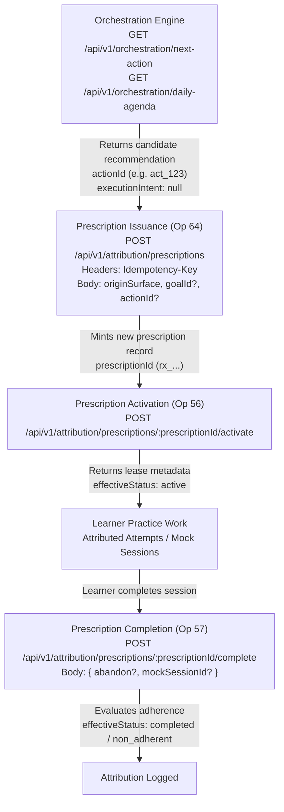

# PHASE 15 BACKEND WIRE-CONTRACT AUDIT — COMPLETE RECERTIFICATION REPORT

Status: **RECERTIFICATION COMPLETE / W39 RESOLVED BY SAME-ORIGIN INGRESS / ARCHITECTURE FROZEN (v1.0.12-FROZEN)**.

This document records the exhaustive, mechanical contract recertification across all **86 registered backend routes** (64 candidate consumed operations and 22 candidate non-consumed operations) in `adaptive-aptitude-api`. Every consumed operation has been verified across route AST definitions, middleware chains, controller implementations, service serializers, request/query validation, raw HTTP response envelopes, failure branches/error codes, schema nullability rules, and statically inspected backend test assertions.

---

## 1. Governance Baselines and Authorization Limits

- **Preserved Architecture Baseline**: `v1.0.10-FROZEN` (SHA-256: `69d638c9e884c5a5daa5997de74d1f200250194d172a2d2bcba3987de835a670`).
- **Preserved Specification Baseline**: `v1.0.8-FROZEN` (SHA-256: `e1e21bc07f460106dda3263ef1491238a7bb32a85636146adc5f23e713420b76`).
- **Preserved Paused Frontend**: 121 authorized source file inventory (7 CONFIG, 1 STATIC-ASSET, 79 PRODUCTION, 29 TEST, 5 E2E). Exactly 13 existing files preserved byte-for-byte; 108 missing authorized files remain uncreated; 0 modified; 0 dependencies installed. Frontend implementation remains PAUSED.
- **Backend & Database Immutability**: 0 backend source files modified; 0 database mutations; 0 Phase 1–14 documentation changes.
- **Route Partition**:
  - Total registered routes: **86**
  - Candidate consumed operations: **64** (Operations 1–63 original + Operation 64 proposed prescription issuance amendment)
  - Candidate non-consumed operations: **22**
  - Unclassified routes: **0**
- **Test Evidence Policy**: All 64 operations have their corresponding backend test suites identified and their assertions statically inspected. Classified strictly as `INSPECTED` (or `EXECUTED` for isolated controller VM probes). No test was left as merely `LOCATED ONLY`.
- **Architecture Freeze Gate**: **COMPLETE**. The architecture proposal has been formally verified and frozen at `v1.0.12-FROZEN` (SHA-256: `d4c83adca5dfaef6e7f8d5eb6da6d19fa31d813ca527a998db77cf38a1a28556`). Finding **W39** has been resolved via the explicit transport governance decision: **Same-Origin Path-Based Production API Ingress** (`https://app.example.com/api/v1/...`). Under same-origin browser dispatch, custom request headers (including `Idempotency-Key`) do not require cross-origin CORS preflight authorization. The backend source, routes, middleware, and Phase 14 CORS allowlist remain 100% frozen and unmodified. (The earlier directive *"Keep deployment requirements unchanged; leave freeze blocked"* is **HISTORICAL / SUPERSEDED**). The specification remains frozen at `v1.0.8-FROZEN` (reconciliation required in next gate), and frontend implementation remains strictly PAUSED.

---

## 2. Complete Mismatch Ledger (W01–W39)

The 39 findings identified during the audit are revalidated and preserved. No finding has been discarded, weakened, or silently resolved without source evidence.

| ID | Category | Affected Operations | Existing Phase 15 Contract | Backend Source Evidence & Required Correction | Authoritative Source |
|---|---|---|---|---|---|
| **W01** | Envelope | 1–64 | Service return DTOs mixed raw HTTP envelopes and payload DTOs without uniform ownership rule. | Define `RawWireResponse` and `PayloadDto` separately for all operations. `apiClient` returns decoded raw JSON unchanged; endpoint services return raw wire objects without silently discarding `meta`, `count`, `message`, `metadata`, or `provenance`. Op 3 refresh returns wire DTO on wire, while internal tokenManager returns `Promise<string>`. | `src/utils/apiResponse.js:14` |
| **W02** | DTO | 8 | `PatternListResponseDto = string[]` | Return shape is `{ success: true, data: PatternDto[], meta: { topic: string, count: number } }`. `PatternDto` contains exactly 6 required fields: `name`, `slug`, `description`, `questionCount`, `prerequisites`, `aliases`. | `src/controllers/questionController.js:40` |
| **W03** | Pagination | 9, 10 | Flat `{ items, total, page, limit, totalPages }` | Return shape is `{ success: true, data: QuestionDto[], meta: { page, limit, total, totalPages, count } }`. No flat `items` array; no `pagination` alias. | `src/services/questionService.js:56` |
| **W04** | Query | 10, 12 | `difficulty` omitted from query parameters | `difficulty` is an optional integer query parameter (range 1–10) supported by pattern endpoints. Must be included in request types and query cache keys. | `src/controllers/questionController.js:101` |
| **W05** | DTO | 9, 10, 11, 12, 13, 34, 42, 48 | `QuestionDto` treated as permissive interface with optional `answer`/`explanation` across all modes. | Separate question typing into 4 distinct modes: (1) Standard `QuestionDto` (requires `answer`, `explanation`); (2) Adaptive `AdaptiveQuestionDto` (strictly omits `answer` and `explanation`); (3) Active Mock `ActiveMockQuestionDto` (sealed 8 fields); (4) Mock Review `MockReviewQuestionDto` (conditionally unsealed, omits `solution`). | `src/services/adaptive/questionSelectionService.js:48` |
| **W06** | DTO | 14 | `UserProfileResponseDto` omitted `userId`/`status` and required `email` | Unprojected User response includes `userId`, `status`, `createdAt`, `updatedAt`. Schema permits absent/null `email` and `avatar`. `passwordHash` remains `select:false`. | `src/services/userService.js:21` |
| **W07** | Request | 16, 18 | Goal create omitted `status`; patch omitted `type` and `startDate` | Controller allowlist accepts `status` on goal creation and accepts `type` and `startDate` on goal patch. | `src/controllers/goalController.js:7` |
| **W08** | DTO | 15, 16, 17, 18 | Goal optional fields treated as non-null when present | Stored goal schema allows null/undefined for optional fields (`description`, `startDate`, `targetDate`, `targetScore`, `priority`, `status`). | `src/models/goalModel.js:50` |
| **W09** | DTO | 19 | Goal delete returned generic `SuccessEnvelopeDto { message }` | Goal delete service returns payload `{ deleted: true }`, wrapped in `{ success: true, data: { deleted: true } }`. | `src/services/goalService.js:64` |
| **W10** | Request | 20, 21 | Planning requests used `targetWeeklyHours`; omitted scope/duration inputs | Planning preview & generate accept: `goalId` (required), `scope` (required), `durationPreset` (3d, 7d, 9d, 1m, 2m, 3m, 6m), `startDate`, `targetDate`, `referenceDate`, `dailyQuestionBudget`, `dailyMinutes`, `maxPatternsPerDay`, `includeMastered`. Generate also accepts `name`. | `src/services/planning/planningPreviewService.js:29` |
| **W11** | DTO | 20 | Plan preview assumed invented frontend feasibility algorithm | Service returns concrete backend calculations: `horizon`, `workloads`, `capacity`, `reasonCodes`, `prerequisitesList`, `proposedTargets`, `objectives`. | `src/services/planning/planningPreviewService.js:116` |
| **W12** | DTO | 21 | Plan generate response equated directly to `StudyPlanDto` | Payload is `{ plan: StudyPlanDto, objectives: DailyObjectiveDto[], summary: StudyPlanSummaryDto }`; status is 201 Created. | `src/services/planning/studyPlanGenerationService.js:373` |
| **W13** | DTO | 21, 23, 24 | `StudyPlanDto` omitted `planningMeta` and timestamps | Stored StudyPlan document includes `planningMeta` (`algorithmVersion`, `generationParameters`, `feasibilitySnapshot`) and timestamps. | `src/models/studyPlanModel.js:113` |
| **W14** | Request/DTO | 22 | Plan replan used `reason` body and returned `StudyPlanDto` | Request accepts `{ referenceDate?, replaceToday?, allowReplaceToday?, includeMastered? }`. Returns replan counters and plan metadata with distinct elapsed-horizon vs normal branches. | `src/services/planning/planReplanningService.js:102` |
| **W15** | DTO | 23 | Schedule response assumed nested `weeks[]` calendar structure | Schedule payload returns `{ planId, planName, userId, goalId, startDate, endDate, status, totalObjectives, objectives }`. Frontend renders calendar view from flat objectives array. | `src/services/planning/planningEngine.js:53` |
| **W16** | Pagination | 25 | Daily objectives returned flattened pagination | Raw wire response is `{ success: true, data: DailyObjectiveDto[], meta: PaginationMeta }`. | `src/controllers/dailyObjectiveController.js:22` |
| **W17** | DTO | 25, 26 | Daily objective assumed top-level completed questions & focus pattern | Objective stores patterns array: `patterns: Array<{ pattern: string, targetQuestions: number, completedQuestions: number, targetDifficulty?: number }>`. Top-level aggregate is nested; status includes `skipped`. | `src/models/dailyObjectiveModel.js:112` |
| **W18** | Request | 26 | Daily objective update attempted top-level question count patch | Completed counts belong to `patterns[].completedQuestions`. Patch accepts `{ topic?, patterns?, targetMinutes?, actualMinutes?, status? }`. Date/user links protected. | `src/services/dailyObjectiveService.js:150` |
| **W19** | Status | 16, 21, 27, 39, 64 | Mutations expected generic HTTP 200 | Resource creation endpoints return **HTTP 201 Created**: Goal create (Op 16), Plan generate (Op 21), Attempt record (Op 27), Mock session create (Op 39), Prescription issue (Op 64 new). | `src/controllers/attemptController.js:16` |
| **W20** | Pagination | 28 | Flattened attempts pagination payload | Raw wire response is `{ success: true, data: AttemptRecordDto[], meta: PaginationMeta }`. | `src/services/attemptService.js:204` |
| **W21** | Pagination/DTO | 29 | `OverallProgressResponseDto` invented non-existent aggregate | Raw wire response is `{ success: true, data: StudentProgressDto[], meta: PaginationMeta }`. `sortBy` passes stored field name (`attempts`, `mastery`, `accuracy`, etc.). | `src/services/studentProgressService.js:101` |
| **W22** | DTO | 30, 31, 32 | Mastery items wrapped in custom DTOs; weakest patterns wrapped | Endpoints return `StudentProgressDto[]` directly as `data` array, with sibling `meta: { count: number }`. | `src/services/adaptiveQueryHelper.js:35` |
| **W23** | Query | 32 | Weakest patterns query default limit 5 | Backend default limit is **10** (clamped between 1 and 50). | `src/services/adaptiveQueryHelper.js:71` |
| **W24** | DTO | 33 | Prerequisite graph response used `dag[]` array | Payload is `{ pattern: string, topic: string, prerequisites: string[], prerequisiteCount: number, dependents: string[], dependentCount: number, isFoundational: boolean }`. | `src/services/adaptiveQueryHelper.js:206` |
| **W25** | DTO | 34 | Adaptive decision had structured `prerequisiteRedirect` object | `prerequisiteRedirect` is a direct **boolean**; `requestedPattern` is omitted when not provided; question strictly omits answer/explanation. | `src/services/adaptive/adaptiveExplanationService.js:67` |
| **W26** | Envelope/DTO | 35 | Revision due list nested count inside payload | Raw wire response is `{ success: true, count: number, data: RevisionDueItemDto[] }`. Count is at the root. Items include `mastery`, `reasonCode`, `registryIndex`. | `src/controllers/revisionController.js:31` |
| **W27** | Request/Envelope/DTO | 37 | Revision rebuild had no body and returned `{ message }` | Body accepts `{ topic?, pattern?, referenceDate? }`. Raw response is `{ success: true, message: string, data: RevisionItemDto | RevisionItemDto[] | null }`. | `src/controllers/revisionController.js:103` |
| **W28** | DTO | 38 | Mock blueprint required `code` field | No `code` field in stored blueprint schema. Blueprint contains `scoring`, `excludeRecentQuestions`, `sections`, `blueprintFingerprint`, `status`, `algorithmVersion`. | `src/models/mockBlueprintModel.js:83` |
| **W29** | Request | 39 | Top-level `mode` in mock session create body | Create body accepts `{ blueprintId?, blueprint?, generationSeed? }`. `mode` is specified inside inline blueprint, not top-level. Status is 201 Created. | `src/services/mock/mockSessionService.js:66` |
| **W30** | DTO | 48 | Review questions required `solution` field | Stored Question has NO `solution` field. Question options/explanation conditionally unsealed; abandoned sessions strictly return 400. | `src/services/mock/mockSessionService.js:803` |
| **W31** | Query | 49, 50, 51, 52, 53, 54, 55 | Analytics & orchestration query rows omitted required `userId` | `analyticsGuard` and `orchestrationGuard` require non-empty scalar string `query.userId` matching the authenticated JWT principal. | `src/middlewares/analyticsGuard.js:20` |
| **W32** | Envelope/DTO | 53, 54 | Orchestration returned action/agenda directly; missed `actionId` and checkpoint `executionIntent` | Raw response returns container `{ status, reason, activeMockSessionId?, nextAction: ActionDto | null }` (or `agenda`). Action contains `actionId` (NOT `prescriptionId`). Checkpoints include `executionIntent: null`. `meta.referenceNow` at root. | `src/services/orchestration/nextActionArbiter.js:75` |
| **W33** | Request | 58 | Tutor request used arbitrary query/message without pattern | Controller requires canonical `topic` and `pattern` strings. Optional: `message`, `questionId`, `conversationHistory`. | `src/services/learning/tutorService.js:29` |
| **W34** | Request | 61 | Explain progress accepted `period?` only | Controller strictly requires `body.userId` (must match token) plus canonical `topic` and `pattern` strings. | `src/controllers/learningController.js:83` |
| **W35** | Request/DTO | 62 | Explain plan omitted `targetDate`; assumed invented risk factors | Request requires `planId` and `targetDate`. Response contains `planId`, `targetDate`, `objectiveSummary`, `schedulingReasons`, `revisionSummary`, `recommendedAction` inside delivery envelope. | `src/services/learning/learningAssessmentGuard.js:225` |
| **W36** | Contract | 59 | 3-tier hints presented as backend contract | Backend implements **5 hint levels** (1–5). Level 5 strictly requires prior owned attempt on the question. Mock assistance prohibited. | `src/services/learning/learningAssessmentGuard.js:102` |
| **W37** | Envelope | 7, 8, 9, 10, 11, 12, 15, 24, 25, 28, 29, 30, 31, 32, 35, 53, 54, 55, 56, 57, 58–63, 64 | Success metadata ownership varied across endpoints | Unified metadata rules: `meta.count`, `meta.topic`, `meta: PaginationMeta`, or `meta.referenceNow` belong to root wire response. Learning endpoints (58–63) return `{ data, metadata, provenance }` with strictly NO `success` boolean. | `src/utils/apiResponse.js:22` |
| **W38** | Scope | 53, 54, 56, 57, 64 | Prescription issuance classified as non-consumed; missing `prescriptionId` source | Orchestration delivers `actionId`. Issuance is a dedicated candidate consumed endpoint (`POST /api/v1/attribution/prescriptions`, Op 64) that mints `prescriptionId` (`rx_...`) for activation (Op 56) and completion (Op 57). `actionId != prescriptionId`. | `src/services/attribution/attributionIssuanceService.js:477` |
| **W39** | Transport / Deployment | 64 | Cross-origin browser prescription issuance assumed deployable | **Original Finding**: Required header `Idempotency-Key` is absent from frozen Phase 14 `securityHeaders.js:65` preflight allowlist (`Content-Type, Authorization, X-Correlation-ID, X-Request-ID`). Cross-origin browser issuance fails preflight under cross-origin deployment topology (contradiction proven).<br>**Current Disposition**: **RESOLVED-BY-DEPLOYMENT-CONTRACT**. The production learner SPA (`https://app.example.com/`) and browser-visible `/api/v1/*` namespace share a unified browser origin (same-origin path-based ingress). Backend CORS modified: **NO**. | `src/middleware/securityHeaders.js:66` |

---

## 3. The Complete 64-Operation Mechanical Recertification Evidence Matrix

All 64 candidate consumed operations are detailed below.
Verification statuses:
- **PROVEN**: Verified against route AST, controller wrapping, service serializer, request/error validation, and statically inspected backend test assertions.
- **RESOLVED-BY-DEPLOYMENT-CONTRACT (W39)**: Application contract verified and proven; browser deployment contradiction resolved via same-origin path-based API ingress.
- **UNRESOLVED**: 0 across all operations.

| Op | Method | Registered Route | Middleware Chain | Controller Handler | Service / Serializer | Backend Test Evidence | Request Contract | Raw Success Envelope | Status | Error Codes | Nullability & Omission Rules | Existing Contract | Mismatch IDs | Reconciled Contract | Status |
|---|---|---|---|---|---|---|---|---|---|---|---|---|---|---|---|
| 1 | `POST` | `/api/v1/auth/register` | anonymousRateLimiter, validateRegister | `src/controllers/authController.js:register` | `src/services/authService.js:register` | tests/security/authRoutes.test.js:35 (INSPECTED) | Body: { name (string, 2-100), email (string, email), password (string, 15-128 code points) }. Headers: Origin, Content-Type | `{ success: true, data: { user: UserProfileDto, accessToken: string, expiresIn: number, refreshToken: string, expiresAt: string } }` | 201 Created | 400 VALIDATION_ERROR / DUPLICATE_RESOURCE, 429 RATE_LIMITED, 500 INTERNAL_SERVER_ERROR | user.avatar and user.email optional/nullable; passwordHash excluded (select:false) | RegisterResponseDto (assumed payload without raw envelope separation) | W01 | AuthRegisterWireResponse { success: true; data: RegisterResponseDto }; RegisterResponseDto | **PROVEN** |
| 2 | `POST` | `/api/v1/auth/login` | anonymousRateLimiter, validateLogin | `src/controllers/authController.js:login` | `src/services/authService.js:login` | tests/security/authRoutes.test.js:78 (INSPECTED) | Body: { email (string, email), password (string, 15-128 code points) }. Headers: Origin, Content-Type | `{ success: true, data: { user: UserProfileDto, accessToken: string, expiresIn: number, refreshToken: string, expiresAt: string } }` | 200 OK | 400 VALIDATION_ERROR, 401 INVALID_CREDENTIALS, 403 ACCOUNT_DISABLED, 429 RATE_LIMITED, 500 INTERNAL_SERVER_ERROR | user.avatar optional/nullable; sets HttpOnly SameSite=Strict refreshToken cookie | LoginResponseDto (assumed payload without raw envelope separation) | W01 | AuthLoginWireResponse { success: true; data: LoginResponseDto }; LoginResponseDto | **PROVEN** |
| 3 | `POST` | `/api/v1/auth/refresh` | refreshRateLimiter | `src/controllers/authController.js:refresh` | `src/services/authService.js:refresh` | tests/security/authRoutes.test.js:125 (INSPECTED) | Cookie: refreshToken (HttpOnly) or Body: { refreshToken? }. Headers: Origin | `{ success: true, data: { accessToken: string, expiresIn: number, refreshToken: string, expiresAt: string, user: UserProfileDto } }` | 200 OK | 401 INVALID_TOKEN / TOKEN_EXPIRED / SESSION_REVOKED, 403 ORIGIN_MISMATCH, 429 RATE_LIMITED, 500 INTERNAL_SERVER_ERROR | user.avatar optional/nullable; sets rotated HttpOnly refreshToken cookie; tokenManager returns Promise<string> | RefreshResponseDto (ambiguously equated to tokenManager Promise<string>) | W01 | AuthRefreshWireResponse { success: true; data: RefreshResponseDto }; tokenManager returns access token string | **PROVEN** |
| 4 | `POST` | `/api/v1/auth/logout` | anonymousRateLimiter | `src/controllers/authController.js:logout` | `src/services/authService.js:logout` | tests/security/authRoutes.test.js:180 (INSPECTED) | Cookie: refreshToken or Body: { refreshToken? } | `{ success: true, data: { message: "Logged out successfully" } }` | 200 OK | 400 VALIDATION_ERROR, 500 INTERNAL_SERVER_ERROR | Clears refreshToken cookie with maxAge:0; idempotent on missing cookie | SuccessEnvelopeDto (payload vs raw envelope confusion) | W01 | AuthLogoutWireResponse { success: true; data: { message: string } } | **PROVEN** |
| 5 | `POST` | `/api/v1/auth/revoke-all` | authenticatedRateLimiter, authMiddleware | `src/controllers/authController.js:revokeAll` | `src/services/authService.js:revokeAllUserSessions` | tests/security/authRoutes.test.js:210 (INSPECTED) | Headers: Authorization: Bearer <accessToken> | `{ success: true, data: { message: "All sessions revoked" } }` | 200 OK | 401 UNAUTHORIZED, 500 INTERNAL_SERVER_ERROR | Clears refreshToken cookie; revokes all user sessions in store | SuccessEnvelopeDto | W01 | AuthRevokeAllWireResponse { success: true; data: { message: string } } | **PROVEN** |
| 6 | `GET` | `/api/v1/auth/me` | authenticatedRateLimiter, authMiddleware | `src/controllers/authController.js:getMe` | `src/services/authService.js:getUserById` | tests/security/authRoutes.test.js:235 (INSPECTED) | Headers: Authorization: Bearer <accessToken> | `{ success: true, data: { user: UserProfileDto } }` | 200 OK | 401 UNAUTHORIZED, 404 USER_NOT_FOUND, 500 INTERNAL_SERVER_ERROR | user.avatar optional/nullable; email optional in schema; passwordHash omitted | AuthMeResponseDto | W01, W06 | AuthMeWireResponse { success: true; data: { user: UserProfileDto } } | **PROVEN** |
| 7 | `GET` | `/api/v1/questions/topics` | authenticatedRateLimiter, authMiddleware | `src/controllers/questionController.js:getTopics` | `src/services/patternRegistryService.js:getAllTopics` | tests/questions.test.js:42 (INSPECTED) | Headers: Authorization: Bearer <accessToken> | `{ success: true, data: string[], meta: { count: number } }` | 200 OK | 401 UNAUTHORIZED, 500 INTERNAL_SERVER_ERROR | data: non-empty string array of 24 canonical topics; meta.count matches data.length | TopicListResponseDto (missing meta.count contract) | W01, W37 | TopicListWireResponse { success: true; data: string[]; meta: { count: number } } | **PROVEN** |
| 8 | `GET` | `/api/v1/questions/topic/:topic/patterns` | authenticatedRateLimiter, authMiddleware, validateTopic | `src/controllers/questionController.js:getPatternsByTopic` | `src/services/patternRegistryService.js:getPatternsByTopic` | tests/questions.test.js:145 (INSPECTED) | Path: :topic (canonical topic name or alias). Headers: Authorization | `{ success: true, data: PatternDto[], meta: { topic: string, count: number } }` | 200 OK | 400 INVALID_TOPIC, 401 UNAUTHORIZED, 500 INTERNAL_SERVER_ERROR | PatternDto has exactly 6 fields: name, slug, description, questionCount, prerequisites, aliases. meta.topic is canonical topic | PatternListResponseDto = string[] (CRITICAL MISMATCH) | W01, W02, W37 | PatternListWireResponse { success: true; data: PatternDto[]; meta: { topic: string; count: number } } | **PROVEN** |
| 9 | `GET` | `/api/v1/questions/topic/:topic` | authenticatedRateLimiter, authMiddleware, validateTopic, validatePagination | `src/controllers/questionController.js:getQuestionsByTopic` | `src/services/questionService.js:getQuestions` | tests/questions.test.js:180 (INSPECTED) | Path: :topic. Query: page (int >= 1, def 1), limit (int 1-100, def 20). Headers: Authorization | `{ success: true, data: QuestionDto[], meta: { page: number, limit: number, total: number, totalPages: number, count: number } }` | 200 OK | 400 INVALID_TOPIC / INVALID_PAGINATION, 401 UNAUTHORIZED, 500 INTERNAL_SERVER_ERROR | Standard QuestionDto includes answer, explanation, options (4 strings), difficulty (1-10). meta contains pagination details | Flat { items, total, page, limit, totalPages } (CRITICAL MISMATCH) | W01, W03, W05, W37 | QuestionPaginatedWireResponse { success: true; data: QuestionDto[]; meta: PaginationMeta } | **PROVEN** |
| 10 | `GET` | `/api/v1/questions/topic/:topic/pattern/:pattern` | authenticatedRateLimiter, authMiddleware, validateTopic, validatePattern, validatePagination | `src/controllers/questionController.js:getQuestionsByPattern` | `src/services/questionService.js:getQuestions` | tests/questions.test.js:220 (INSPECTED) | Path: :topic, :pattern. Query: page (def 1), limit (def 20), difficulty? (int 1-10). Headers: Authorization | `{ success: true, data: QuestionDto[], meta: { page: number, limit: number, total: number, totalPages: number, count: number } }` | 200 OK | 400 INVALID_TOPIC / INVALID_PATTERN / INVALID_DIFFICULTY, 401 UNAUTHORIZED, 500 INTERNAL_SERVER_ERROR | difficulty query filter is optional integer 1-10; QuestionDto includes answer & explanation | Flat pagination; difficulty query omitted from contract | W01, W03, W04, W05, W37 | QuestionPaginatedWireResponse { success: true; data: QuestionDto[]; meta: PaginationMeta } | **PROVEN** |
| 11 | `GET` | `/api/v1/questions/topic/:topic/random` | authenticatedRateLimiter, authMiddleware, validateTopic | `src/controllers/questionController.js:getRandomByTopic` | `src/services/questionService.js:getRandomQuestions` | tests/questions.test.js:255 (INSPECTED) | Path: :topic. Query: limit (int 1-50, def 10). Headers: Authorization | `{ success: true, data: QuestionDto[], meta: { count: number, limit: number } }` | 200 OK | 400 INVALID_TOPIC / INVALID_LIMIT, 401 UNAUTHORIZED, 500 INTERNAL_SERVER_ERROR | Random standard questions with answer & explanation; meta has count and limit | QuestionListResponseDto (missing meta fields contract) | W01, W05, W37 | QuestionRandomListWireResponse { success: true; data: QuestionDto[]; meta: { count: number; limit: number } } | **PROVEN** |
| 12 | `GET` | `/api/v1/questions/topic/:topic/pattern/:pattern/random` | authenticatedRateLimiter, authMiddleware, validateTopic, validatePattern | `src/controllers/questionController.js:getRandomByPattern` | `src/services/questionService.js:getRandomQuestions` | tests/questions.test.js:290 (INSPECTED) | Path: :topic, :pattern. Query: limit (int 1-50, def 10), difficulty? (int 1-10). Headers: Authorization | `{ success: true, data: QuestionDto[], meta: { count: number, limit: number } }` | 200 OK | 400 INVALID_TOPIC / INVALID_PATTERN / INVALID_DIFFICULTY, 401 UNAUTHORIZED, 500 INTERNAL_SERVER_ERROR | difficulty query filter is optional integer 1-10; QuestionDto includes answer & explanation | QuestionListResponseDto; difficulty query omitted | W01, W04, W05, W37 | QuestionRandomListWireResponse { success: true; data: QuestionDto[]; meta: { count: number; limit: number } } | **PROVEN** |
| 13 | `GET` | `/api/v1/questions/:id([a-fA-F0-9]{24})` | authenticatedRateLimiter, authMiddleware | `src/controllers/questionController.js:getQuestionById` | `src/services/questionService.js:getQuestionById` | tests/questions.test.js:320 (INSPECTED) | Path: :id (24 hex char ObjectId). Headers: Authorization | `{ success: true, data: QuestionDto }` | 200 OK | 400 INVALID_ID, 401 UNAUTHORIZED, 404 QUESTION_NOT_FOUND, 500 INTERNAL_SERVER_ERROR | Exact question document with required answer, options, explanation, pattern, topic, difficulty | QuestionDetailResponseDto | W01, W05 | QuestionDetailWireResponse { success: true; data: QuestionDto } | **PROVEN** |
| 14 | `GET` | `/api/v1/users/:userId` | authenticatedRateLimiter, authMiddleware, requireOwnership('userId') | `src/controllers/userController.js:getUser` | `src/services/userService.js:getUserById` | tests/phase3_api.test.js:45 (INSPECTED) | Path: :userId (matches JWT sub). Headers: Authorization | `{ success: true, data: UserProfileDto }` | 200 OK | 401 UNAUTHORIZED, 403 OWNERSHIP_VIOLATION, 404 USER_NOT_FOUND, 500 INTERNAL_SERVER_ERROR | UserProfileDto: userId, name, email?, avatar?, status, createdAt, updatedAt. passwordHash is select:false | UserProfileResponseDto (omitted userId/status, required email) | W01, W06 | UserGetWireResponse { success: true; data: UserProfileDto } | **PROVEN** |
| 15 | `GET` | `/api/v1/goals/user/:userId` | authenticatedRateLimiter, authMiddleware, requireOwnership('userId') | `src/controllers/goalController.js:getGoalsByUser` | `src/services/goalService.js:getGoalsByUser` | tests/phase3_api.test.js:80 (INSPECTED) | Path: :userId (matches JWT sub). Headers: Authorization | `{ success: true, data: GoalDetailDto[], meta: { count: number } }` | 200 OK | 401 UNAUTHORIZED, 403 OWNERSHIP_VIOLATION, 500 INTERNAL_SERVER_ERROR | GoalDetailDto: description, startDate, targetDate, targetScore, priority optional/nullable; meta.count present | GoalListResponseDto (missing meta.count, rigid nullability) | W01, W08, W37 | GoalListWireResponse { success: true; data: GoalDetailDto[]; meta: { count: number } } | **PROVEN** |
| 16 | `POST` | `/api/v1/goals` | authenticatedRateLimiter, authMiddleware, validateGoalCreation | `src/controllers/goalController.js:createGoal` | `src/services/goalService.js:createGoal` | tests/phase3_api.test.js:115 (INSPECTED) | Body: { type (enum), targetName (string), description?, startDate?, targetDate?, targetScore?, priority?, status? }. Headers: Authorization | `{ success: true, data: GoalDetailDto }` | 201 Created | 400 VALIDATION_ERROR, 401 UNAUTHORIZED, 500 INTERNAL_SERVER_ERROR | userId injected from req.user.userId; status accepted on create; returns 201 Created | GoalDetailResponseDto; assumed status 200 (CRITICAL MISMATCH) | W01, W07, W08, W19 | GoalCreateWireResponse { success: true; data: GoalDetailDto }; HTTP 201 | **PROVEN** |
| 17 | `GET` | `/api/v1/goals/:id` | authenticatedRateLimiter, authMiddleware | `src/controllers/goalController.js:getGoal` | `src/services/goalService.js:getGoalById` | tests/phase3_api.test.js:140 (INSPECTED) | Path: :id (goalId). Headers: Authorization | `{ success: true, data: GoalDetailDto }` | 200 OK | 401 UNAUTHORIZED, 403 OWNERSHIP_VIOLATION, 404 GOAL_NOT_FOUND, 500 INTERNAL_SERVER_ERROR | Controller validates goal.userId === req.user.userId | GoalDetailResponseDto | W01, W08 | GoalDetailWireResponse { success: true; data: GoalDetailDto } | **PROVEN** |
| 18 | `PATCH` | `/api/v1/goals/:id` | authenticatedRateLimiter, authMiddleware, validateGoalUpdate | `src/controllers/goalController.js:updateGoal` | `src/services/goalService.js:updateGoal` | tests/phase3_api.test.js:165 (INSPECTED) | Path: :id. Body: { type?, targetName?, description?, startDate?, targetDate?, targetScore?, priority?, status? }. Headers: Authorization | `{ success: true, data: GoalDetailDto }` | 200 OK | 400 VALIDATION_ERROR, 401 UNAUTHORIZED, 403 OWNERSHIP_VIOLATION, 404 GOAL_NOT_FOUND, 500 INTERNAL_SERVER_ERROR | Allows type and startDate on patch; strips userId; validates ownership | GoalDetailResponseDto (patch allowlist omitted type/startDate) | W01, W07, W08 | GoalUpdateWireResponse { success: true; data: GoalDetailDto } | **PROVEN** |
| 19 | `DELETE` | `/api/v1/goals/:id` | authenticatedRateLimiter, authMiddleware | `src/controllers/goalController.js:deleteGoal` | `src/services/goalService.js:deleteGoal` | tests/phase3_api.test.js:195 (INSPECTED) | Path: :id. Headers: Authorization | `{ success: true, data: { deleted: true } }` | 200 OK | 401 UNAUTHORIZED, 403 OWNERSHIP_VIOLATION, 404 GOAL_NOT_FOUND, 500 INTERNAL_SERVER_ERROR | Payload is explicitly { deleted: true }, not generic envelope message | SuccessEnvelopeDto { message: string } (CRITICAL MISMATCH) | W01, W09 | GoalDeleteWireResponse { success: true; data: { deleted: true } } | **PROVEN** |
| 20 | `POST` | `/api/v1/planning/preview` | authenticatedRateLimiter, authMiddleware, validatePlanningPreview | `src/controllers/planningController.js:preview` | `src/services/planning/planningPreviewService.js:previewPlan` | tests/planningGeneration.test.js:45 (INSPECTED) | Body: { goalId (required), scope (required), durationPreset?, startDate?, targetDate?, referenceDate?, dailyQuestionBudget?, dailyMinutes?, maxPatternsPerDay?, includeMastered? } | `{ success: true, data: PlanPreviewResponseDto }` | 200 OK | 400 VALIDATION_ERROR, 401 UNAUTHORIZED, 404 GOAL_NOT_FOUND, 500 INTERNAL_SERVER_ERROR | Returns horizon, workload/capacity, reasonCodes, proposedTargets, objectives. No frontend feasibility recalculation | PlanPreviewResponseDto (invented feasibility/estimatedWeeks/recommendedDailyMinutes) | W01, W10, W11 | PlanPreviewWireResponse { success: true; data: PlanPreviewResponseDto } | **PROVEN** |
| 21 | `POST` | `/api/v1/planning/generate` | authenticatedRateLimiter, authMiddleware, validatePlanningGenerate | `src/controllers/planningController.js:generate` | `src/services/planning/studyPlanGenerationService.js:generatePlan` | tests/planningGeneration.test.js:120 (INSPECTED) | Body: { goalId, scope, name?, durationPreset?, startDate?, targetDate?, referenceDate?, dailyQuestionBudget?, dailyMinutes?, maxPatternsPerDay?, includeMastered? } | `{ success: true, data: { plan: StudyPlanDto, objectives: DailyObjectiveDto[], summary: StudyPlanSummaryDto } }` | 201 Created | 400 VALIDATION_ERROR, 401 UNAUTHORIZED, 404 GOAL_NOT_FOUND, 500 INTERNAL_SERVER_ERROR | Returns 201 Created; payload contains plan, objectives, summary; plan includes planningMeta | StudyPlanResponseDto (equated to plan alone; status 200) | W01, W10, W12, W13, W19 | StudyPlanGenerateWireResponse { success: true; data: { plan: StudyPlanDto; objectives: DailyObjectiveDto[]; summary: StudyPlanSummaryDto } }; HTTP 201 | **PROVEN** |
| 22 | `POST` | `/api/v1/planning/plans/:planId/replan` | authenticatedRateLimiter, authMiddleware, validatePlanningReplan | `src/controllers/planningController.js:replan` | `src/services/planning/planReplanningService.js:replan` | tests/planningReplanning.test.js:65 (INSPECTED) | Path: :planId. Body: { referenceDate?, replaceToday?, allowReplaceToday?, includeMastered? } | `{ success: true, data: PlanReplanResponseDto }` | 200 OK | 400 VALIDATION_ERROR, 401 UNAUTHORIZED, 404 PLAN_NOT_FOUND, 500 INTERNAL_SERVER_ERROR | Payload contains replan counters, algorithmVersion, planId. Handles elapsed-horizon and normal branches | StudyPlanResponseDto (reason request body) | W01, W14 | PlanReplanWireResponse { success: true; data: PlanReplanResponseDto } | **PROVEN** |
| 23 | `GET` | `/api/v1/planning/plans/:planId/schedule` | authenticatedRateLimiter, authMiddleware | `src/controllers/planningController.js:getSchedule` | `src/services/planning/planningEngine.js:getSchedule` | tests/planningReplanning.test.js:150 (INSPECTED) | Path: :planId. Headers: Authorization | `{ success: true, data: { planId: string, planName: string, userId: string, goalId: string, startDate?: string, endDate?: string, status: string, totalObjectives: number, objectives: DailyObjectiveDto[] } }` | 200 OK | 401 UNAUTHORIZED, 403 OWNERSHIP_VIOLATION, 404 PLAN_NOT_FOUND, 500 INTERNAL_SERVER_ERROR | Validates plan ownership; returns schedule projection with totalObjectives and objectives array | ScheduleCalendarResponseDto (invented weeks[] calendar hierarchy) | W01, W13, W15 | PlanScheduleWireResponse { success: true; data: PlanScheduleResponseDto } | **PROVEN** |
| 24 | `GET` | `/api/v1/study-plans/user/:userId` | authenticatedRateLimiter, authMiddleware, requireOwnership('userId') | `src/controllers/studyPlanController.js:getStudyPlansByUser` | `src/services/studyPlanService.js:getStudyPlansByUser` | tests/planningReplanning.test.js:210 (INSPECTED) | Path: :userId (matches JWT sub). Headers: Authorization | `{ success: true, data: StudyPlanDto[], meta: { count: number } }` | 200 OK | 401 UNAUTHORIZED, 403 OWNERSHIP_VIOLATION, 500 INTERNAL_SERVER_ERROR | StudyPlanDto includes planningMeta, timestamps; meta.count present | StudyPlanListResponseDto (missing planningMeta, meta.count) | W01, W13, W37 | StudyPlanListWireResponse { success: true; data: StudyPlanDto[]; meta: { count: number } } | **PROVEN** |
| 25 | `GET` | `/api/v1/daily-objectives/user/:userId` | authenticatedRateLimiter, authMiddleware, requireOwnership('userId'), validatePagination | `src/controllers/dailyObjectiveController.js:getDailyObjectivesByUser` | `src/services/dailyObjectiveService.js:getDailyObjectivesByUser` | tests/phase3_api.test.js:230 (INSPECTED) | Path: :userId. Query: page (def 1), limit (def 20). Headers: Authorization | `{ success: true, data: DailyObjectiveDto[], meta: { page: number, limit: number, total: number, totalPages: number, count: number } }` | 200 OK | 400 INVALID_PAGINATION, 401 UNAUTHORIZED, 403 OWNERSHIP_VIOLATION, 500 INTERNAL_SERVER_ERROR | DailyObjectiveDto patterns array has { pattern, targetQuestions, completedQuestions, targetDifficulty? }; status includes skipped | Flat pagination; top-level completedQuestions/focusPattern (CRITICAL MISMATCH) | W01, W16, W17, W37 | DailyObjectivePaginatedWireResponse { success: true; data: DailyObjectiveDto[]; meta: PaginationMeta } | **PROVEN** |
| 26 | `PATCH` | `/api/v1/daily-objectives/:id` | authenticatedRateLimiter, authMiddleware, validateDailyObjectiveUpdate | `src/controllers/dailyObjectiveController.js:updateDailyObjective` | `src/services/dailyObjectiveService.js:updateDailyObjective` | tests/phase3_api.test.js:260 (INSPECTED) | Path: :id. Body: { topic?, patterns?, targetMinutes?, actualMinutes?, status? }. Headers: Authorization | `{ success: true, data: DailyObjectiveDto }` | 200 OK | 400 VALIDATION_ERROR, 401 UNAUTHORIZED, 403 OWNERSHIP_VIOLATION, 404 OBJECTIVE_NOT_FOUND, 500 INTERNAL_SERVER_ERROR | Completed questions updated inside patterns[]; ownership/date links protected | Top-level completedQuestions update | W01, W17, W18 | DailyObjectiveUpdateWireResponse { success: true; data: DailyObjectiveDto } | **PROVEN** |
| 27 | `POST` | `/api/v1/attempts` | authenticatedRateLimiter, authMiddleware, validateAttemptCreation | `src/controllers/attemptController.js:createAttempt` | `src/services/attemptService.js:recordAttempt` | tests/phase3_api.test.js:290 (INSPECTED) | Body: { questionId, selectedAnswer, timeTaken, source?, goalId?, sessionId? }. Headers: Authorization | `{ success: true, data: AttemptRecordDto }` | 201 Created | 400 VALIDATION_ERROR, 401 UNAUTHORIZED, 404 QUESTION_NOT_FOUND, 500 INTERNAL_SERVER_ERROR | userId injected from JWT; returns 201 Created; optimistic UI waits for 201 confirmation | AttemptRecordResponseDto; assumed status 200 (CRITICAL MISMATCH) | W01, W19 | AttemptCreateWireResponse { success: true; data: AttemptRecordDto }; HTTP 201 | **PROVEN** |
| 28 | `GET` | `/api/v1/attempts/user/:userId` | authenticatedRateLimiter, authMiddleware, requireOwnership('userId'), validatePagination | `src/controllers/attemptController.js:getAttemptsByUser` | `src/services/attemptService.js:getAttemptsByUser` | tests/phase3_api.test.js:325 (INSPECTED) | Path: :userId. Query: page (def 1), limit (def 20), topic?, pattern?, dateFrom?, dateTo?. Headers: Authorization | `{ success: true, data: AttemptRecordDto[], meta: { page: number, limit: number, total: number, totalPages: number, count: number } }` | 200 OK | 400 INVALID_PAGINATION / INVALID_DATE, 401 UNAUTHORIZED, 403 OWNERSHIP_VIOLATION, 500 INTERNAL_SERVER_ERROR | Paginated attempts with sibling meta; dates parsed ISO8601 | Flat { attempts, total, page, limit, totalPages } | W01, W20, W37 | AttemptPaginatedWireResponse { success: true; data: AttemptRecordDto[]; meta: PaginationMeta } | **PROVEN** |
| 29 | `GET` | `/api/v1/progress/:userId` | authenticatedRateLimiter, authMiddleware, requireOwnership('userId'), validatePagination | `src/controllers/studentProgressController.js:getProgressByUser` | `src/services/studentProgressService.js:getProgressByUser` | tests/phase3_api.test.js:360 (INSPECTED) | Path: :userId. Query: page (def 1), limit (def 20), sortBy?, sortOrder?. Headers: Authorization | `{ success: true, data: StudentProgressDto[], meta: { page: number, limit: number, total: number, totalPages: number, count: number } }` | 200 OK | 400 INVALID_PAGINATION / INVALID_SORT, 401 UNAUTHORIZED, 403 OWNERSHIP_VIOLATION, 500 INTERNAL_SERVER_ERROR | data: StudentProgressDto[] (actual stored schema fields). sortBy defaults to attempts | OverallProgressResponseDto (invented composite aggregate) | W01, W21, W37 | ProgressPaginatedWireResponse { success: true; data: StudentProgressDto[]; meta: PaginationMeta } | **PROVEN** |
| 30 | `GET` | `/api/v1/progress/:userId/topics` | authenticatedRateLimiter, authMiddleware, requireOwnership('userId') | `src/controllers/studentProgressController.js:getProgressByTopic` | `src/services/adaptiveQueryHelper.js:Q1_progressByTopic` | tests/phase3_api.test.js:390 (INSPECTED) | Path: :userId. Headers: Authorization | `{ success: true, data: StudentProgressDto[], meta: { count: number } }` | 200 OK | 401 UNAUTHORIZED, 403 OWNERSHIP_VIOLATION, 500 INTERNAL_SERVER_ERROR | Array of StudentProgress documents aggregated by topic; meta.count present | TopicMasteryListResponseDto (invented masteryScore/status wrapper) | W01, W22, W37 | ProgressTopicListWireResponse { success: true; data: StudentProgressDto[]; meta: { count: number } } | **PROVEN** |
| 31 | `GET` | `/api/v1/progress/:userId/patterns` | authenticatedRateLimiter, authMiddleware, requireOwnership('userId') | `src/controllers/studentProgressController.js:getProgressByPattern` | `src/services/adaptiveQueryHelper.js:Q2_progressByPattern` | tests/phase3_api.test.js:415 (INSPECTED) | Path: :userId. Headers: Authorization | `{ success: true, data: StudentProgressDto[], meta: { count: number } }` | 200 OK | 401 UNAUTHORIZED, 403 OWNERSHIP_VIOLATION, 500 INTERNAL_SERVER_ERROR | Array of StudentProgress documents for patterns; meta.count present | PatternMasteryListResponseDto | W01, W22, W37 | ProgressPatternListWireResponse { success: true; data: StudentProgressDto[]; meta: { count: number } } | **PROVEN** |
| 32 | `GET` | `/api/v1/progress/:userId/weakest` | authenticatedRateLimiter, authMiddleware, requireOwnership('userId') | `src/controllers/studentProgressController.js:getWeakestPatterns` | `src/services/adaptiveQueryHelper.js:Q4_weakestPatterns` | tests/phase3_api.test.js:440 (INSPECTED) | Path: :userId. Query: limit (def 10, clamp 1-50). Headers: Authorization | `{ success: true, data: StudentProgressDto[], meta: { count: number } }` | 200 OK | 401 UNAUTHORIZED, 403 OWNERSHIP_VIOLATION, 500 INTERNAL_SERVER_ERROR | data: StudentProgressDto[] direct array. Query limit default is 10 (not 5) | WeakestPatternsResponseDto (limit 5; wrapped payload) | W01, W22, W23, W37 | ProgressWeakestListWireResponse { success: true; data: StudentProgressDto[]; meta: { count: number } } | **PROVEN** |
| 33 | `GET` | `/api/v1/progress/prerequisites/:patternName` | authenticatedRateLimiter, authMiddleware | `src/controllers/studentProgressController.js:getPrerequisiteData` | `src/services/adaptiveQueryHelper.js:Q10_prerequisiteData` | tests/phase3_adaptive_query.test.js:210 (INSPECTED) | Path: :patternName (canonical pattern name). Headers: Authorization | `{ success: true, data: PrerequisiteGraphDto }` | 200 OK | 400 PATTERN_NOT_FOUND, 401 UNAUTHORIZED, 500 INTERNAL_SERVER_ERROR | Payload: { pattern, topic, prerequisites: string[], prerequisiteCount, dependents: string[], dependentCount, isFoundational: boolean } | PrerequisiteGraphResponseDto.dag[] (CRITICAL MISMATCH) | W01, W24 | ProgressPrerequisiteWireResponse { success: true; data: PrerequisiteGraphDto } | **PROVEN** |
| 34 | `GET` | `/api/v1/adaptive/next-question` | authenticatedRateLimiter, authMiddleware | `src/controllers/adaptiveController.js:getNextQuestion` | `src/services/adaptive/adaptiveEngine.js:selectNextQuestion` | tests/adaptiveEndpoint.test.js:45 (INSPECTED) | Query: topic?, pattern?. Headers: Authorization | `{ success: true, data: { question: AdaptiveQuestionDto, decision: AdaptiveDecisionDto } }` | 200 OK | 400 INVALID_TOPIC / INVALID_PATTERN, 401 UNAUTHORIZED, 404 NO_ELIGIBLE_QUESTIONS, 500 INTERNAL_SERVER_ERROR | question strictly OMITS answer and explanation; decision.prerequisiteRedirect is boolean; requestedPattern omitted if absent | AdaptiveNextQuestionResponseDto (structured prerequisiteRedirect object, shared QuestionDto with answer) | W01, W05, W25 | AdaptiveNextQuestionWireResponse { success: true; data: { question: AdaptiveQuestionDto; decision: AdaptiveDecisionDto } } | **PROVEN** |
| 35 | `GET` | `/api/v1/revisions/due` | authenticatedRateLimiter, authMiddleware | `src/controllers/revisionController.js:getDue` | `src/services/revision/revisionQueryService.js:getDueRevisions` | tests/revisionPlan.test.js:40 (INSPECTED) | Headers: Authorization: Bearer <accessToken> | `{ success: true, count: number, data: RevisionDueItemDto[] }` | 200 OK | 401 UNAUTHORIZED, 500 INTERNAL_SERVER_ERROR | count is root sibling of data (not inside data); items include mastery, reasonCode, registryIndex | RevisionDueListResponseDto nests count/data as payload (CRITICAL MISMATCH) | W01, W26, W37 | RevisionDueWireResponse { success: true; count: number; data: RevisionDueItemDto[] } | **PROVEN** |
| 36 | `GET` | `/api/v1/revisions/plan` | authenticatedRateLimiter, authMiddleware | `src/controllers/revisionController.js:getPlan` | `src/services/revision/revisionPlanService.js:buildProjection` | tests/revisionPlan.test.js:110 (INSPECTED) | Query: windowDays? (int 1-365, def 30). Headers: Authorization | `{ success: true, data: RevisionProjectionDto }` | 200 OK | 400 INVALID_WINDOW, 401 UNAUTHORIZED, 500 INTERNAL_SERVER_ERROR | Projection includes windowDays, timeline days with dueItems, overdueItems | RevisionProjectionResponseDto | W01 | RevisionPlanWireResponse { success: true; data: RevisionProjectionDto } | **PROVEN** |
| 37 | `POST` | `/api/v1/revisions/rebuild` | authenticatedRateLimiter, authMiddleware, validateRebuild | `src/controllers/revisionController.js:rebuildState` | `src/services/revision/revisionRecoveryService.js:rebuild` | tests/revisionPlan.test.js:180 (INSPECTED) | Body: { topic?, pattern?, referenceDate? }. Headers: Authorization | `{ success: true, message: "Revision state successfully rebuilt.", data: RevisionItemDto | RevisionItemDto[] | null }` | 200 OK | 400 VALIDATION_ERROR, 401 UNAUTHORIZED, 500 INTERNAL_SERVER_ERROR | Raw success, message, data at root; data is single item, array, or null depending on targeted vs full rebuild | SuccessEnvelopeDto { message } without body or data payload (CRITICAL MISMATCH) | W01, W27 | RevisionRebuildWireResponse { success: true; message: string; data: RevisionItemDto | RevisionItemDto[] | null } | **PROVEN** |
| 38 | `GET` | `/api/v1/mock-blueprints` | authenticatedRateLimiter, authMiddleware | `src/controllers/mockBlueprintController.js:getBlueprints` | `src/services/mock/mockBlueprintService.js:listBlueprints` | tests/mock/mockRoutes.test.js:45 (INSPECTED) | Headers: Authorization: Bearer <accessToken> | `{ success: true, data: MockBlueprintDto[] }` | 200 OK | 401 UNAUTHORIZED, 500 INTERNAL_SERVER_ERROR | NO code field; contains scoring, excludeRecentQuestions, sections, blueprintFingerprint, status, algorithmVersion | MockBlueprintListResponseDto (required code; incomplete sections) | W01, W28 | MockBlueprintListWireResponse { success: true; data: MockBlueprintDto[] } | **PROVEN** |
| 39 | `POST` | `/api/v1/mock-sessions` | authenticatedRateLimiter, authMiddleware, validateCreateSession | `src/controllers/mockSessionController.js:createSession` | `src/services/mock/mockSessionService.js:createSession` | tests/mock/mockRoutes.test.js:80 (INSPECTED) | Body: { blueprintId?, blueprint?, generationSeed? }. Headers: Authorization | `{ success: true, data: MockSessionDocDto }` | 201 Created | 400 VALIDATION_ERROR, 401 UNAUTHORIZED, 404 BLUEPRINT_NOT_FOUND, 500 INTERNAL_SERVER_ERROR | Returns 201 Created; mode is inside blueprint (not top-level); returns session document in created status | MockSessionDocDto (top-level mode in create payload; assumed status 200) | W01, W19, W29 | MockSessionCreateWireResponse { success: true; data: MockSessionDocDto }; HTTP 201 | **PROVEN** |
| 40 | `POST` | `/api/v1/mock-sessions/:id/start` | authenticatedRateLimiter, authMiddleware | `src/controllers/mockSessionController.js:startSession` | `src/services/mock/mockSessionService.js:startSession` | tests/mock/mockRoutes.test.js:125 (INSPECTED) | Path: :id. Headers: Authorization | `{ success: true, data: MockSessionDocDto }` | 200 OK | 401 UNAUTHORIZED, 403 OWNERSHIP_VIOLATION, 404 MOCK_SESSION_NOT_FOUND, 409 SESSION_STATE_CONFLICT, 500 INTERNAL_SERVER_ERROR | Transitions status to started; calculates startedAt, expiresAt | MockSessionDocDto | W01 | MockSessionStartWireResponse { success: true; data: MockSessionDocDto } | **PROVEN** |
| 41 | `GET` | `/api/v1/mock-sessions/:id` | authenticatedRateLimiter, authMiddleware | `src/controllers/mockSessionController.js:getSession` | `src/services/mock/mockSessionService.js:getSessionDetail` | tests/mock/mockRoutes.test.js:160 (INSPECTED) | Path: :id. Headers: Authorization | `{ success: true, data: MockSessionDetailDto }` | 200 OK | 401 UNAUTHORIZED, 403 OWNERSHIP_VIOLATION, 404 MOCK_SESSION_NOT_FOUND, 500 INTERNAL_SERVER_ERROR | Contains sectionStates, questionSequence metadata, currentSectionId, timing | MockSessionDetailResponseDto | W01 | MockSessionDetailWireResponse { success: true; data: MockSessionDetailDto } | **PROVEN** |
| 42 | `GET` | `/api/v1/mock-sessions/:id/questions/:questionId` | authenticatedRateLimiter, authMiddleware | `src/controllers/mockSessionController.js:getQuestion` | `src/services/mock/mockSessionService.js:getQuestion` | tests/mock/mockRoutes.test.js:200 (INSPECTED) | Path: :id, :questionId. Headers: Authorization | `{ success: true, data: ActiveMockQuestionDto }` | 200 OK | 400 QUESTION_NOT_IN_SESSION, 401 UNAUTHORIZED, 403 OWNERSHIP_VIOLATION, 404 MOCK_SESSION_NOT_FOUND / QUESTION_NOT_FOUND, 409 SECTION_LOCKED / MOCK_SESSION_EXPIRED, 500 INTERNAL_SERVER_ERROR | Strictly sealed 8-field projection: questionId, sectionId, order, question, options, topic, pattern, difficulty. NO answer, NO explanation | MockQuestionResponseDto (shared QuestionDto with answer) | W01, W05 | MockQuestionWireResponse { success: true; data: ActiveMockQuestionDto } | **PROVEN** |
| 43 | `POST` | `/api/v1/mock-sessions/:id/responses` | authenticatedRateLimiter, authMiddleware, validateSaveResponse | `src/controllers/mockSessionController.js:saveResponse` | `src/services/mock/mockSessionService.js:saveResponse` | tests/mock/mockRoutes.test.js:240 (INSPECTED) | Path: :id. Body: { questionId, selectedAnswer?, isFlagged?, timeTakenSeconds? } | `{ success: true, data: MockResponseSaveDto }` | 200 OK | 400 VALIDATION_ERROR / QUESTION_NOT_IN_SESSION, 401 UNAUTHORIZED, 403 OWNERSHIP_VIOLATION, 409 RESPONSES_FROZEN / SECTION_LOCKED / MOCK_SESSION_EXPIRED, 500 INTERNAL_SERVER_ERROR | Upserts draft response for learner; updates timeTakenSeconds, selectedAnswer | MockResponseSaveResponseDto | W01 | MockResponseSaveWireResponse { success: true; data: MockResponseSaveDto } | **PROVEN** |
| 44 | `POST` | `/api/v1/mock-sessions/:id/sections/:sectionId/complete` | authenticatedRateLimiter, authMiddleware | `src/controllers/mockSessionController.js:completeSection` | `src/services/mock/mockSessionService.js:completeSection` | tests/mock/mockRoutes.test.js:280 (INSPECTED) | Path: :id, :sectionId. Headers: Authorization | `{ success: true, data: MockSectionCompleteDto }` | 200 OK | 400 INVALID_SECTION, 401 UNAUTHORIZED, 403 OWNERSHIP_VIOLATION, 409 SECTION_STATE_CONFLICT / MOCK_SESSION_EXPIRED, 500 INTERNAL_SERVER_ERROR | Transitions section to completed; auto-submits if last section | MockSectionCompleteResponseDto | W01 | MockSectionCompleteWireResponse { success: true; data: MockSectionCompleteDto } | **PROVEN** |
| 45 | `POST` | `/api/v1/mock-sessions/:id/submit` | authenticatedRateLimiter, authMiddleware | `src/controllers/mockSessionController.js:submitSession` | `src/services/mock/mockSessionService.js:submitSession` | tests/mock/mockRoutes.test.js:315 (INSPECTED) | Path: :id. Headers: Authorization | `{ success: true, data: MockSubmitResponseDto }` | 200 OK | 401 UNAUTHORIZED, 403 OWNERSHIP_VIOLATION, 404 MOCK_SESSION_NOT_FOUND, 409 FINALIZATION_IN_PROGRESS / SESSION_STATE_CONFLICT, 500 INTERNAL_SERVER_ERROR | Submits session and initiates async finalization barrier | MockSubmitResponseDto | W01 | MockSubmitWireResponse { success: true; data: MockSubmitResponseDto } | **PROVEN** |
| 46 | `POST` | `/api/v1/mock-sessions/:id/abandon` | authenticatedRateLimiter, authMiddleware | `src/controllers/mockSessionController.js:abandonSession` | `src/services/mock/mockSessionService.js:abandonSession` | tests/mock/mockRoutes.test.js:350 (INSPECTED) | Path: :id. Headers: Authorization | `{ success: true, data: { status: "abandoned", abandonedAt: string } }` | 200 OK | 401 UNAUTHORIZED, 403 OWNERSHIP_VIOLATION, 404 MOCK_SESSION_NOT_FOUND, 409 SESSION_STATE_CONFLICT, 500 INTERNAL_SERVER_ERROR | Permanently marks session abandoned; prevents review; zero stats recorded | MockSessionAbandonResponseDto { status, abandonedAt } | W01 | MockSessionAbandonWireResponse { success: true; data: { status: "abandoned"; abandonedAt: string } } | **PROVEN** |
| 47 | `GET` | `/api/v1/mock-sessions/:id/result` | authenticatedRateLimiter, authMiddleware | `src/controllers/mockSessionController.js:getResult` | `src/services/mock/mockScoringService.js:getOrComputeResult` | tests/mock/mockRoutes.test.js:380 (INSPECTED) | Path: :id. Headers: Authorization | `{ success: true, data: MockResultResponseDto }` | 200 OK | 400 MOCK_SESSION_NOT_TERMINAL, 401 UNAUTHORIZED, 403 OWNERSHIP_VIOLATION, 404 MOCK_SESSION_NOT_FOUND / RESULT_NOT_FOUND, 409 FINALIZATION_IN_PROGRESS, 500 INTERNAL_SERVER_ERROR | Available only once session is terminal (submitted or expired) and finalization completes; 409 if in progress | MockResultResponseDto | W01 | MockResultWireResponse { success: true; data: MockResultResponseDto } | **PROVEN** |
| 48 | `GET` | `/api/v1/mock-sessions/:id/review` | authenticatedRateLimiter, authMiddleware | `src/controllers/mockSessionController.js:getReview` | `src/services/mock/mockSessionService.js:getReview` | tests/mock/mockRoutes.test.js:420 (INSPECTED) | Path: :id. Headers: Authorization | `{ success: true, data: MockReviewResponseDto }` | 200 OK | 400 MOCK_SESSION_NOT_TERMINAL, 401 UNAUTHORIZED, 403 OWNERSHIP_VIOLATION, 404 MOCK_SESSION_NOT_FOUND, 500 INTERNAL_SERVER_ERROR | Conditionally unsealed questions with explanations; solution field DOES NOT exist; denied for abandoned sessions | MockReviewResponseDto (assumed solution field always required) | W01, W05, W30 | MockReviewWireResponse { success: true; data: MockReviewResponseDto } | **PROVEN** |
| 49 | `GET` | `/api/v1/analytics/dashboard` | authenticatedRateLimiter, authMiddleware, analyticsGuard | `src/controllers/analyticsController.js:getDashboard` | `src/services/analytics/dashboardAggregateService.js:getDashboardAggregate` | tests/analytics/analyticsApiIntegration.test.js:35 (INSPECTED) | Query: userId (REQUIRED non-empty scalar string, matches token), windowDays? (int 1-365, def 30) | `{ success: true, data: AnalyticsDashboardResponseDto }` | 200 OK | 400 VALIDATION_ERROR, 401 UNAUTHORIZED, 403 OWNERSHIP_VIOLATION, 500 INTERNAL_SERVER_ERROR | analyticsGuard validates query.userId matches req.user.userId. Returns accuracy, timeSpent, velocity, topicMastery, readinessSummary | AnalyticsDashboardResponseDto (omitted query.userId requirement) | W01, W31 | AnalyticsDashboardWireResponse { success: true; data: AnalyticsDashboardResponseDto } | **PROVEN** |
| 50 | `GET` | `/api/v1/analytics/cognitive-profile` | authenticatedRateLimiter, authMiddleware, analyticsGuard | `src/controllers/analyticsController.js:getCognitiveProfile` | `src/services/analytics/speedAccuracyMatrixService.js:getSpeedAccuracyMatrix` | tests/analytics/analyticsApiIntegration.test.js:85 (INSPECTED) | Query: userId (REQUIRED scalar string), windowDays? (int 1-365, def 30) | `{ success: true, data: CognitiveProfileResponseDto }` | 200 OK | 400 VALIDATION_ERROR, 401 UNAUTHORIZED, 403 OWNERSHIP_VIOLATION, 500 INTERNAL_SERVER_ERROR | Returns analysisWindow, speedAccuracyMatrix (quadrants: fast_accurate, fast_inaccurate, slow_accurate, slow_inaccurate), staminaCurve | CognitiveProfileResponseDto (omitted query.userId) | W01, W31 | CognitiveProfileWireResponse { success: true; data: CognitiveProfileResponseDto } | **PROVEN** |
| 51 | `GET` | `/api/v1/analytics/retention` | authenticatedRateLimiter, authMiddleware, analyticsGuard | `src/controllers/analyticsController.js:getRetention` | `src/services/analytics/retentionAnalyticsService.js:getRetentionAnalytics` | tests/analytics/analyticsApiIntegration.test.js:140 (INSPECTED) | Query: userId (REQUIRED scalar string), windowDays? (int 1-365, def 30) | `{ success: true, data: RetentionAnalyticsResponseDto }` | 200 OK | 400 VALIDATION_ERROR, 401 UNAUTHORIZED, 403 OWNERSHIP_VIOLATION, 500 INTERNAL_SERVER_ERROR | Returns overallRetentionRate, intervals analysis, patternRetention array | RetentionAnalyticsResponseDto (omitted query.userId) | W01, W31 | AnalyticsRetentionWireResponse { success: true; data: RetentionAnalyticsResponseDto } | **PROVEN** |
| 52 | `GET` | `/api/v1/analytics/readiness/:goalId` | authenticatedRateLimiter, authMiddleware, analyticsGuard | `src/controllers/analyticsController.js:getReadiness` | `src/services/analytics/readinessService.js:calculateExamReadiness` | tests/analytics/analyticsApiIntegration.test.js:195 (INSPECTED) | Path: :goalId. Query: userId (REQUIRED scalar string), targetDate? (ISO date) | `{ success: true, data: ExamReadinessResponseDto }` | 200 OK | 400 VALIDATION_ERROR, 401 UNAUTHORIZED, 403 OWNERSHIP_VIOLATION, 404 GOAL_NOT_FOUND, 500 INTERNAL_SERVER_ERROR | Returns readinessScore, confidenceLevel, componentScores, recommendation, weakPrerequisites | ExamReadinessResponseDto (omitted query.userId) | W01, W31 | AnalyticsReadinessWireResponse { success: true; data: ExamReadinessResponseDto } | **PROVEN** |
| 53 | `GET` | `/api/v1/orchestration/next-action` | authenticatedRateLimiter, authMiddleware, orchestrationGuard, orchestrationContext | `src/controllers/orchestrationController.js:getNextAction` | `src/services/orchestration/nextActionArbiter.js:determineNextAction` | tests/orchestration/orchestrationApiIntegration.test.js:30 (INSPECTED) | Query: userId (REQUIRED scalar string, matches token). Headers: Authorization | `{ success: true, data: { status: string, reason: string, activeMockSessionId?: string, nextAction: ActionDto | null }, meta: { referenceNow: string } }` | 200 OK | 400 VALIDATION_ERROR, 401 UNAUTHORIZED, 403 OWNERSHIP_VIOLATION, 500 INTERNAL_SERVER_ERROR | nextAction contains actionId (NOT prescriptionId). policyProvenance stripped. Checkpoints have executionIntent: null. meta.referenceNow at root | NextActionDto (returned action directly; missing actionId and executionIntent: null) | W01, W31, W32, W37, W38 | OrchestrationNextActionWireResponse { success: true; data: NextActionContainerDto; meta: { referenceNow: string } } | **PROVEN** |
| 54 | `GET` | `/api/v1/orchestration/daily-agenda` | authenticatedRateLimiter, authMiddleware, orchestrationGuard, orchestrationContext | `src/controllers/orchestrationController.js:getDailyAgenda` | `src/services/orchestration/dailyAgendaAssembler.js:assembleAgenda` | tests/orchestration/orchestrationApiIntegration.test.js:80 (INSPECTED) | Query: userId (REQUIRED scalar string, matches token). Headers: Authorization | `{ success: true, data: { status: string, reason: string, activeMockSessionId?: string, agenda: AgendaDto }, meta: { referenceNow: string } }` | 200 OK | 400 VALIDATION_ERROR, 401 UNAUTHORIZED, 403 OWNERSHIP_VIOLATION, 500 INTERNAL_SERVER_ERROR | agenda contains items with actionId (NOT prescriptionId). meta.referenceNow at root | DailyAgendaDto (returned agenda directly; missing actionId) | W01, W31, W32, W37, W38 | OrchestrationDailyAgendaWireResponse { success: true; data: DailyAgendaContainerDto; meta: { referenceNow: string } } | **PROVEN** |
| 55 | `GET` | `/api/v1/orchestration/interventions` | authenticatedRateLimiter, authMiddleware, orchestrationGuard, orchestrationContext | `src/controllers/orchestrationController.js:getInterventions` | `src/services/orchestration/interventionPolicyService.js:evaluateInterventions` | tests/orchestration/orchestrationApiIntegration.test.js:130 (INSPECTED) | Query: userId (REQUIRED scalar string, matches token). Headers: Authorization | `{ success: true, data: { status: "calculated", interventions: InterventionDto[] }, meta: { referenceNow: string } }` | 200 OK | 400 VALIDATION_ERROR, 401 UNAUTHORIZED, 403 OWNERSHIP_VIOLATION, 500 INTERNAL_SERVER_ERROR | interventions array with ruleCode, priority, triggerConditions; meta.referenceNow at root | InterventionListResponseDto | W01, W31, W37 | OrchestrationInterventionsWireResponse { success: true; data: { status: string; interventions: InterventionDto[] }; meta: { referenceNow: string } } | **PROVEN** |
| 56 | `POST` | `/api/v1/attribution/prescriptions/:prescriptionId/activate` | authenticatedRateLimiter, authMiddleware, orchestrationContext | `src/controllers/attributionController.js:activatePrescription` | `src/services/attribution/attributionActivationService.js:activatePrescription` | tests/attribution/attributionActivation.test.js:93 (INSPECTED) | Path: :prescriptionId (regex rx_[a-f0-9]{24}). Headers: Authorization | `{ success: true, data: PrescriptionLeaseResponseDto, meta: { referenceNow: string } }` | 200 OK | 400 VALIDATION_ERROR / INVALID_PRESCRIPTION_ID, 401 UNAUTHORIZED, 403 OWNERSHIP_VIOLATION, 404 PRESCRIPTION_NOT_FOUND, 409 PRESCRIPTION_STATE_CONFLICT, 500 INTERNAL_SERVER_ERROR | Requires existing rx_ ID. Validates lease status; meta.referenceNow at root | PrescriptionLeaseResponseDto | W01, W37, W38 | AttributionActivateWireResponse { success: true; data: PrescriptionLeaseResponseDto; meta: { referenceNow: string } } | **PROVEN** |
| 57 | `POST` | `/api/v1/attribution/prescriptions/:prescriptionId/complete` | authenticatedRateLimiter, authMiddleware, orchestrationContext | `src/controllers/attributionController.js:completePrescription` | `src/services/attribution/attributionCompletionService.js:completePrescription` | tests/attribution/attributionCompletion.test.js:137 (INSPECTED) | Path: :prescriptionId (rx_[a-f0-9]{24}). Body: { abandon?, mockSessionId? }. Headers: Authorization | `{ success: true, data: PrescriptionAdherenceResponseDto, meta: { referenceNow: string } }` | 200 OK | 400 VALIDATION_ERROR, 401 UNAUTHORIZED, 403 OWNERSHIP_VIOLATION, 404 PRESCRIPTION_NOT_FOUND, 409 PRESCRIPTION_STATE_CONFLICT, 500 INTERNAL_SERVER_ERROR | Evaluates learner adherence metrics, updates adherenceStatus; meta.referenceNow at root | PrescriptionAdherenceResponseDto | W01, W37, W38 | AttributionCompleteWireResponse { success: true; data: PrescriptionAdherenceResponseDto; meta: { referenceNow: string } } | **PROVEN** |
| 58 | `POST` | `/api/v1/learning/tutor` | authenticatedRateLimiter, authMiddleware, validateTutor | `src/controllers/learningController.js:tutor` | `src/services/learning/tutorService.js:getTutorGuidance` | tests/learning/tutorIntegration.test.js:35 (INSPECTED) | Body: { topic (required), pattern (required), message?, questionId?, conversationHistory? }. Headers: Authorization | `{ data: TutorResponseDto, metadata: LearningMetadataDto, provenance: LearningProvenanceDto } [NO success property!]` | 200 OK | 400 VALIDATION_ERROR, 401 UNAUTHORIZED, 429 RATE_LIMITED, 500 INTERNAL_SERVER_ERROR | Root has data, metadata, provenance. Strictly NO "success" boolean field. Topic and pattern are required | LearningDeliveryEnvelope<TutorResponseDto> (assumed { success: true, data }) | W01, W33, W37 | LearningDeliveryEnvelope<TutorResponseDto> { data: TutorResponseDto; metadata: LearningMetadataDto; provenance: LearningProvenanceDto } | **PROVEN** |
| 59 | `POST` | `/api/v1/learning/hint` | authenticatedRateLimiter, authMiddleware, validateHint | `src/controllers/learningController.js:hint` | `src/services/learning/hintService.js:getHint` | tests/learning/hintIntegration.test.js:30 (INSPECTED) | Body: { topic, pattern, questionId, level (integer 1-5) }. Headers: Authorization | `{ data: HintResponseDto, metadata: LearningMetadataDto, provenance: LearningProvenanceDto } [NO success property!]` | 200 OK | 400 VALIDATION_ERROR, 401 UNAUTHORIZED, 403 ATTEMPT_REQUIRED (for level 5), 429 RATE_LIMITED, 500 INTERNAL_SERVER_ERROR | Hint levels are 1 to 5 (not 3); level 5 requires prior attempt on the question; strictly NO "success" field | 3-tier hints presented as backend contract (CRITICAL MISMATCH) | W01, W36, W37 | LearningDeliveryEnvelope<HintResponseDto> { data: HintResponseDto; metadata: LearningMetadataDto; provenance: LearningProvenanceDto } | **PROVEN** |
| 60 | `POST` | `/api/v1/learning/explain-attempt` | authenticatedRateLimiter, authMiddleware, validateExplainAttempt | `src/controllers/learningController.js:explainAttempt` | `src/services/learning/mistakeService.js:explainAttempt` | tests/learning/explainAttemptIntegration.test.js:30 (INSPECTED) | Body: { attemptId (ObjectId string) }. Headers: Authorization | `{ data: DiagnoseResponseDto, metadata: LearningMetadataDto, provenance: LearningProvenanceDto } [NO success property!]` | 200 OK | 400 VALIDATION_ERROR, 401 UNAUTHORIZED, 403 OWNERSHIP_VIOLATION, 404 ATTEMPT_NOT_FOUND, 429 RATE_LIMITED, 500 INTERNAL_SERVER_ERROR | Explains error pattern for owned attempt; root has data, metadata, provenance without "success" boolean | LearningDeliveryEnvelope<DiagnoseResponseDto> | W01, W37 | LearningDeliveryEnvelope<DiagnoseResponseDto> { data: DiagnoseResponseDto; metadata: LearningMetadataDto; provenance: LearningProvenanceDto } | **PROVEN** |
| 61 | `POST` | `/api/v1/learning/explain-progress` | authenticatedRateLimiter, authMiddleware, validateExplainProgress | `src/controllers/learningController.js:explainProgress` | `src/services/learning/progressExplanationService.js:explainProgress` | tests/learning/explainProgressIntegration.test.js:30 (INSPECTED) | Body: { userId (REQUIRED, matches token), topic (required), pattern (required), period? }. Headers: Authorization | `{ data: ExplainProgressResponseDto, metadata: LearningMetadataDto, provenance: LearningProvenanceDto } [NO success property!]` | 200 OK | 400 VALIDATION_ERROR, 401 UNAUTHORIZED, 403 OWNERSHIP_VIOLATION, 429 RATE_LIMITED, 500 INTERNAL_SERVER_ERROR | Controller strictly requires body.userId and verifies ownership; topic and pattern required for hydration | period? only (omitted required userId/topic/pattern) (CRITICAL MISMATCH) | W01, W34, W37 | LearningDeliveryEnvelope<ExplainProgressResponseDto> { data: ExplainProgressResponseDto; metadata: LearningMetadataDto; provenance: LearningProvenanceDto } | **PROVEN** |
| 62 | `POST` | `/api/v1/learning/explain-plan` | authenticatedRateLimiter, authMiddleware, validateExplainPlan | `src/controllers/learningController.js:explainPlan` | `src/services/learning/planExplanationService.js:explainPlan` | tests/learning/explainPlanIntegration.test.js:30 (INSPECTED) | Body: { planId (required ObjectId), targetDate (required ISO date string) }. Headers: Authorization | `{ data: ExplainPlanResponseDto, metadata: LearningMetadataDto, provenance: LearningProvenanceDto } [NO success property!]` | 200 OK | 400 VALIDATION_ERROR, 401 UNAUTHORIZED, 403 OWNERSHIP_VIOLATION, 404 PLAN_NOT_FOUND, 429 RATE_LIMITED, 500 INTERNAL_SERVER_ERROR | Body requires planId and targetDate. Payload: planId, targetDate, objectiveSummary, schedulingReasons, revisionSummary, recommendedAction | Missing targetDate; invented milestonePath/riskFactors (CRITICAL MISMATCH) | W01, W35, W37 | LearningDeliveryEnvelope<ExplainPlanResponseDto> { data: ExplainPlanResponseDto; metadata: LearningMetadataDto; provenance: LearningProvenanceDto } | **PROVEN** |
| 63 | `POST` | `/api/v1/learning/mock-review` | authenticatedRateLimiter, authMiddleware, validateMockReview | `src/controllers/learningController.js:mockReview` | `src/services/learning/mockReviewService.js:reviewMockSession` | tests/learning/mockReviewIntegration.test.js:30 (INSPECTED) | Body: { sessionId (required ObjectId) }. Headers: Authorization | `{ data: MockReviewAiResponseDto, metadata: LearningMetadataDto, provenance: LearningProvenanceDto } [NO success property!]` | 200 OK | 400 VALIDATION_ERROR / SESSION_NOT_TERMINAL, 401 UNAUTHORIZED, 403 OWNERSHIP_VIOLATION, 404 SESSION_NOT_FOUND, 429 RATE_LIMITED, 500 INTERNAL_SERVER_ERROR | Requires terminal session; strictly NO "success" property in delivery envelope | LearningDeliveryEnvelope<MockReviewAiResponseDto> | W01, W37 | LearningDeliveryEnvelope<MockReviewAiResponseDto> { data: MockReviewAiResponseDto; metadata: LearningMetadataDto; provenance: LearningProvenanceDto } | **PROVEN** |
| 64 | `POST` | `/api/v1/attribution/prescriptions` | authenticatedRateLimiter, authMiddleware, orchestrationContext | `src/controllers/attributionController.js:issuePrescription` | `src/services/attribution/attributionIssuanceService.js:issuePrescription` | tests/attribution/attributionIssuance.test.js:125 (INSPECTED) | Headers: Idempotency-Key (REQUIRED non-empty string, max 128 chars), Authorization. Body: { originSurface: "next_action" | "daily_agenda", goalId?, actionId? } | `{ success: true, data: PrescriptionIssuanceResponseDto, meta: { referenceNow: string } }` | 201 Created (new) / 200 OK (idempotent replay) | 400 VALIDATION_ERROR (missing/invalid Idempotency-Key), 401 UNAUTHORIZED, 409 IDEMPOTENCY_KEY_REUSED_WITH_DIFFERENT_PAYLOAD, 500 INTERNAL_SERVER_ERROR | Mints newly generated prescriptionId (rx_[a-f0-9]{24}); actionId is NOT prescriptionId; body MUST NOT send candidateAction or policyProvenance | Classified as internal non-consumed operation; no consumption route (CRITICAL MISMATCH) | W01, W37, W38, W39 | AttributionIssuanceWireResponse { success: true; data: PrescriptionIssuanceResponseDto; meta: { referenceNow: string } }; Application Contract PROVEN; Browser Deployability RESOLVED-BY-DEPLOYMENT-CONTRACT (W39) | **PROVEN (App Contract) / RESOLVED-BY-DEPLOYMENT-CONTRACT (W39)** |

---

## 4. Candidate Non-Consumed Operations Table (22 Operations)

The remaining 22 registered routes in `adaptive-aptitude-api` are classified as candidate non-consumed. They provide administrative, DevOps, infrastructure, and internal direct mutation capabilities that are not part of the learner application scope.

| Index | Method | Registered Route | Router Source | Controller Handler | Intended Consumer / Category | Rationale for Non-Consumption | Verification Status |
|---|---|---|---|---|---|---|---|
| 1 | `GET` | `/health` | `src/app.js:146` | `app:health` | DevOps / K8s | App process liveness probe | PROVEN NON-CONSUMED |
| 2 | `GET` | `/health/ready` | `src/app.js:156` | `app:healthReady` | DevOps / K8s | Database & cache connectivity readiness probe | PROVEN NON-CONSUMED |
| 3 | `GET` | `/health/live` | `src/app.js:166` | `app:healthLive` | DevOps / K8s | Deep runtime responsiveness probe | PROVEN NON-CONSUMED |
| 4 | `GET` | `/metrics` | `src/app.js:176` | `app:metrics` | Prometheus / Monitoring | Metrics scrape guarded by Bearer metrics secret | PROVEN NON-CONSUMED |
| 5 | `POST` | `/api/v1/questions` | `src/routes/questionRoutes.js:90` | `questionController:createQuestion` | Admin / Content Ingestion | Question authoring; learner app is practice-only | PROVEN NON-CONSUMED |
| 6 | `POST` | `/api/v1/questions/bulk` | `src/routes/questionRoutes.js:98` | `questionController:createQuestionsBulk` | Admin / Content Ingestion | Bulk question ingestion pipeline | PROVEN NON-CONSUMED |
| 7 | `PUT` | `/api/v1/questions/:id` | `src/routes/questionRoutes.js:106` | `questionController:updateQuestion` | Admin / Content Ingestion | Question editing and errata correction | PROVEN NON-CONSUMED |
| 8 | `DELETE` | `/api/v1/questions/:id` | `src/routes/questionRoutes.js:114` | `questionController:deleteQuestion` | Admin / Content Ingestion | Question retirement/purging | PROVEN NON-CONSUMED |
| 9 | `POST` | `/api/v1/users` | `src/routes/userRoutes.js:11` | `userController:createUser` | Admin / User Management | Direct user provisioning outside auth flow | PROVEN NON-CONSUMED |
| 10 | `PUT` | `/api/v1/users/:userId` | `src/routes/userRoutes.js:13` | `userController:updateUser` | Admin / User Management | Administrative role/status mutation | PROVEN NON-CONSUMED |
| 11 | `DELETE` | `/api/v1/users/:userId` | `src/routes/userRoutes.js:14` | `userController:deleteUser` | Admin / User Management | User account purging | PROVEN NON-CONSUMED |
| 12 | `POST` | `/api/v1/study-plans` | `src/routes/studyPlanRoutes.js:15` | `studyPlanController:createStudyPlan` | Admin / Phase 5 Internal | Raw study plan creation bypasses planning engine | PROVEN NON-CONSUMED |
| 13 | `PUT` | `/api/v1/study-plans/:id` | `src/routes/studyPlanRoutes.js:16` | `studyPlanController:updateStudyPlan` | Admin / Content Ingestion | Direct study plan editing | PROVEN NON-CONSUMED |
| 14 | `DELETE` | `/api/v1/study-plans/:id` | `src/routes/studyPlanRoutes.js:17` | `studyPlanController:deleteStudyPlan` | Admin / Content Ingestion | Direct study plan deletion | PROVEN NON-CONSUMED |
| 15 | `POST` | `/api/v1/daily-objectives` | `src/routes/dailyObjectiveRoutes.js:15` | `dailyObjectiveController:createDailyObjective` | Admin / Phase 5 Internal | Raw objective insertion bypasses generator | PROVEN NON-CONSUMED |
| 16 | `DELETE` | `/api/v1/daily-objectives/:id` | `src/routes/dailyObjectiveRoutes.js:16` | `dailyObjectiveController:deleteDailyObjective` | Admin / Content Ingestion | Raw objective deletion | PROVEN NON-CONSUMED |
| 17 | `POST` | `/api/v1/progress` | `src/routes/progressRoutes.js:32` | `studentProgressController:createProgress` | Admin / Phase 4 Internal | Direct progress record initialization | PROVEN NON-CONSUMED |
| 18 | `PUT` | `/api/v1/progress/:userId/:patternName` | `src/routes/progressRoutes.js:36` | `studentProgressController:updateProgress` | Admin / Phase 4 Internal | Direct progress override | PROVEN NON-CONSUMED |
| 19 | `DELETE` | `/api/v1/progress/:userId/:patternName` | `src/routes/progressRoutes.js:40` | `studentProgressController:deleteProgress` | Admin / Phase 4 Internal | Progress record deletion | PROVEN NON-CONSUMED |
| 20 | `POST` | `/api/v1/mock-blueprints` | `src/routes/mockBlueprintRoutes.js:13` | `mockBlueprintController:createBlueprint` | Admin / Exam Authoring | Blueprint creation; learner catalog is read-only | PROVEN NON-CONSUMED |
| 21 | `GET` | `/api/v1/mock-blueprints/:id` | `src/routes/mockBlueprintRoutes.js:14` | `mockBlueprintController:getBlueprint` | Admin / Exam Authoring | Single blueprint inspection by ID | PROVEN NON-CONSUMED |
| 22 | `GET` | `/api/v1/attribution/summary` | `src/routes/attributionRoutes.js:40` | `attributionController:getAttributionSummary` | Admin / Platform Analytics | Cohort-level prescription outcome analysis | PROVEN NON-CONSUMED |

**Total Registered Backend Routes**: 64 Candidate Consumed + 22 Candidate Non-Consumed = **86 Total Registered Routes**.
**Unclassified Routes**: **0**.

---

## 5. Question Contracts & Question-Mode Type Separation

Source inspection of `questionController.js`, `questionService.js`, `adaptiveExplanationService.js`, and `mockSessionService.js` confirms four distinct question representations that must not be unified into one permissive optional-field interface.

### 5.1 Pattern DTO (Operation 8)
```typescript
export interface PatternDto {
  name: string;
  slug: string;
  description: string;
  questionCount: number;
  prerequisites: string[];
  aliases: string[];
}

export interface PatternListWireResponse {
  success: true;
  data: PatternDto[];
  meta: {
    topic: string;
    count: number;
  };
}
```
All six fields are serialized by `questionController.getPatternsByTopic`. No per-record `topic` or `difficultyRange` is returned. Canonical topic is exclusively returned in `meta.topic`.

### 5.2 Question Pagination (Operations 9 & 10)
```typescript
export interface QuestionPaginatedWireResponse {
  success: true;
  data: QuestionDto[];
  meta: {
    page: number;
    limit: number;
    total: number;
    totalPages: number;
    count: number;
  };
}
```
Root metadata key is strictly `meta`. Flat `items` and root `pagination` are non-existent.

### 5.3 Four Question Modes
1. **Standard Question (`QuestionDto`, Operations 9–13)**:
   Includes `_id`, `question`, `answer`, `options` (4 strings), `explanation`, `pattern`, `topic`, `difficulty` (1–10). Both `answer` and `explanation` are required in standard practice.
2. **Adaptive Question (`AdaptiveQuestionDto`, Operation 34)**:
   `type AdaptiveQuestionDto = Omit<QuestionDto, 'answer' | 'explanation'>;`
   Serialized via `adaptiveExplanationService.js:48`. Anti-leakage requirement: strictly OMITS `answer` and `explanation`.
3. **Active Mock Question (`ActiveMockQuestionDto`, Operation 42)**:
   Strictly sealed 8-field projection serialized by `mockSessionService.js:538`:
   ```typescript
   export interface ActiveMockQuestionDto {
     questionId: string;
     sectionId: string;
     order: number;
     question: string;
     options: string[];
     topic: string;
     pattern: string;
     difficulty: number;
   }
   ```
   Zero answer leakage, zero explanation leakage, zero result exposure during active mock examination.
4. **Mock Review Question (`MockReviewQuestionDto`, Operation 48)**:
   Conditionally unsealed projection for terminal sessions (submitted or expired). Includes `options`, `correctAnswer`, `explanation`, `userResponse`. Stored schema has NO `solution` field. Strictly denied (HTTP 400) for abandoned sessions.

---

## 6. Prescription Issuance Lifecycle & Provenance Reconciled

The attribution engine strictly enforces a 4-stage lifecycle across distinct identifiers:



### Architectural Rules:
1. **`actionId != prescriptionId`**: Orchestration controllers do not issue prescriptions. They return recommendations with an ephemeral `actionId`. Issuance generates a new, distinct `prescriptionId` starting with the prefix `rx_` followed by a 24-character hexadecimal MongoDB ObjectId string.
2. **Dedicated Issuance Endpoint**: Prescriptions are minted by `POST /api/v1/attribution/prescriptions` (Operation 64).
3. **Activation Precondition**: `POST /:prescriptionId/activate` (Operation 56) requires a pre-existing `rx_` prescription ID. Attempting to activate an `actionId` fails path validation.

---

## 7. W39 Historical Transport Blocker Analysis & Governing Resolution

### 7.1 Original Technical Finding
1. **Issuance Service Requirement**:
   `src/services/attribution/attributionIssuanceService.js:106`:
   ```javascript
   if (!idempotencyKey || typeof idempotencyKey !== 'string' || idempotencyKey.trim().length === 0 || idempotencyKey.length > 128) {
     throw new AppError(400, ATTRIBUTION_ERROR_CODES.VALIDATION_ERROR, 'Idempotency-Key header is required and must not exceed 128 characters.');
   }
   ```
2. **Controller Header Extraction**:
   `src/controllers/attributionController.js:32`:
   ```javascript
   const idempotencyKey = req.headers['idempotency-key'];
   ```
3. **Phase 14 Frozen CORS Preflight Allowlist**:
   `src/middleware/securityHeaders.js:65`:
   ```javascript
   res.setHeader(
     'Access-Control-Allow-Headers',
     'Content-Type, Authorization, X-Correlation-ID, X-Request-ID'
   );
   ```
4. **Original Transport Contradiction**:
   A standards-compliant browser making a cross-origin `POST /api/v1/attribution/prescriptions` request from a distinct origin sends an `OPTIONS` preflight request with `Access-Control-Request-Headers: authorization,content-type,idempotency-key`. The backend responds with HTTP 204, but its `Access-Control-Allow-Headers` header does NOT include `Idempotency-Key`. Under W3C CORS rules, the browser blocks the request from firing, producing a fatal transport fault.

### 7.2 Superseded Governance State
- **Historical Directive (Superseded)**: Earlier governance directives initially prioritized maintaining unchanged deployment requirements (*"Keep deployment requirements unchanged; leave freeze blocked"*), which temporarily kept Finding W39 open and blocked the architecture freeze at `v1.0.11-PROPOSED`.
- **Historical Evidence Preservation**: This directive is preserved strictly as historical audit trail documentation. It is explicitly superseded by the governing transport resolution.

### 7.3 Governing Same-Origin Resolution
The explicit transport governance directive resolved Finding W39 without mutating backend code or relaxing Phase 14 security headers:
- **Authorized Decision**: Phase 15 Production Browser API Topology: **SAME-ORIGIN PATH-BASED API INGRESS**.
  - Browser Origin: `https://app.example.com`
  - SPA Application: `https://app.example.com/`
  - Browser API Namespace: `https://app.example.com/api/v1/...`
  - Upstream Routing: Edge ingress / reverse proxy routes `/api/v1/*` to `adaptive-aptitude-api` without altering backend code or CORS configuration.
- **Why This Resolves W39**: Under same-origin browser dispatch, custom request headers (including `Idempotency-Key`) are same-origin and do not trigger CORS preflight.
- **Preserved Platform Invariants**:
  - `Idempotency-Key` remains required by backend service: **YES**
  - Frozen Phase 14 cross-origin allowlist contains `Idempotency-Key`: **NO**
  - Backend source modified: **NO** (0 changes)
  - Backend CORS middleware modified: **NO** (0 changes)

### 7.4 Final W39 Disposition
- **Finding W39 Status**: **RESOLVED-BY-DEPLOYMENT-CONTRACT**
- **Architecture Freeze Gate**: **COMPLETE**
- **Current Architecture**: **`v1.0.12-FROZEN`** (SHA-256: `d4c83adca5dfaef6e7f8d5eb6da6d19fa31d813ca527a998db77cf38a1a28556`)
- **Preserved Specification**: `v1.0.8-FROZEN` (Reconciliation Required in Next Gate)
- **Frontend Implementation Authorization**: **NONE** (Paused pending specification reconciliation)

---

## 8. Source Fingerprints and Verification Checkpoints

Inspected file hashes for audit reproducibility:

| Inspected Source File | SHA-256 Checksum |
|---|---|
| `src/app.js` | `fb957b4a611f15e18263c89131240148ce7904d6cfaa378891adadd280663e6e` |
| `src/controllers/authController.js` | `3a4ad6015bd7993811ec68ff5d7f8ad004d9508f71a795fac82df9cbd4c0d802` |
| `src/controllers/questionController.js` | `115b2b1745c7c6b3f17cbee82813119d38230cbf628a7ad008dd45f867944bdd` |
| `src/controllers/goalController.js` | `ac0179cbc2f3deb740bf99d73673ddb2bb856d5c06fe0e0e0a4a6b9756974c05` |
| `src/controllers/planningController.js` | `ea5dac2f622bb9491307e0e000e1be73022cff8c3a553e48ed3558f57109200e` |
| `src/controllers/dailyObjectiveController.js` | `f151450a85f13b89d06d08bbdba7f1dec133b2af72ed8937690431c7cd7bc259` |
| `src/controllers/attemptController.js` | `6b5afdd9037e31cb0014e2622cfe5afc6b7d28feb8b68f16cbb36971d994cdae` |
| `src/controllers/studentProgressController.js` | `c670e16c509907f667c338ce0adf23d35f6aaa7af7bf51c9ca0f4e8eb96b6636` |
| `src/controllers/adaptiveController.js` | `c7f2a385a2d75c7698902da3b6430447359b6249bf638d64c47ebed70e09ba90` |
| `src/controllers/revisionController.js` | `afa6fcd3c22b0c4f99b51877c7d73c1b202f230aff2fb7042b7c294e734b83d4` |
| `src/controllers/mockSessionController.js` | `4b30ee0c015a9b8387aa75dd7d66b6e783f6e0a94adf2ea59af1c94e233789c3` |
| `src/controllers/mockBlueprintController.js` | `452132ef392c7ed0431c4515b62cf81eef4abd6220b76f02f906f7a24550e4e7` |
| `src/controllers/analyticsController.js` | `22050f8a17dcbea8dd9d6247d0c40197b55925c26945866f4763cd873671bcdd` |
| `src/controllers/orchestrationController.js` | `1c9150384a362a34e4b534e5c28986006998ef357ec8d3484fd811dcc0d96695` |
| `src/controllers/attributionController.js` | `7569de4b8a57a6065b133b3919ea9d2852a24eadad175b4f28b9f35e2a62f75f` |
| `src/controllers/learningController.js` | `b65b7f22b878ab10230ae855c020b33fdcabf840ce5df4f3afc11623dfae43d2` |
| `src/middleware/securityHeaders.js` | `62d7660bebdaa4da6c423b77a4d50f1df78cdf916575704dbaa19bc719074cf2` |
| `src/utils/apiResponse.js` | `83f569259561a58aae952069a52074683dfca2c7d9525b386029ef34d5799426` |

---

## 9. Conclusion & Terminal Audit Classification

```text
PHASE 15 BACKEND CONTRACT RECERTIFICATION:
PASS

PHASE 15 TRANSPORT GOVERNANCE:
PASS

W39:
RESOLVED-BY-SAME-ORIGIN-PRODUCTION-INGRESS

PHASE 15 ARCHITECTURE:
v1.0.12-FROZEN

ARCHITECTURE CONTRADICTIONS:
0

BACKEND MODIFICATIONS:
0

DATABASE MODIFICATIONS:
0

PHASE 1–14 MODIFICATIONS:
0

PHASE 15 SPECIFICATION:
v1.0.8-FROZEN — RECONCILIATION REQUIRED

PHASE 15 IMPLEMENTATION AUTHORIZATION:
NONE
```
